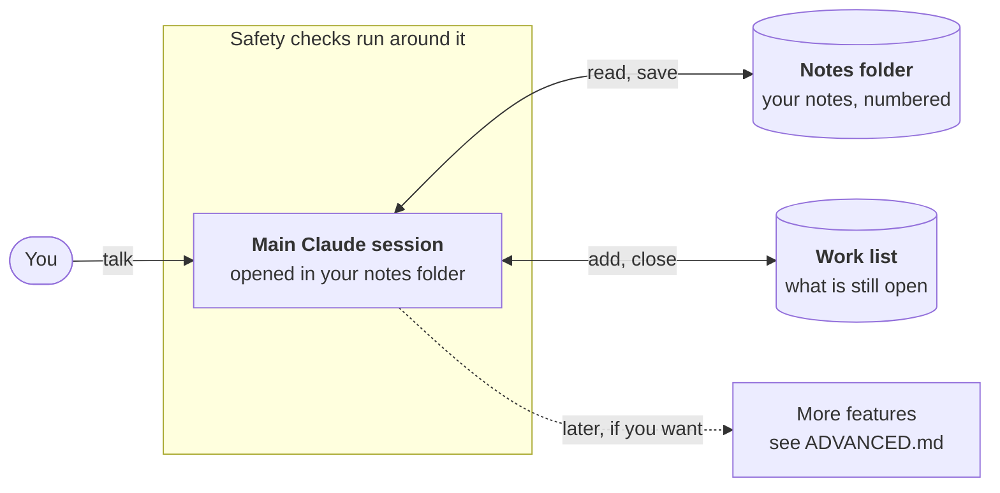

# second-brain-kit

A ready-made way of working with Claude Code: Claude keeps your notes and your unfinished work, and looks at its results before it says "done". [繁體中文](README.zh-TW.md)

## What you get

- **A notes folder that Claude keeps tidy.** Say "remember this" today and "find what I said about it" next month.
- **A work list.** Claude writes down what is still open, so a new conversation can pick it up where the last one stopped.
- **"Done" means checked.** Claude opens the result before it tells you a job is finished, and says so when it could not check.
- **Safety first.** Claude asks before deleting things, publishing anything, or changing your settings.

## What you need

- **Claude Code**: the Claude app that works with files on your computer (in a terminal, the window where you type commands, or in the Claude desktop app). The claude.ai chat in a web browser cannot do this. One Claude account is enough.
- **Python 3**: a free program the kit's small tools run on.

Claude checks everything else and offers to install what is missing.

## Install: paste this one sentence into Claude Code

```
Install second-brain-kit from https://github.com/0Smallcat0/second-brain-kit and set me up by its docs/SETUP.md. I only have one Claude account.
```

## What happens next

1. Claude asks you three short things: where to keep your notes, which language to use, and what you mainly use Claude for ("not sure yet" is fine).
2. It sets everything up and asks before anything that changes your settings.
3. It runs a short check: a brand-new conversation has to find a test note and continue a test item. Then the test data is removed.
4. It shows you how to start: a shortcut on your desktop, and a two-minute first try.

## How to use it after

Open the shortcut and just talk. For example:

- "Remember this: I want to finish chapter 3 this week."
- "Find my notes about linear algebra."
- "What is still open?"
- "Continue where we stopped on the project report."

## The picture



<details><summary>Drawn version</summary>


[SVG](docs/diagrams/00-basic.svg) · [PNG](docs/diagrams/00-basic.png)

</details>

You talk to one Claude conversation that starts inside your notes folder. It reads and saves your notes and keeps the work list; you never type commands. The safety checks are small programs Claude Code runs automatically, for example before Claude pushes or deletes anything.

## Where your data lives

- **Your notes:** the folder you chose (suggested: `second-brain` in your home folder). Plain text files you can open with any editor.
- **The work list, logs and settings:** `~/.claude/sbk/` (`~` is your home folder).
- **Your own words, kept for long conversations:** when a long conversation gets summarised, the kit puts your own messages back word for word. It keeps a copy in `~/.claude/sbk/requests/` on this computer.
- **History:** the notes folder uses git, a tool that records every change on this computer, so an older version can be brought back. It is **not a backup**: if the disk dies, the history dies with it. Copy the notes folder to another disk or a cloud drive you trust from time to time.

Nothing is pushed to GitHub or sent anywhere by the kit, and nothing is handed to other AI tools. Claude itself is an online service, as always.

## Questions

**The install failed.** Paste the error into Claude Code and say "Fix the second-brain-kit install". If Claude cannot add the plugin, it can download the kit and install it by hand (see Manual install).

**A check is too strict or gets in the way.** Tell Claude, for example "The done-check is too strict, make it quieter" or "Stop asking me before X". Every check has a switch; Claude changes it for you.

**Do I need ChatGPT, Gemini or another AI?** No. One Claude account is enough. If you have one, you can connect it later.

**How do I remove it?** Say "Remove second-brain-kit". Claude removes the plugin, its settings block and the shortcut, and asks before deleting any of your notes.

## When you want more

Topic conversations (one per subject), reminders, a usage warning, a stricter done-check and other AI tools are included but switched off. Claude may suggest one when it would help, or you ask for it. See [docs/ADVANCED.md](docs/ADVANCED.md); it also has six pictures of how the parts fit together.

## Manual install

The sentence above makes Claude run these two commands. You can type them in Claude Code yourself (a plugin is an add-on for Claude Code):

```
/plugin marketplace add 0Smallcat0/second-brain-kit
/plugin install second-brain-kit@second-brain-kit
```

Then run `/sbk-setup`. Or clone this repository, open Claude Code inside it, and say: "Read docs/SETUP.md and set up second-brain-kit for me."

[docs/SETUP.md](docs/SETUP.md) ([繁體中文](docs/zh-TW/SETUP.md)) is written for Claude: ordered steps, each with a check.

## For the curious

```
.claude-plugin/   plugin and marketplace files
skills/           setup-second-brain, evidence-before-done, vault-tidy, multi-tool-routing (Advanced)
commands/         /sbk-setup, /sbk-status
hooks/            the safety checks (Python 3, standard library only)
entry/            work list, status, reminders, hand-over and worker tools
templates/        rules for Claude, the notes folder guide, note format, settings, Advanced templates
scripts/          note checker, index maker, overwrite guard, selftest
docs/             SETUP, ADVANCED, PITFALLS, MULTI-TOOL (+ zh-TW); docs/diagrams = the pictures
experimental/     pieces that are not proven yet
```

- `python scripts/selftest.py` tests every check and tool in a throw-away folder.
- [docs/PITFALLS.md](docs/PITFALLS.md): what went wrong in real use and why the defaults are what they are.
- [experimental/](experimental/README.md): what is not proven yet. The usage warning (Advanced) reads the same numbers as Claude Code's `/usage` screen, which is not an official interface. The done-check judges from the order of Claude's actions and a word list for "done"; it can miss cases or, rarely, flag a fine one, which is why Basic only logs it.

## License

MIT, see [LICENSE](LICENSE).
