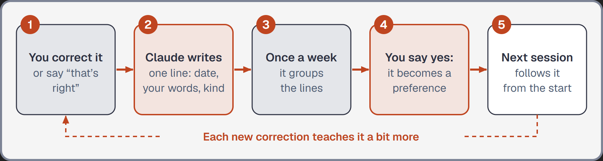

# second-brain-kit

Gives Claude a notes folder, a tracker of open work and safety checks, so it remembers across conversations and learns from your corrections. **No programming needed**: it works in the Claude desktop app's **Code** tab or in a terminal. [繁體中文](README.zh-TW.md)

## What you get


Your notes are found again in a new conversation, open work is tracked for you, and Claude learns how you like things done.

## Install in 3 steps


About 15–30 minutes, mostly Claude working on its own; you answer 6 questions and say yes a few times.

The sentence for step 2:

```
Install second-brain-kit from https://github.com/0Smallcat0/second-brain-kit and set me up by its docs/SETUP.md. I only have one Claude account.
```

Prefer to type it yourself? In Claude Code 2.1.275 or later: `/plugin install second-brain-kit --marketplace 0Smallcat0/second-brain-kit`, then `/sbk-setup`. Other ways: [Install details](docs/INSTALL.md).

## Basic or Full


| | Basic | Full |
|---|---|---|
| Sessions | One, in your notes folder | An entry you talk to, one session per subject, a maintenance session |
| Reminders | None | Weekly review, deadlines, your own |
| Outside resources | Not used | Only what you ticked at install |
| Suits | Starting out; a few things at a time | Several subjects that get mixed up, deadlines you forget |

Basic is always installed; each Full part is switched on by itself, later. Every part side by side: [ADVANCED.md](docs/ADVANCED.md#basic-and-full).

## How it learns



Claude writes one line each time you correct it or say it did right. Nothing becomes a preference until you say yes.

## Everyday

Just say it in your own words:

- "Add this to my notes."
- "What do I still need to do?"
- "Remember that I prefer it this way."

## Cost and plan

- **Cost:** the kit is free and uses your Claude plan like any conversation does.
- **Plan needed:** Claude Code on a paid plan (Pro, Max, Ultra, Team, Enterprise) or a Console account, plus [Python 3](https://www.python.org/downloads/) (free). The free claude.ai plan and the web chat cannot run it.

## Safety and data

- **It asks before the risky steps:** pushing to the internet, deleting a whole folder, throwing away git work, skipping git checks, changing protected rule files, or shrinking a note to a fraction of it.
- **Everything stays on your computer:** your notes are plain files in a folder you choose, and the kit uploads nothing (Claude itself is an online service, as always).
- **Git history is not a backup:** copy your notes folder to another disk or a cloud drive you trust from time to time.

## More

[Guide](docs/GUIDE.md) · [Safety and data](docs/SAFETY.md) · [Questions and costs](docs/FAQ.md) · [Install details and manual install](docs/INSTALL.md) · [How it works](docs/HOW-IT-WORKS.md) · [Full plan](docs/ADVANCED.md) · [Pitfalls](docs/PITFALLS.md)

## License

MIT, see [LICENSE](LICENSE). Made by users, not an official Anthropic plugin.
