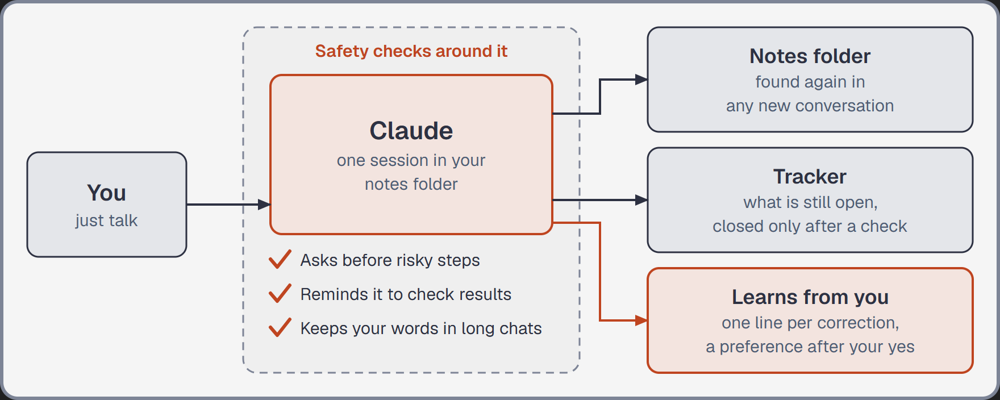
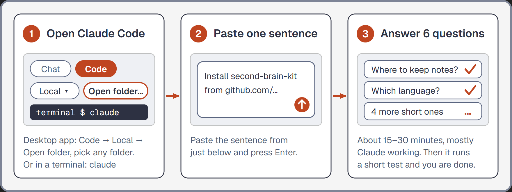
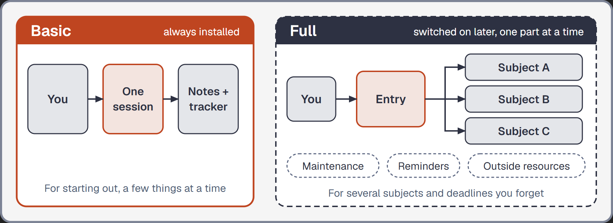

# second-brain-kit

Claude remembers you in every new conversation: your notes, what is still open and how you like things done, kept in a folder on your own computer. **No programming needed.** [繁體中文](README.zh-TW.md)

## What you get



## Before you start

- **Claude on a paid plan** (Pro, Max, Ultra, Team, Enterprise) or a Console account, in the Claude desktop app's **Code** tab or a terminal. The free plan and the web chat cannot run it. The kit itself is free.
- **Python 3** (free). If it is missing, Claude offers to install it for you during setup.

## Install in 3 steps



The sentence for step 2:

```
Install second-brain-kit from https://github.com/0Smallcat0/second-brain-kit
and set me up by its docs/SETUP.md.
```

- About 15–30 minutes, mostly Claude working on its own.
- Claude will ask permission a few times and show commands that look technical. That is normal during setup: click Allow.
- When it is done, try: "What do I still need to do?"

<details><summary>For developers: install with commands</summary>

In Claude Code 2.1.275 or later: `/plugin install second-brain-kit --marketplace 0Smallcat0/second-brain-kit`, then `/sbk-setup`. Other ways: [Install details](docs/INSTALL.md).

</details>

## Basic or Full



| | Basic | Full |
|---|---|---|
| Sessions | One, in your notes folder | An entry you talk to, one session per subject, a maintenance session |
| Reminders | None | Weekly review, deadlines, your own |
| Outside resources | Not used | Only what you ticked at install |
| Suits | Starting out; a few things at a time | Several subjects that get mixed up, deadlines you forget |

Basic is always installed; each Full part is switched on by itself, later. Every part side by side: [ADVANCED.md](docs/ADVANCED.md#basic-and-full).

## How it learns


Nothing becomes a preference until you say yes.

## Everyday

Just say it in your own words:

- "Add this to my notes."
- "What do I still need to do?"
- "Remember that I prefer it this way."

## Safety and data

- **It asks you first** before deleting a whole folder, cutting a note down to a fraction, uploading your notes anywhere, or changing its own protected rules. [Exact list](docs/SAFETY.md)
- **Everything stays on your computer** as ordinary text files in a folder you choose; the kit uploads nothing (Claude itself is an online service, as always).
- **Easy to stop:** your notes stay readable without the kit. Keep a copy of the folder on another disk or a cloud drive you trust.

## More

[Guide](docs/GUIDE.md) · [Safety and data](docs/SAFETY.md) · [Questions and costs](docs/FAQ.md) · [Install details and manual install](docs/INSTALL.md) · [How it works](docs/HOW-IT-WORKS.md) · [Full plan](docs/ADVANCED.md) · [Pitfalls](docs/PITFALLS.md)

## License

MIT, see [LICENSE](LICENSE). Made by users, not an official Anthropic plugin.
