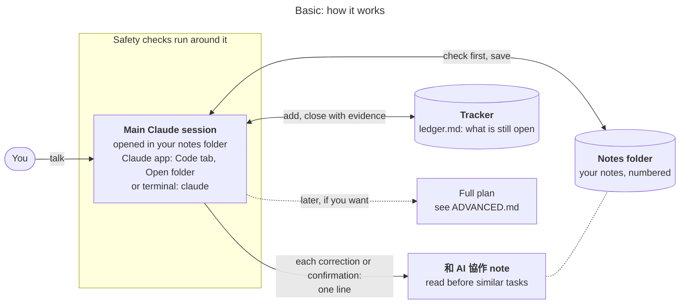
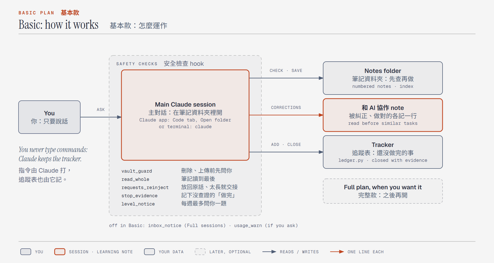

# second-brain-kit

Free add-on that gives Claude Code notes and a tracker (a list of open work, each item closed with a note of how it was checked): what you asked it to remember and what is unfinished can be found again in a brand-new conversation. [繁體中文](README.zh-TW.md)

## What Basic does for you

Basic is the part that is always installed. Compared with Claude Code on its own:

- **Your notes are found again in a new conversation.** Say "remember this" today; next month a brand-new conversation finds it. Before every task Claude checks the notes first.
- **One tracker** (`ledger.py`). Claude writes down what is still open, so you do not have to. It closes an item only with a note of how it was checked; that note is for the session that checks the work later, not for you: you just get the result.
- **Done-check: a reminder for Claude to look at the result before it says "done".** When it says done without looking, Basic writes that down but does not stop it (you can turn on stopping later).
- **It asks before deleting, uploading or overwriting.** Before deleting things, uploading files to the internet, or replacing a whole note, Claude stops and asks you.
- **Your own words come back when a chat gets long.** In a long conversation Claude Code automatically squeezes older parts into a summary, and details can get lost; the kit puts your own messages back word for word, which lowers the chance that a request gets lost. When a conversation gets very long, Claude writes a hand-over and tells you to start a fresh one and say "continue".
- **Claude learns from you.** Every time you correct it, and every time you confirm it did something right, it writes one line in a note (和 AI 協作: date, your words, what kind of thing it was). Before the next similar task it reads that note.

## Basic and Full

| | Basic | Full |
|---|---|---|
| Sessions | One, in your notes folder | Two fixed: **entry** (the only one you talk to) and **maintenance** (the kit itself and the weekly learning loop), plus one per subject of yours that the entry starts and sends work into |
| Checking "done" | Claude closes items with evidence | Topic sessions report to the entry, which opens the evidence; you get one result message |
| Learning from use | One line per correction or confirmation, read before similar tasks | The same, plus a weekly review that turns repeated lines into preferences, skills and (only for a mistake that came back) a new check; one trend line a week |
| Long conversations | Claude writes a hand-over; you start a fresh one | The same; long idle background sessions are replaced by a fresh one automatically |
| Reminders | None | Weekly review, a monthly re-check of your outside resources, the daily hand-over check, your own |
| Outside resources | Not used | Only what you ticked at install (other AI, Colab or Kaggle, credits), picked by kind of work |
| Suits | Starting out; a few things at a time | Several subjects that get mixed up, deadlines you forget |

Full is not one switch: each part is switched on by itself, at install or later ("Turn on topic sessions"); "Back to Basic" switches them off and keeps your files. Every part, side by side: [ADVANCED.md, "Basic and Full"](docs/ADVANCED.md#basic-and-full).

## Costs

- **The kit is free.** It uses your Claude plan like any conversation does.
- **Basic** uses only what you do yourself.
- **Full:** every topic session that is working uses your limit like a conversation; an idle one uses none. The reminder check that runs every 5 minutes only reads files on your computer and uses **none** of your limit; only starting a session or sending one a message does.
- **Limits by plan** (starting values; your Claude may change them and tells you when): Pro - 2 topic sessions at once, a reminder may start or message one at most 4 times a day, 2 hours apart; Max - 4 at once, 12 a day, 1 hour apart; Team, Enterprise or higher - 6 at once, 24 a day, 30 minutes apart; API or not sure - same as Pro. Over a limit the work waits and runs later.
- **Computer off or asleep:** nothing runs. At the next check a missed reminder runs once, marked "(late)".

## Before you start

- **Cost:** the kit is free, but Claude Code needs a paid plan (Pro, Max, Ultra, Team, Enterprise) or a Console account (a developer account with prepaid credits); the free claude.ai plan does not include Claude Code ([official page](https://code.claude.com/docs/en/setup)). No ChatGPT, Gemini or other AI account is needed.
- **Install two things first:** [Claude Code](https://code.claude.com/docs/en/setup) (official; the Claude that works with files on your computer. If you would rather not use a terminal, the window where you type commands, get the [desktop app](https://code.claude.com/docs/en/desktop-quickstart)) and [Python 3](https://www.python.org/downloads/) (free; the kit's small tools run on it). The claude.ai chat in a web browser cannot do this.
- **How to open Claude Code:** desktop app: open Claude, sign in, click the **Code** tab. Terminal: on Windows press Start, search "PowerShell", open it and type `claude`; on a Mac press Cmd+Space, search "Terminal", open it and type `claude`. Either one works for this kit.
- **How long:** about 15-30 minutes, mostly Claude working on its own; you answer 6 questions and say yes a few times. Add 5-10 minutes if the computer still needs Python or git (a tool that records changes; Claude offers to install it).
- **What it touches:** only the folders and settings it creates itself; before it changes anything you already had (for example Claude's settings file), it asks you.
- **Changing your mind:** tell Claude "Remove second-brain-kit". It removes the kit, the block it added to your settings and the shortcut it made (terminal users only); your notes and tracker stay, and it asks before deleting them.
- **This is not an official plugin from Anthropic** (the company that makes Claude; a plugin is an add-on for Claude Code); users made it.

## Install: paste this one sentence into Claude Code

```
Install second-brain-kit from https://github.com/0Smallcat0/second-brain-kit and set me up by its docs/SETUP.md. I only have one Claude account.
```

## What happens next

1. Claude asks you six things (plus one short question, only if it cannot tell: do you use the Claude app or a terminal?): where to keep your notes; which language to use; what you use Claude for and where you get stuck most (for example several things at once get mixed up, you often forget deadlines, you keep having to explain the background again, or it's all fine); whether it may look at your Claude history on this computer to help decide (it only counts a few numbers on this computer, uploads nothing, and "no" is fine); which Claude plan you have (Pro, Max, Team, Enterprise or API; "not sure" is fine), so nothing runs more often than your plan allows; and which outside resources you already have, from a list to tick (another AI account, Colab or Kaggle, a GPU of your own, cloud credit, student offers such as Azure for Students or Copilot; free-to-sign-up ones are marked 可免費申請). Only what you tick is ever used.
2. **Claude suggests each part and you confirm.** Basic is always installed; for the Full sessions (entry, maintenance and one per subject), reminders, and splitting work with the outside resources you ticked, it says in one line each whether to switch it on now and why. It also suggests note areas that fit what you use Claude for. With no history, or if you say no, it goes by your answer alone; if your answer points to none of them, you get Basic. Say what to add or drop.
3. It sets everything up and asks before changing any setting you already had.
4. It runs a short check: a brand-new conversation has to find a test note and continue a test item. Then the test data is removed.
5. It shows you how to start, for the way you open Claude: in the Claude app, the exact clicks that open your notes folder (no shortcut is made); in a terminal, a desktop shortcut or two short commands. Then a two-minute first try.

## How to use it after

Open Claude on your notes folder, then type to Claude the way you would chat. There are two ways in; use the one you installed with:

- **Claude app:** open Claude and click the **Code** tab (top of the sidebar). In the row under the prompt box, click the first control and pick the top entry under **Local**, then click the folder control next to it, choose **Open folder…** and pick your notes folder. Next time, click that session in the sidebar to carry on; **+ New** starts a fresh one in the same way.
- **Terminal:** the shortcut Claude made for you, or without it: open the terminal, type `cd` and your notes folder's path, then `claude` (`claude --continue` returns to the last conversation).

Then say, for example:

- "Remember this: I want to finish chapter 3 this week."
- "Find my notes about linear algebra."
- "What is still open?"
- "Continue where we stopped on the project report."

## The picture



<details><summary>Drawn version</summary>



[SVG](docs/diagrams/00-basic.svg) · [PNG](docs/diagrams/00-basic.png)

</details>

You talk to one Claude conversation that starts inside your notes folder. It checks your notes (including the 和 AI 協作 note of your corrections) before it starts anything, saves what is worth keeping, writes a line whenever you correct or confirm it, and keeps the tracker; you never type commands. The safety checks (hooks) are small programs Claude Code runs automatically, for example before Claude uploads or deletes anything. What each one does:

- `vault_guard` - asks you before Claude pushes, deletes a whole folder, throws away git work, skips git checks, changes protected rule files or shrinks a note to a fraction of it. Basic: on.
- `read_whole` - in the notes folder, stops Claude from judging a note by its first lines; it reads the note to the end. Basic: on.
- `requests_reinject` - when a long conversation is summarised, puts your own messages back word for word; when it gets too long, tells Claude to write a hand-over and you to start a fresh one. Basic: on.
- `stop_evidence` - notices when Claude says "done" after a change without looking at the result. Basic: on, writes a log line only.
- `level_notice` - about once a week, asks one yes/no question when what happened to you shows another part would help. Basic: on.
- `inbox_notice` - shows the work waiting in a Full session's inbox, and in the entry the work done and waiting for its check. Basic: off (on with the Full sessions).
- `usage_warn` - warns once when your weekly Claude usage passes 80%. Basic: off (on if you ask).

## Where your data lives

- **Your notes:** the folder you chose (suggested: `second-brain` in your home folder). Plain text files you can open with any editor.
- **The tracker, logs and settings:** in a settings folder in your personal folder (`~/.sbk/`; before 0.2.5 it was `~/.claude/sbk/`, which keeps working until you move it; `~` means your personal folder, for example `C:\Users\your-name` on Windows).
- **Your own words, kept for long conversations:** when a long conversation gets summarised, the kit puts your own messages back word for word and keeps a copy in `requests` in the same settings folder, on this computer only.
- **Whether it reads your conversations:** only if you said yes at install. At install it only counts in how many different folders you used Claude in the last two weeks and whether a conversation got so long it was summarised twice or more; after that, about once a week, it looks only at conversations in your notes folder and counts how often you asked Claude to remind you or said things got mixed up. Yes or no, it counts the open items in the tracker and the done-check's log. Everything is counted on this computer and no setting is changed.
- **History:** the notes folder uses git, a tool that records every change on this computer, so an older version can be brought back. It is **not a backup**: if the disk dies, the history dies with it. Copy the notes folder to another disk or a cloud drive you trust from time to time.

The kit uploads nothing to GitHub (a website for code), sends nothing anywhere, and hands nothing to outside resources you did not tick. Claude itself is an online service, as always: what you tell it goes to Anthropic, the same as any Claude use.

## Questions

**The install failed.** Paste the error into Claude Code and say "Fix the second-brain-kit install". If Claude cannot add the kit as a plugin, it can download it and install it by hand (see Manual install).

**A check is too strict or gets in the way.** Tell Claude, for example "The done-check is too strict, make it quieter" or "Stop asking me before X". Every check has a switch; Claude changes it for you.

**Do I need ChatGPT, Gemini, Colab or anything else?** No. One Claude account with Claude Code is enough; the kit splits work inside it (a cheaper model for mechanical jobs, a fresh helper for an independent check). At install you tick what you already have; you can add more later.

**How do I remove it?** See "Changing your mind" under Before you start.

## When Claude suggests more

Claude never adds a part on its own. About once a week a small script looks at the things below on your computer. It looks at **trouble you actually ran into**, not at how busy you are. When one holds, Claude asks you one question, "Turn on X?", with the numbers; it does it only after your yes. Say no and it will not ask about that again for four weeks.

- In one week you told Claude twice or more that things got mixed up (for example "you mixed up the two reports", "not that project") -> the Full sessions: an entry session you talk to, a maintenance session and one conversation per subject (topic sessions). How many open items you have, and in how many subjects, is shown with it for reference. The entry sends each job straight into the topic session that owns it and starts it if needed, within your plan's limits; you get the result from the entry. Where background sessions cannot run (for example the desktop app alone), the entry tells you which session to open.
- In one week you asked Claude to remind you twice or more, or something with a deadline is still open three days after the date -> reminders.
- Claude said "done" without looking at the result, this has been written down for two weeks or more and at least 20 times, and at least 3 of every 4 times you later said something was wrong -> it asks whether Claude should be stopped and made to check first.
- You told Claude you have an outside resource (another AI account, Colab, Kaggle, cloud credit) -> a table for splitting work with it by kind of work. Just naming one in a conversation does not count.

You can also ask for any of them at any time, and for a usage warning (a heads-up when your weekly Claude usage is nearly used up). Details in [docs/ADVANCED.md](docs/ADVANCED.md); it also has the full Basic and Full comparison and six pictures of how the parts fit together.

## Manual install

The sentence above makes Claude run these two commands. You can type them in Claude Code yourself:

```
/plugin marketplace add 0Smallcat0/second-brain-kit
/plugin install second-brain-kit@second-brain-kit
```

Then type `/sbk-setup` in Claude Code. Or clone (download a copy of) this repository (the folder of code), open Claude Code inside it, and say: "Read docs/SETUP.md and set up second-brain-kit for me."

[docs/SETUP.md](docs/SETUP.md) ([繁體中文](docs/zh-TW/SETUP.md)) is written for Claude: ordered steps, each with a check.

## For the curious

```
.claude-plugin/   plugin and marketplace files
skills/           setup-second-brain, evidence-before-done, vault-tidy, multi-tool-routing (outside resources, Full)
commands/         /sbk-setup, /sbk-status
hooks/            the safety checks (Python 3, standard library only)
entry/            tracker (ledger.py), status, reminders, live routing (session.py), hand-over (handover.py), learning loop (learn.py), worker tools
templates/        rules for Claude, the notes folder guide, note format, the 和 AI 協作 note, settings, Full templates (entry, maintenance, topics)
scripts/          note checker, index maker, overwrite guard, level check, selftest
docs/             SETUP, ADVANCED, PITFALLS, MULTI-TOOL = outside resources (+ zh-TW); docs/diagrams = the pictures
experimental/     pieces that are not proven yet
```

- `python scripts/selftest.py` tests every check and tool in a throw-away folder.
- [docs/PITFALLS.md](docs/PITFALLS.md): what went wrong in real use and why the defaults are what they are.
- [experimental/](experimental/README.md): what is not proven yet. The usage warning (Full) reads the same numbers as Claude Code's `/usage` screen, which is not an official interface. The done-check judges from the order of Claude's actions and a word list for "done"; it can miss cases or, rarely, flag a fine one, which is why Basic only logs it.

## License

MIT, see [LICENSE](LICENSE).
