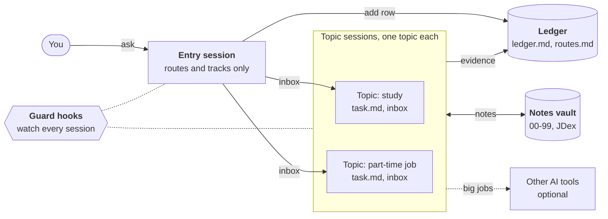
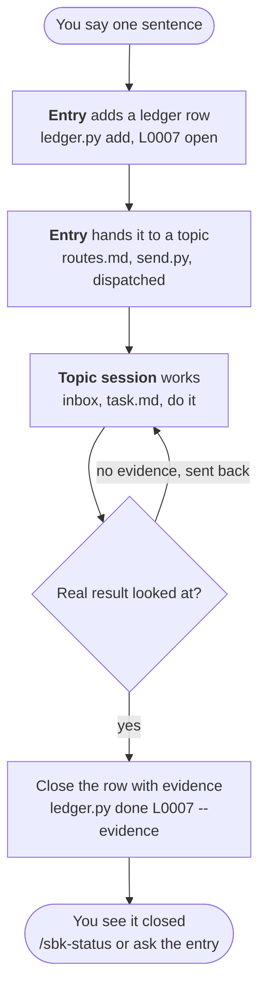
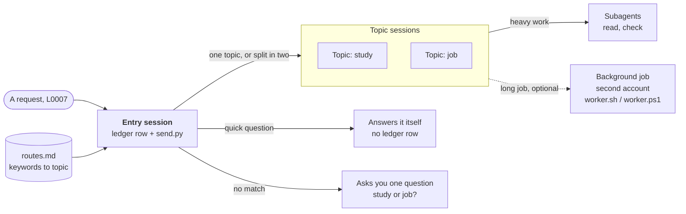
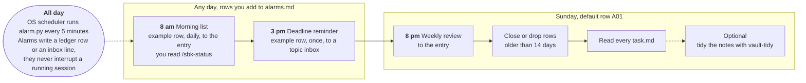
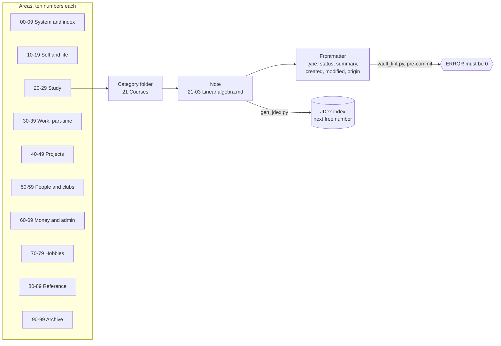
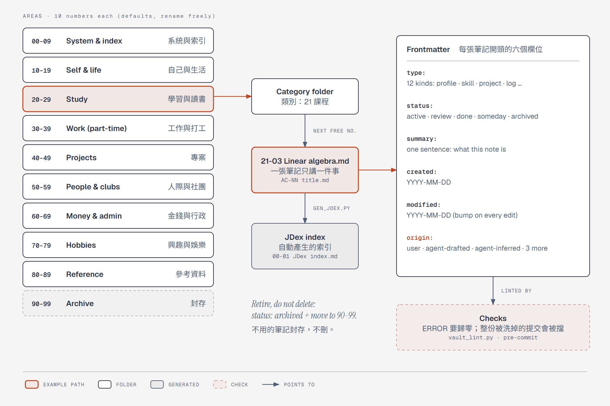
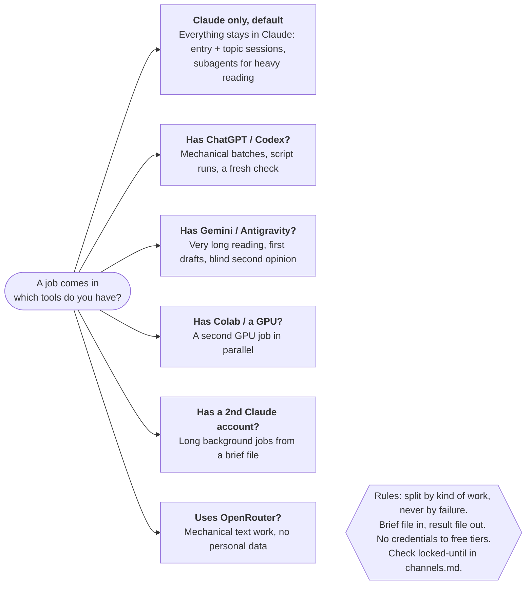

# second-brain-kit

**Install: paste this one sentence into Claude Code.**

```
Install the Claude Code plugin from https://github.com/0Smallcat0/second-brain-kit and set me up by its docs/SETUP.md.
```

It maps to these two commands (Claude runs them for you; you can also type them yourself):

```
/plugin marketplace add 0Smallcat0/second-brain-kit
/plugin install second-brain-kit@second-brain-kit
```

Then run `/sbk-setup`. Claude asks which AI tools you have (default: just Claude), where to keep your notes, and your two main areas of use, then installs everything and tells you what it did.

*A working method for Claude Code, set up by Claude itself.* [繁體中文](README.zh-TW.md)

## The problem

- Claude **forgets** between sessions: what you asked, what you decided, who you are.
- Claude says **"done"** without checking. The file was never opened, the test never run.
- Sessions **sprawl**: ten conversations, no idea which one owns what, requests fall between them.
- Your **notes rot**: unnamed files, broken links, nothing archived, nothing findable.

## What this adds to a plain `CLAUDE.md` template

A `CLAUDE.md` template is a list of wishes. This kit makes the wishes checkable:

| Piece | What it does |
|---|---|
| **Entry session + topic sessions** | All requests go to one entry session, which routes them to a topic session (study, job, side project ...). One session, one topic. Start with the entry and two topic sessions. |
| **Ledger** | One line per request: `ledger.py add / list / done --evidence`. An item closes only with evidence, so nothing is lost and "done" means something. |
| **Evidence before "done"** | A Stop hook notices "done" after an edit with nothing read back or run since, and asks for evidence once. A skill tells Claude how to check each kind of work. |
| **Guard hooks** | Ask before `git push`, skipped hooks, destructive git, mass deletes; refuse reading a note in fragments; put your own words back after compaction; warn at 80% weekly usage. All fail open and have an off/log/ask/deny switch. |
| **A numbered second-brain vault** | Johnny-Decimal style notes (`21-03 Linear algebra.md`) with frontmatter, an auto-generated index, a linter, and a pre-commit guard against overwriting. Notes stay findable and Claude knows how to read and write them. |
| **Alarms and `task.md`** | A small reminder table that writes to the ledger (never nags a running session) and a `task.md` per topic for work with three or more items. |

You do not have to configure any of it by hand: **Claude installs it for you**, step by step, checking each step.

One Claude account is enough. If you also have a second Claude account, Codex, Gemini, Colab or OpenRouter, Claude will ask and can use them ([reference](docs/MULTI-TOOL.md)); if not, none of that is installed.

## How it works

Six pictures. Each is a Mermaid diagram that GitHub draws here; open "Drawn version" under it for the larger SVG/PNG ([all files](docs/diagrams/)).

### 1. The whole picture

You talk to one entry session. It files each request in the ledger and hands it to a topic session. Topic sessions keep the notes vault, close ledger rows with evidence, and may use other AI tools. Guard hooks watch every session.



<details><summary>Drawn version</summary>


[SVG](docs/diagrams/01-architecture.svg) · [PNG](docs/diagrams/01-architecture.png)

</details>

### 2. Life of one request

One sentence becomes a ledger row, is dispatched, worked on, and closed only with evidence. If evidence is missing it is sent back.



<details><summary>Drawn version</summary>


[SVG](docs/diagrams/02-request-life.svg) · [PNG](docs/diagrams/02-request-life.png)

</details>

### 3. Who gets the task

The entry reads `routes.md` and picks the topic; quick questions it answers itself; heavy work goes to subagents, or to a second Claude account if you have one.



<details><summary>Drawn version</summary>


[SVG](docs/diagrams/03-task-dispatch.svg) · [PNG](docs/diagrams/03-task-dispatch.png)

</details>

### 4. A day

A scheduler tick every five minutes fires the rows of `alarms.md` into the ledger or a topic inbox. The morning list and the reminder are example rows you can add; the weekly review is the default row.



<details><summary>Drawn version</summary>


[SVG](docs/diagrams/04-day-timeline.svg) · [PNG](docs/diagrams/04-day-timeline.png)

</details>

### 5. The vault and the note format

Numbered folders (Johnny Decimal), one numbered note per file, six frontmatter fields, a generated index, and a lint plus pre-commit guard.



<details><summary>Drawn version</summary>



[SVG](docs/diagrams/05-vault-folders.svg) · [PNG](docs/diagrams/05-vault-folders.png)

</details>

### 6. Which tool gets which job

Only Claude is the default. Each extra tool you have takes one kind of work, split by kind and never by failure.



<details><summary>Drawn version</summary>


[SVG](docs/diagrams/06-tool-routing.svg) · [PNG](docs/diagrams/06-tool-routing.png)

</details>

## Manual install

Clone this repository, open Claude Code in it, and say: *"Read docs/SETUP.md and set up the second-brain kit for me."* [docs/SETUP.md](docs/SETUP.md) is written for Claude: ordered steps, each with a check. ([繁體中文版](docs/zh-TW/SETUP.md))

## After setup

- `/sbk-status` shows everything still open: ledger, every topic's `task.md`, inboxes, alarms.
- Talk to the entry session (`cd ~/.claude/sbk/entry && claude --add-dir <your vault>`); it files the request and hands it to a topic session.
- `python <vault>/scripts/vault_lint.py` checks the notes; the `vault-tidy` skill tidies them.
- Change how strict a hook is without editing code: `~/.claude/sbk/config.json` -> `"modes": {"stop_evidence": "log"}`.
- `python scripts/selftest.py` tests every hook and tool of the kit in a throw-away folder.

## What is in the box

```
.claude-plugin/        plugin + marketplace manifests
skills/                setup-second-brain, vault-tidy, evidence-before-done, multi-tool-routing
commands/              /sbk-setup, /sbk-status
hooks/                 hooks.json + the hook scripts (Python 3, standard library only)
entry/                 ledger, send, alarm, status, worker launchers
templates/             CLAUDE.md principles, vault AGENTS.md, note format, task.md, routes, alarms ...
scripts/               vault_lint, gen_jdex, check_overwrite, pre-commit, selftest
docs/                  SETUP, PITFALLS, MULTI-TOOL (+ zh-TW); docs/diagrams = the six pictures (SVG + PNG)
experimental/          pieces that are not proven yet
```

Read [docs/PITFALLS.md](docs/PITFALLS.md) for what went wrong in real use and why the defaults are what they are.

## What is experimental

Everything in the main folders is exercised by `scripts/selftest.py`. What is not yet proven lives in [`experimental/`](experimental/README.md), each item with one line on why. Two things to know:

- `usage_warn` uses the same usage endpoint as Claude Code's `/usage` screen. It is not a documented API and may change; the hook fails open and stays silent when it cannot read it.
- The Stop hook decides from the order of tool calls plus a word list for "done". It will miss some cases and, rarely, flag a fine one; replay it on your own transcripts (`hooks/stop_evidence.py --replay`) and set it to `log` if it is noisy.

## License

MIT, see [LICENSE](LICENSE).
