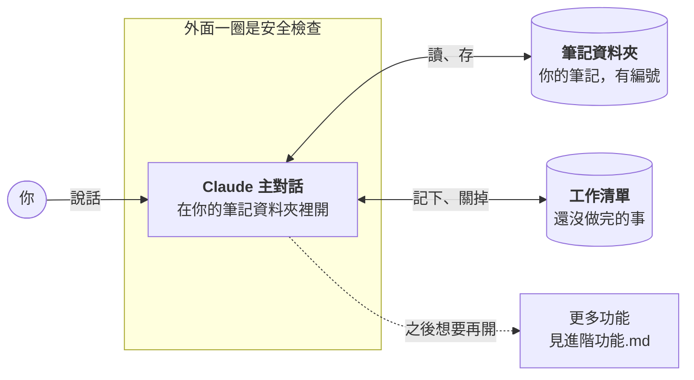

# second-brain-kit

一套現成的 Claude Code 用法：Claude 幫你保管筆記和還沒做完的事，說「做完了」之前會先看過結果。[English](README.md)

## 你會得到

- **一個 Claude 幫你整理的筆記資料夾。** 今天說「記住這個」，下個月說「找我之前說的那個」就找得到。
- **一份工作清單。** 還沒做完的事 Claude 會記下來，換一個新對話也能接著做。
- **「做完」是真的看過。** Claude 先打開結果看過才說完成；沒辦法檢查的會直接講。
- **安全優先。** 刪東西、公開任何東西、改你的設定之前，Claude 會先問你。

## 你需要

- **Claude Code**：能直接處理你電腦上檔案的 Claude（在終端機，也就是輸入文字指令的視窗，或在 Claude 桌面版 App 裡用）。瀏覽器裡的 claude.ai 聊天網頁做不到這些。一個 Claude 帳號就夠了。
- **Python 3**：一個免費程式，這套東西裡的小工具要靠它跑。

其他的 Claude 會自己檢查，缺什麼會問你要不要幫你裝。

## 安裝：把這一句貼進 Claude Code

```
請從 https://github.com/0Smallcat0/second-brain-kit 安裝 second-brain-kit，照 docs/zh-TW/SETUP.md 幫我設定。我只有一個 Claude 帳號。
```

## 接下來會發生什麼

1. Claude 問你三個簡單的問題：筆記要放哪裡、用哪種語言、你主要拿 Claude 做什麼（還不確定也可以）。
2. 它把東西設定好；會改到你設定的地方，都會先問你。
3. 它做一次簡短的測試：開一個全新的對話，要能找到測試筆記、接著做測試項目。測完把測試資料清掉。
4. 它教你怎麼開始：桌面上一個捷徑，加上兩分鐘的第一次試用。

## 裝好之後怎麼用

點兩下捷徑，直接說話就好。例如：

- 「記住：我這週要讀完第三章。」
- 「找我之前記的線性代數筆記。」
- 「還有什麼沒做完？」
- 「接著上次的專案報告繼續。」

## 一張圖看懂



<details><summary>完整版圖片</summary>


[SVG](docs/diagrams/00-basic.svg) · [PNG](docs/diagrams/00-basic.png)

</details>

你只跟一個 Claude 對話說話，這個對話是在你的筆記資料夾裡開的。它讀、存你的筆記，也幫你記工作清單；你不用打任何指令。安全檢查是 Claude Code 自動執行的小程式，例如在 Claude 要上傳或刪除東西之前先攔下來問你。

## 你的資料放在哪

- **筆記：** 你選的那個資料夾（建議放在個人資料夾裡的 `second-brain`）。都是一般的文字檔，用任何編輯器都打得開。
- **工作清單、紀錄、設定：** `~/.claude/sbk/`（`~` 是你的個人資料夾）。
- **你說過的原話：** 長對話被自動摘要時，這套東西會把你自己的訊息原文放回去，並在這台電腦的 `~/.claude/sbk/requests/` 留一份。
- **修改紀錄：** 筆記資料夾用 git（一個在這台電腦上記下每次修改的工具），改壞了可以找回舊版本。它**不是備份**：硬碟壞了，紀錄也一起沒了。請不時把筆記資料夾複製到另一顆硬碟或你信任的雲端硬碟。

這套東西不會把任何東西上傳到 GitHub 或寄到別的地方，也不會把東西交給其他 AI 工具。Claude 本身照常是線上服務。

## 常見問題

**安裝失敗了。** 把錯誤訊息貼給 Claude Code，說「幫我修好 second-brain-kit 的安裝」。如果 Claude 沒辦法加入外掛，它可以改成把整套東西下載下來手動裝（見下面〈手動安裝〉）。

**某個檢查太嚴、很礙事。** 直接跟 Claude 說，例如「做完檢查太嚴了，調鬆一點」或「做 X 之前不用再問我」。每個檢查都有開關，Claude 會幫你調。

**一定要有 ChatGPT、Gemini 或其他 AI 嗎？** 不用。一個 Claude 帳號就夠了。有的話，之後可以再接上。

**要怎麼移除？** 說「移除 second-brain-kit」。Claude 會移除外掛、它加的那段設定和捷徑；要刪你的任何筆記之前都會先問。

## 想要更多功能時

一件事一個對話的主題對話、提醒、用量提醒、更嚴格的做完檢查、其他 AI 工具，這些都已經包含在裡面，只是先關著。Claude 覺得有幫助時可能會提議，你也可以直接要。說明在 [docs/zh-TW/進階功能.md](docs/zh-TW/進階功能.md)，裡面還有六張圖說明各部分怎麼搭在一起。

## 手動安裝

上面那句話會讓 Claude 執行下面兩個指令。你也可以自己在 Claude Code 裡打（外掛是 Claude Code 的擴充套件）：

```
/plugin marketplace add 0Smallcat0/second-brain-kit
/plugin install second-brain-kit@second-brain-kit
```

接著執行 `/sbk-setup`。也可以把這個 repository（程式碼的資料夾）clone（下載一份）到電腦上，在裡面開 Claude Code，說：「讀 docs/zh-TW/SETUP.md，幫我把 second-brain-kit 設定好。」

[docs/zh-TW/SETUP.md](docs/zh-TW/SETUP.md)（[English](docs/SETUP.md)）是寫給 Claude 看的：照順序的步驟，每一步都有檢查。

## 給想看細節的人

```
.claude-plugin/   外掛與 marketplace 設定檔
skills/           setup-second-brain、evidence-before-done、vault-tidy、multi-tool-routing（進階）
commands/         /sbk-setup、/sbk-status
hooks/            安全檢查（Python 3，只用標準函式庫）
entry/            工作清單、狀態、提醒、轉交與背景工作的小工具
templates/        給 Claude 的原則、筆記資料夾說明、筆記格式、設定檔、進階功能的模板
scripts/          筆記檢查、索引產生、防覆寫、自我測試
docs/             SETUP、進階功能、踩過的坑、多工具分工（含英文版）；docs/diagrams 是各張圖
experimental/     還沒驗證穩定的部分
```

- `python scripts/selftest.py` 會在用完即丟的資料夾裡，測試每個檢查和小工具。
- [docs/zh-TW/踩過的坑.md](docs/zh-TW/踩過的坑.md)：實際使用時出過什麼錯，以及預設為什麼長這樣。
- [experimental/](experimental/README.md)：還沒驗證穩定的部分。用量提醒（進階功能）讀的是和 Claude Code `/usage` 畫面同一個來源，那不是官方公開的介面。做完檢查是看 Claude 動作的先後順序加上一份「完成」字眼清單來判斷，可能漏抓，偶爾也會誤判，所以基本版只記錄、不攔下。

## 授權

MIT，見 [LICENSE](LICENSE)。
