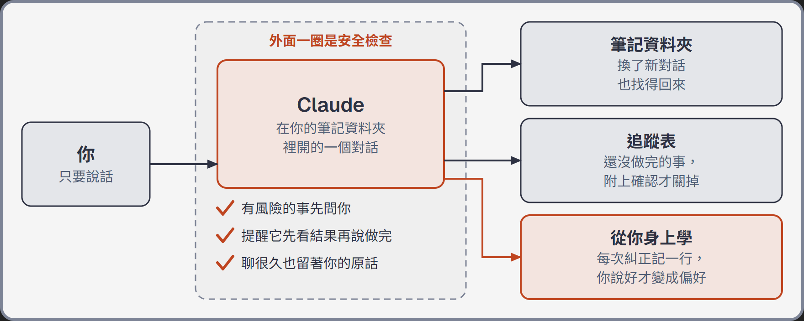
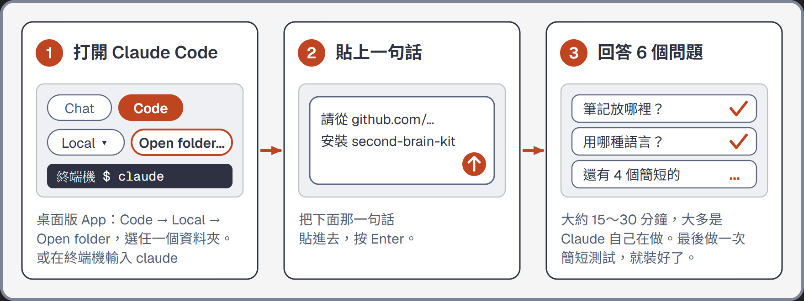
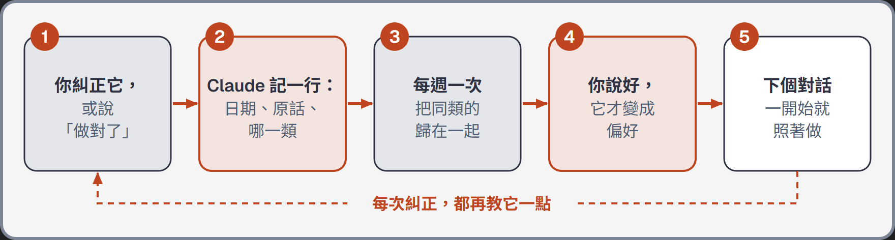

# second-brain-kit

讓 Claude 換了新對話也記得你：你的筆記、還沒做完的事、你喜歡的做法，都留在你自己電腦的資料夾裡。**不用會寫程式。**[English](README.md)

## 你會得到什麼



## 開始前

- **付費的 Claude 方案**（Pro、Max、Ultra、Team、Enterprise）或 Console 帳號，在 Claude 桌面版 App 的 **Code** 分頁或終端機裡用。免費方案和網頁聊天用不了。這套工具本身免費。
- **Python 3**（免費）。沒裝的話，安裝過程中 Claude 會問你要不要幫你裝。

## 三步驟安裝



第 2 步要貼的那一句：

```
請從 https://github.com/0Smallcat0/second-brain-kit 安裝 second-brain-kit，
照 docs/SETUP.md 幫我設定，用繁體中文跟我說話。
```

- 大約 15～30 分鐘，大部分時間是 Claude 自己在做。
- 過程中 Claude 會跳出幾次權限確認，上面的指令看起來很技術，這是正常的，按允許就好。
- 裝好後試著說：「我還有什麼沒做完？」

<details><summary>給開發者：用指令安裝</summary>

在 Claude Code 2.1.275 以上：`/plugin install second-brain-kit --marketplace 0Smallcat0/second-brain-kit`，再輸入 `/sbk-setup`。其他方式：[安裝細節](docs/zh-TW/安裝.md)。

</details>

## 基本款還是完整款


| | 基本款 | 完整款 |
|---|---|---|
| 對話 | 一個，在你的筆記資料夾裡 | 你說話的入口、每件事一個對話、系統維護對話 |
| 提醒 | 沒有 | 每週檢視、期限、你自己加的 |
| 外部資源 | 不用 | 只用你安裝時勾的 |
| 適合 | 剛開始用；同時幾件事 | 好幾件事常被搞混、常忘記期限 |

基本款一定會裝；完整款每一項之後各自再開。每一項並排比較：[進階功能.md](docs/zh-TW/進階功能.md#基本款和完整款)。

## 它怎麼學



你沒說好之前，什麼都不會變成偏好。

## 每天怎麼用

用你平常的說法講就好：

- 「把這個記進我的筆記。」
- 「我還有什麼沒做完？」
- 「記住：我喜歡這樣做。」

## 安全與資料

- **先問你才做：** 刪掉整個資料夾、把一張筆記砍到剩一小部分、把筆記傳到網路上、改它自己受保護的規則之前。[完整清單](docs/zh-TW/安全與資料.md)
- **全部留在你的電腦上：** 筆記是你選的資料夾裡的一般文字檔，這套工具不上傳任何東西（Claude 本身照常是線上服務）。
- **隨時可以不用：** 不用這套工具，筆記照樣打得開。記得不時把資料夾複製一份到另一顆硬碟或你信任的雲端硬碟。

## 更多

[使用指南](docs/zh-TW/指南.md) · [安全與資料](docs/zh-TW/安全與資料.md) · [常見問題與費用](docs/zh-TW/常見問題.md) · [安裝細節與手動安裝](docs/zh-TW/安裝.md) · [運作原理](docs/zh-TW/運作原理.md) · [完整款](docs/zh-TW/進階功能.md) · [踩過的坑](docs/zh-TW/踩過的坑.md)

## 授權

MIT，見 [LICENSE](LICENSE)。使用者自己做的，不是 Anthropic 官方的外掛。
