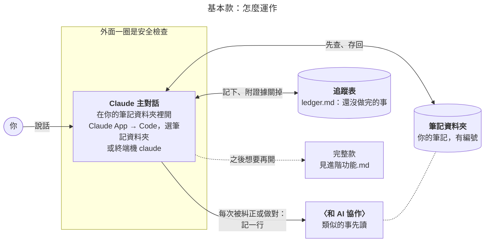

# second-brain-kit

幫 Claude Code 加上筆記和追蹤表（還沒做完的事，一件一行，做完時附上怎麼確認的）的免費擴充工具：你要它記的事、還沒做完的事，換了一個新對話也找得回來。[English](README.md)

## 基本款能幫你什麼

基本款是一定會裝的那一份。和單純用 Claude Code 比起來：

- **筆記換了對話也找得回來。** 今天說「記住這個」，下個月開一個全新的對話也找得到。每件事動手前，Claude 先查筆記。
- **一份追蹤表**（`ledger.py`）。還沒做完的事 Claude 會記下來，你不用自己記。它要附上怎麼確認的，才會關掉一件事；這份證據是給之後核對的對話看的，不是給你看的：你只拿到結果。
- **做完檢查：提醒 Claude 先看結果再說「做完」。** 它沒看結果就說做完時，基本款會記下來，但不會攔住它（想讓它直接被攔下，之後可以再開）。
- **刪除、上傳、覆寫之前先問你。** 刪東西、把檔案上傳到網路、把一整張筆記蓋掉之前，Claude 會先停下來問你。
- **聊太久時，把你的原話補回去。** 對話太長時，Claude Code 會自動把舊的內容濃縮成摘要，細節可能不見；這套工具會把你自己打的訊息原文補回去，降低你的要求被漏掉的機會。對話長到一定程度，Claude 會寫好交接，請你開新對話說「繼續」。
- **Claude 會從你身上學。** 你每次糾正它、每次確認它做對了，它都在一張筆記（〈和 AI 協作〉：日期、你的原話、是哪一類事）記一行。下次遇到類似的事，先讀這張。

## 基本款和完整款

| | 基本款 | 完整款 |
|---|---|---|
| 對話 | 一個，在你的筆記資料夾裡 | 兩個固定的：**入口**（你唯一需要說話的對話）和**系統維護**（套件本身和每週的學習循環），再加上你的每件事各一個，由入口開、把事送進去 |
| 「做完了」誰核對 | Claude 附證據才關掉 | 主題對話回報給入口，入口打開證據核對；你收到一則結果 |
| 從使用中學習 | 每次被糾正或確認做對記一行，類似的事先讀 | 一樣，再加上每週檢視：把重複的行整理成偏好、技能，以及（只有同一種錯又出現時）新的檢查；每週一行趨勢 |
| 長對話 | Claude 寫好交接，你開新對話 | 一樣；在背景跑、太長又閒著的對話自動換新的接手 |
| 提醒 | 沒有 | 每週檢視、每月重新檢查你的外部資源、每天的交接檢查、你自己加的 |
| 外部資源 | 不用 | 只用你安裝時勾的（其他 AI、Colab 或 Kaggle、點數），依工作種類挑 |
| 適合 | 剛開始用；同時幾件事 | 好幾件事常被搞混、常忘記期限 |

完整款不是一個開關：每一項各自開，安裝時或之後說「幫我開主題對話」都可以；說「回到基本款」就全部關掉，檔案留著。每一項並排比較：[進階功能.md〈基本款和完整款〉](docs/zh-TW/進階功能.md#基本款和完整款)。

## 費用

- **這套工具免費。** 它和一般對話一樣用你的 Claude 方案。
- **基本款**只用你自己做的事那些額度。
- **完整款：** 正在做事的主題對話，像一般對話一樣用你的額度；閒著的不用。每五分鐘跑一次的提醒檢查只讀你電腦上的檔案，**完全不用**額度；只有叫起一個對話或傳訊息給它才會用。
- **照方案的上限**（起始值；你的 Claude 之後可以調，調了會跟你說）：Pro——同時 2 個主題對話，提醒一天最多叫起或傳訊息 4 次、同一個對話間隔 2 小時；Max——同時 4 個、一天 12 次、間隔 1 小時；Team、Enterprise 或更高——同時 6 個、一天 24 次、間隔 30 分鐘；API 或不確定——和 Pro 一樣。超過上限時工作先等著，之後再跑。
- **電腦關機或睡眠：** 什麼都不會跑。下次檢查時，錯過的提醒只補跑一次，標上「(late)」。

## 開始前

- **費用：** 這套工具免費，但 Claude Code 要付費方案（Pro、Max、Ultra、Team、Enterprise）或 Console 帳號（開發者用的預付額度帳號）；免費的 claude.ai 方案不能用 Claude Code（[官方說明](https://code.claude.com/docs/en/setup)）。不需要 ChatGPT、Gemini 等其他 AI 帳號。
- **先裝兩個東西：** [Claude Code](https://code.claude.com/docs/en/setup)（官方；能直接處理你電腦上檔案的 Claude。不想碰終端機，也就是輸入文字指令的視窗，就裝[桌面版 App](https://code.claude.com/docs/en/desktop-quickstart)）、[Python 3](https://www.python.org/downloads/)（免費，這套工具裡的小程式要靠它跑）。瀏覽器裡的 claude.ai 聊天網頁做不到這些。
- **怎麼打開 Claude Code：** 桌面版 App：打開 Claude、登入，點側邊欄上方的 **Code** 分頁。終端機：Windows 按開始鍵、搜尋「PowerShell」打開後輸入 `claude`；Mac 按 ⌘＋空白鍵、搜尋「終端機」打開後輸入 `claude`。兩種都能用這套工具。
- **要多久：** 大約 15～30 分鐘，大部分時間是 Claude 自己在做；你要回答 6 個問題、按幾次同意。電腦還沒有 Python 或 git（記錄修改的工具，Claude 會幫你裝）的話，再多 5～10 分鐘。
- **會動到什麼：** 只動它自己建的資料夾和設定；要改到你原有的東西（例如 Claude 的設定檔）之前，會先問你。
- **反悔：** 跟 Claude 說「移除 second-brain-kit」。它會拿掉這套工具、它加進設定的那一段和它做的捷徑（只有用終端機的人才有）；你的筆記和追蹤表會留著，要刪會先問你。
- **這不是 Anthropic（做 Claude 的公司）官方的外掛**（外掛＝Claude Code 的擴充套件），是使用者自己做的。

## 安裝：把這一句貼進 Claude Code

```
請從 https://github.com/0Smallcat0/second-brain-kit 安裝 second-brain-kit，照 docs/zh-TW/SETUP.md 幫我設定。我只有一個 Claude 帳號。
```

## 接下來會發生什麼

1. Claude 問你六件事（它看不出你用 App 還是終端機時，會多問一句這個）：筆記要放在哪裡；用哪種語言；你拿 Claude 做什麼、最常卡在哪（例如同時好幾件事會搞混、常忘記期限、要一直重講背景，還是都還好）；可不可以看這台電腦上你的 Claude 對話紀錄來幫忙判斷（只在這台電腦上數幾個數字、不上傳，不要也可以）；你的 Claude 是哪種方案（Pro、Max、Team、Enterprise 或 API；不確定也可以），讓自己會跑的東西不超過你方案的用量；以及你已經有哪些外部資源，從清單裡勾（其他 AI 帳號、Colab 或 Kaggle、自己的 GPU、雲端點數、Azure for Students 或 Copilot 這類學生方案；可以免費註冊的會標「可免費申請」）。只有你勾的才會用到。
2. **Claude 逐項建議要裝哪些，你確認。** 基本款一定裝；完整款的對話（入口、系統維護，加上一件事一個對話）、提醒、和你勾的外部資源分工，每一項它都用一句話說建議開或先不開、為什麼。它也會照你拿 Claude 做的事，提出適合你的筆記領域。你沒有紀錄或不讓它看，它就只照你的回答；回答沒說到的就只裝基本款。想加或拿掉哪一項直接說。
3. 它把東西設定好；要改你原有的設定之前，會先問你。
4. 它做一次簡短的測試：開一個全新的對話，要能找到測試筆記、接著做測試項目。測完把測試資料清掉。
5. 它照你打開 Claude 的方式教你怎麼開始：用 Claude App 的話，是在 App 裡打開筆記資料夾的確切點法（不會做捷徑）；用終端機的話，是桌面捷徑或兩行指令。最後是兩分鐘的第一次試用。

## 裝好之後怎麼用

在筆記資料夾裡打開 Claude，再用平常聊天的方式打字跟它說。進去的路有兩條，照你安裝時用的那一種：

- **Claude App：** 打開 Claude，點側邊欄上方的 **Code** 分頁。在輸入框下面那一排，點第一個控制項、選 **Local** 底下最上面那一項，再點旁邊的資料夾控制項，選 **Open folder…**，選你的筆記資料夾。下次要繼續，就在側邊欄點那個對話；**+ New** 用同樣的方式開新對話。
- **終端機：** 用 Claude 幫你做的捷徑；沒有捷徑也行：打開終端機，輸入 `cd` 和筆記資料夾的路徑，再輸入 `claude`（`claude --continue` 會回到上一段對話）。

然後說，例如：

- 「記住：我這週要讀完第三章。」
- 「找我之前記的線性代數筆記。」
- 「還有什麼沒做完？」
- 「接著上次的專案報告繼續。」

## 一張圖看懂



<details><summary>完整版圖片</summary>


[SVG](docs/diagrams/00-basic.svg) · [PNG](docs/diagrams/00-basic.png)

</details>

你只跟一個 Claude 對話說話，這個對話是在你的筆記資料夾裡開的。它動手前先查你的筆記（包括記你糾正過什麼的〈和 AI 協作〉），值得留的存回去，你糾正或確認它時記一行，也幫你記追蹤表；你不用打任何指令。安全檢查（hook）是 Claude Code 自動執行的小程式，例如在 Claude 要上傳或刪除東西之前先攔下來問你。各自負責什麼：

- `vault_guard`——Claude 要推上遠端、刪掉整個資料夾、丟掉 git 裡的工作、跳過 git 檢查、改受保護的規則檔，或把一張筆記砍到剩一小部分前，先問你。基本款：開。
- `read_whole`——在筆記資料夾裡，不讓 Claude 只看筆記開頭幾行就下判斷，要讀到最後。基本款：開。
- `requests_reinject`——長對話被濃縮時，把你自己說過的話一字不差放回去；對話太長時，提醒 Claude 寫交接、請你開新對話。基本款：開。
- `stop_evidence`——發現 Claude 改了東西、沒看結果就說「做完」。基本款：開，只記一筆。
- `level_notice`——大約一週一次，你遇到的狀況顯示另一項會有幫助時，問你一個要不要的問題。基本款：開。
- `inbox_notice`——顯示完整款對話收件匣裡等著的工作；在入口另外列出做完、等它核對的事。基本款：關（開完整款的對話時打開）。
- `usage_warn`——你這週的 Claude 用量超過 80% 時提醒一次。基本款：關（你要才開）。

## 你的資料放在哪

- **筆記：** 你選的那個資料夾（建議放在個人資料夾裡的 `second-brain`）。都是一般的文字檔，用任何編輯器都打得開。
- **追蹤表、紀錄、設定：** 放在你個人資料夾裡的一個設定資料夾（`~/.sbk/`；0.2.5 以前是 `~/.claude/sbk/`，搬過去之前照樣能用；`~` 代表你的個人資料夾，例如 Windows 的 `C:\Users\你的帳號名稱`）。
- **你說過的原話：** 長對話被濃縮時，這套工具會把你自己的訊息原文補回去，並在同一個設定資料夾的 `requests` 裡留一份，只存在這台電腦上。
- **它看不看你的對話紀錄：** 只有你在安裝時說可以，它才看。安裝時只數近兩週你在幾個不同的資料夾裡用過 Claude、有沒有對話長到被濃縮兩次以上；之後大約每週一次，只看在筆記資料夾裡的對話，數你請 Claude 提醒、說事情搞混了幾次。不管你同不同意，它都會數追蹤表裡沒做完的事和「做完檢查」的紀錄。全部只在這台電腦上算，不改任何設定。
- **修改紀錄：** 筆記資料夾用 git（一個在這台電腦上記下每次修改的工具），改壞了可以找回舊版本。它**不是備份**：硬碟壞了，紀錄也一起沒了。請不時把筆記資料夾複製到另一顆硬碟或你信任的雲端硬碟。

這套工具不會把任何東西上傳到 GitHub（放程式碼的網站）或寄到別的地方，也不會把東西交給你沒勾的外部資源。Claude 本身照常是線上服務：你跟它說的話會送到 Anthropic 處理，和平常用 Claude 一樣。

## 常見問題

**安裝失敗了。** 把錯誤訊息貼給 Claude Code，說「幫我修好 second-brain-kit 的安裝」。如果 Claude 沒辦法加入這套工具，它可以改成把整套東西下載下來手動裝（見下面〈手動安裝〉）。

**某個檢查太嚴、很礙事。** 直接跟 Claude 說，例如「做完檢查太嚴了，調鬆一點」或「做 X 之前不用再問我」。每個檢查都有開關，Claude 會幫你調。

**一定要有 ChatGPT、Gemini、Colab 這些嗎？** 不用。一個有 Claude Code 的 Claude 帳號就夠了；這套工具會在帳號裡分工（機械的工作交給較便宜的模型，獨立複查交給一個新的幫手）。安裝時你勾你已經有的；之後也可以再加。

**要怎麼移除？** 見上面〈開始前〉的「反悔」。

## 什麼時候會建議加開

Claude 不會自己加功能。大約每週一次，一個小程式在你的電腦上看下面這些狀況。看的是你**真的遇到的麻煩**，不是事情多不多。某一項成立時，Claude 會附上數字問你一句「要不要開？」，你說好才開；你說不要，四週內不會再問同一項。

- 一週內你有兩次以上跟 Claude 說事情搞混了（例如「你把兩個作業搞混了」「不是那個專案」） → 完整款的對話：你說話的入口、系統維護，再加上一件事一個對話（主題對話）。追蹤表裡有幾件事、分幾個主題，會一起附上給你參考。入口會把每件事直接送進負責的主題對話，需要時把它叫起來，不超過你方案的上限；結果由入口告訴你。背景對話跑不起來的地方（例如只有桌面 App），入口會告訴你要打開哪個對話。
- 一週內你請 Claude 提醒你兩次以上，或有期限的事過了日期三天還沒做完 → 提醒。
- Claude 沒看結果就說「做完」的情況，已經記了兩週以上、至少 20 次，而且每四次裡至少三次你後來真的說有問題 → 問你要不要讓它直接被攔下、先去檢查。
- 你跟 Claude 說過你有外部資源（其他 AI 帳號、Colab、Kaggle、雲端點數） → 一張依工作種類分工的表。只是在對話裡提到名字不算。

任何一項（還有用量提醒：Claude 每週用量快用完時提醒你）你也可以隨時直接要。詳細說明在 [docs/zh-TW/進階功能.md](docs/zh-TW/進階功能.md)，裡面還有基本款和完整款的完整比較表，以及六張圖說明各部分怎麼搭在一起。

## 手動安裝

上面那句話會讓 Claude 執行下面兩個指令。你也可以自己在 Claude Code 裡打：

```
/plugin marketplace add 0Smallcat0/second-brain-kit
/plugin install second-brain-kit@second-brain-kit
```

接著在 Claude Code 裡輸入 `/sbk-setup`。也可以把這個 repository（放程式碼的資料夾）clone（下載一份）到電腦上，在裡面開 Claude Code，說：「讀 docs/zh-TW/SETUP.md，幫我把 second-brain-kit 設定好。」

[docs/zh-TW/SETUP.md](docs/zh-TW/SETUP.md)（[English](docs/SETUP.md)）是寫給 Claude 看的：照順序的步驟，每一步都有檢查。

## 給想看細節的人

```
.claude-plugin/   外掛與 marketplace 設定檔
skills/           setup-second-brain、evidence-before-done、vault-tidy、multi-tool-routing（外部資源，完整款）
commands/         /sbk-setup、/sbk-status
hooks/            安全檢查（Python 3，只用標準函式庫）
entry/            追蹤表（ledger.py）、狀態、提醒、即時派送（session.py）、自動交接（handover.py）、學習循環（learn.py）、背景工作的小工具
templates/        給 Claude 的原則、筆記資料夾說明、筆記格式、〈和 AI 協作〉、設定檔、完整款的模板（入口、系統維護、主題）
scripts/          筆記檢查、索引產生、防覆寫、升級檢查、自我測試
docs/             SETUP、進階功能、踩過的坑、外部資源（含英文版）；docs/diagrams 是各張圖
experimental/     還沒驗證穩定的部分
```

- `python scripts/selftest.py` 會在用完即丟的資料夾裡，測試每個檢查和小工具。
- [docs/zh-TW/踩過的坑.md](docs/zh-TW/踩過的坑.md)：實際使用時出過什麼錯，以及預設為什麼長這樣。
- [experimental/](experimental/README.md)：還沒驗證穩定的部分。用量提醒（完整款）讀的是和 Claude Code `/usage` 畫面同一個來源，那不是官方公開的介面。做完檢查是看 Claude 動作的先後順序加上一份「完成」字眼清單來判斷，可能漏抓，偶爾也會誤判，所以基本款只記錄、不攔下。

## 授權

MIT，見 [LICENSE](LICENSE)。
