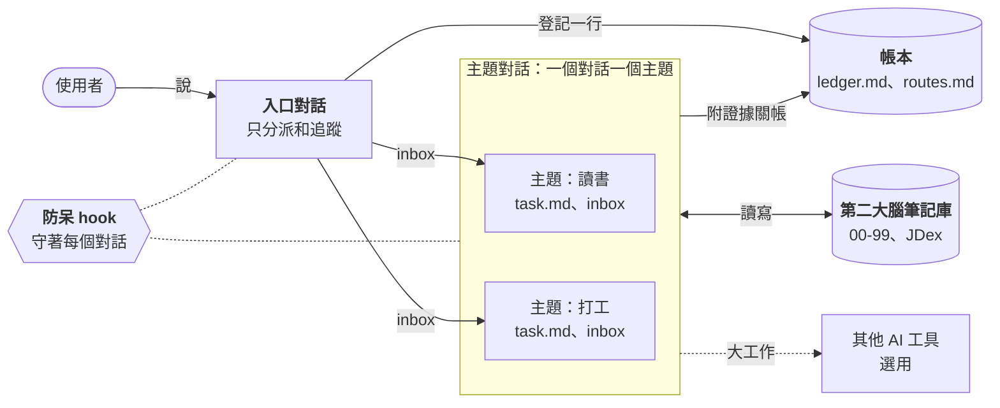
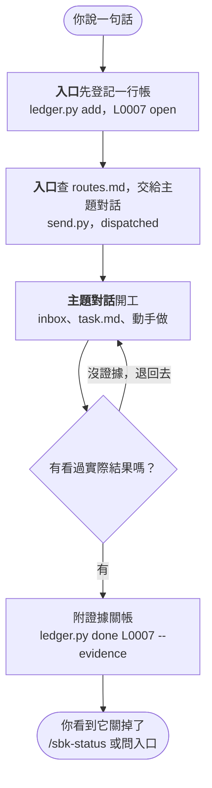
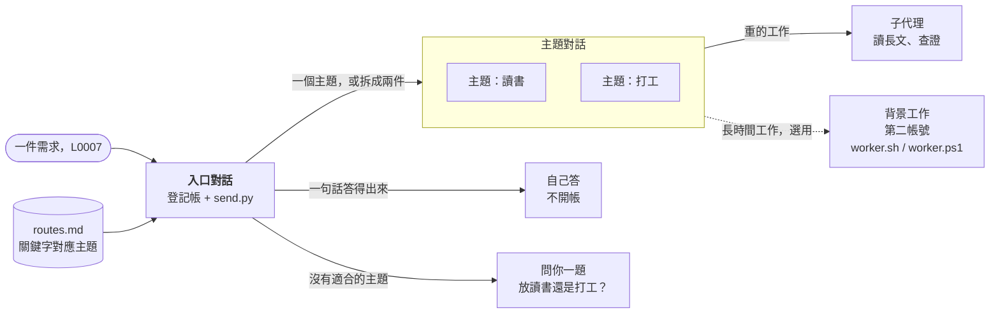
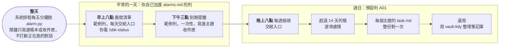
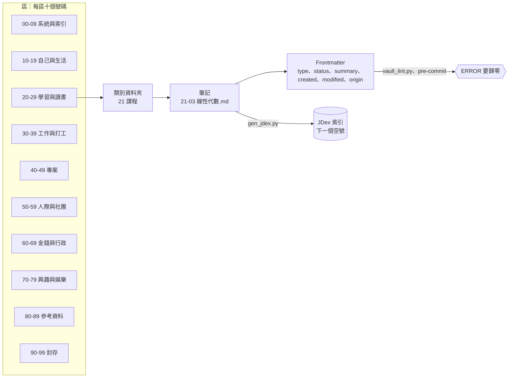
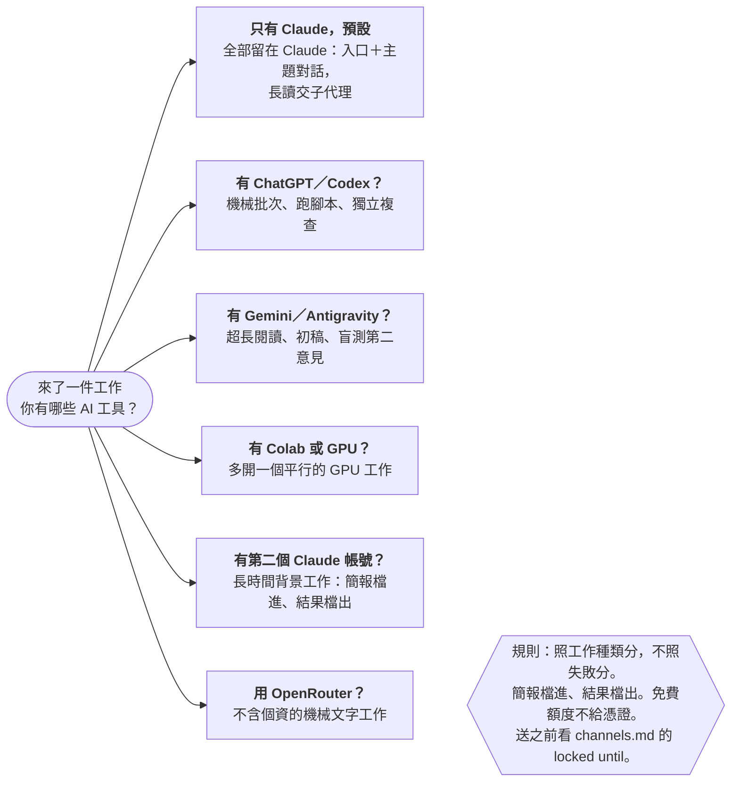

# second-brain-kit

**安裝：把這一句貼進 Claude Code。**

```
Install the Claude Code plugin from https://github.com/0Smallcat0/second-brain-kit and set me up by its docs/SETUP.md.
```

它對應這兩個指令（Claude 會替你下；你自己打也可以）：

```
/plugin marketplace add 0Smallcat0/second-brain-kit
/plugin install second-brain-kit@second-brain-kit
```

接著執行 `/sbk-setup`。Claude 會問你有哪些 AI 工具（預設：只有 Claude）、筆記要放哪裡、你最常用的兩個領域，然後全部裝好，並告訴你做了什麼。

*一套 Claude Code 的工作方式，由 Claude 自己幫你裝好。* [English](README.md)

## 它解決的問題

- Claude 跨對話就**忘記**：你要什麼、決定過什麼、你是誰。
- Claude 沒檢查就說**「做完了」**：檔案沒打開過、測試沒跑過。
- 對話**越開越多**：十個對話，不知道誰管什麼，需求掉在縫隙裡。
- 你的**筆記腐爛**：檔名亂、連結壞、沒封存、找不到。

## 和一份普通的 `CLAUDE.md` 範本差在哪

`CLAUDE.md` 範本只是一張願望清單。這套件讓願望變成可以檢查的東西：

| 項目 | 做什麼 |
|---|---|
| **入口對話＋主題對話** | 所有需求先到一個入口對話，由它分派給主題對話（讀書、打工、side project……）。一個對話一個主題。先從入口加兩個主題對話開始。 |
| **帳本（ledger）** | 每個需求一行：`ledger.py add / list / done --evidence`。項目只有附證據才能關，所以不會掉單，「做完」也才有意義。 |
| **做完要有證據** | Stop hook 發現「改完東西說完成、之後卻沒讀回也沒跑過」，會要求補證據（只問一次）；技能教 Claude 每一種工作怎麼檢查。 |
| **防呆 hook** | `git push`、跳過 hook、破壞性 git、大量刪除前先問；拒絕只讀筆記的片段；壓縮後把你自己的原話放回來；週用量 80% 提醒。全部 fail-open，都有 off／log／ask／deny 開關。 |
| **有編號的第二大腦筆記庫** | Johnny Decimal 風格的筆記（`21-03 線性代數.md`）、frontmatter、自動產生的索引、lint、提交前防覆蓋。筆記找得到，Claude 也知道怎麼讀、怎麼寫。 |
| **鬧鐘與 `task.md`** | 一張小提醒表，寫進帳本（不會去吵正在跑的對話）；三件以上的事每個主題各有一份 `task.md`。 |

這些你都不用自己設定：**Claude 會一步一步裝，每一步都檢查**。

只有一個 Claude 帳號就夠了。如果你還有第二個 Claude 帳號、Codex、Gemini、Colab 或 OpenRouter，Claude 會問你、也能用上它們（[參考](docs/zh-TW/參考-多工具分工.md)）；沒有的話，這些都不會裝。

## 它怎麼運作

六張圖。每張都是 GitHub 直接畫出來的 Mermaid 圖；點開下面的「手繪版」看較大的 SVG／PNG（[全部檔案](docs/diagrams/)；手繪版的標題是英文，附繁中小字）。

### 1. 整體長什麼樣

你只跟一個入口對話說話。它把每個需求登記進帳本，交給主題對話。主題對話管筆記庫、附證據關帳，需要時用其他 AI 工具。防呆 hook 守著每個對話。



<details><summary>手繪版</summary>


[SVG](docs/diagrams/01-architecture.svg) · [PNG](docs/diagrams/01-architecture.png)

</details>

### 2. 一個需求的一生

一句話變成帳本一行，分派、開工，附證據才關帳；沒證據就退回去。



<details><summary>手繪版</summary>


[SVG](docs/diagrams/02-request-life.svg) · [PNG](docs/diagrams/02-request-life.png)

</details>

### 3. 任務怎麼分派

入口查 `routes.md` 決定主題；一句話答得出來的它自己答；重的工作交給子代理，有第二個 Claude 帳號的話也可以交給它。



<details><summary>手繪版</summary>


[SVG](docs/diagrams/03-task-dispatch.svg) · [PNG](docs/diagrams/03-task-dispatch.png)

</details>

### 4. 一天的節奏

排程每五分鐘跑一次，把 `alarms.md` 的列寫進帳本或主題收件匣。晨間清單和到期提醒是你可以自己加的範例列；每週檢視是預設列。



<details><summary>手繪版</summary>


[SVG](docs/diagrams/04-day-timeline.svg) · [PNG](docs/diagrams/04-day-timeline.png)

</details>

### 5. 筆記庫與筆記格式

有編號的資料夾（Johnny Decimal）、一檔一張有編號的筆記、六個 frontmatter 欄位、自動產生的索引，加上 lint 與提交前防覆蓋。



<details><summary>手繪版</summary>


[SVG](docs/diagrams/05-vault-folders.svg) · [PNG](docs/diagrams/05-vault-folders.png)

</details>

### 6. 哪個工具接哪種工作

預設只有 Claude。你多有一個工具，它就接一種工作；照工作種類分，不照失敗分。



<details><summary>手繪版</summary>


[SVG](docs/diagrams/06-tool-routing.svg) · [PNG](docs/diagrams/06-tool-routing.png)

</details>

## 手動安裝

clone 這個倉庫，在裡面開 Claude Code，說：*「讀 docs/zh-TW/SETUP.md，幫我把 second-brain kit 設定好。」* [docs/zh-TW/SETUP.md](docs/zh-TW/SETUP.md) 是寫給 Claude 的：有順序的步驟，每一步都有檢查。（[English](docs/SETUP.md)）

## 裝好之後

- `/sbk-status` 一次列出所有還沒做完的：帳本、各主題的 `task.md`、收件匣、鬧鐘。
- 跟入口對話說話（`cd ~/.claude/sbk/entry && claude --add-dir <你的筆記庫>`）；它登記需求、交給主題對話。
- `python <筆記庫>/scripts/vault_lint.py` 檢查筆記；`vault-tidy` 技能幫你整理。
- 不改程式就能調 hook 的嚴格程度：`~/.claude/sbk/config.json` → `"modes": {"stop_evidence": "log"}`。
- `python scripts/selftest.py` 在一個用完即丟的資料夾裡，測試套件的每個 hook 和工具。

## 裡面有什麼

```
.claude-plugin/        外掛與 marketplace 設定
skills/                setup-second-brain、vault-tidy、evidence-before-done、multi-tool-routing
commands/              /sbk-setup、/sbk-status
hooks/                 hooks.json 與各個 hook（Python 3、只用標準函式庫）
entry/                 ledger、send、alarm、status、worker 啟動腳本
templates/             CLAUDE.md 原則、筆記庫 AGENTS.md、筆記格式、task.md、routes、alarms ……
scripts/               vault_lint、gen_jdex、check_overwrite、pre-commit、selftest
docs/                  SETUP、PITFALLS、MULTI-TOOL（含 zh-TW）；docs/diagrams 是六張圖（SVG + PNG）
experimental/          還沒驗證穩定的部分
```

想知道實際用上會出什麼錯、為什麼預設長這樣，請讀 [docs/zh-TW/踩過的坑.md](docs/zh-TW/踩過的坑.md)。

## 哪些是實驗性的

主要資料夾裡的東西都由 `scripts/selftest.py` 跑過。還沒驗證穩定的放在 [`experimental/`](experimental/README.md)，每一項附一句原因。另外要知道兩件事：

- `usage_warn` 用的是和 Claude Code `/usage` 畫面同一支用量介面，它不是公開文件的 API，可能改變；hook 讀不到時會保持安靜（fail-open）。
- Stop hook 是依工具呼叫的順序，加上一份「完成」字眼的清單來判斷。有些情況它抓不到，偶爾也會誤擋；請對自己的對話紀錄重播看看（`hooks/stop_evidence.py --replay`），太吵就設成 `log`。

## 授權

MIT，見 [LICENSE](LICENSE)。
