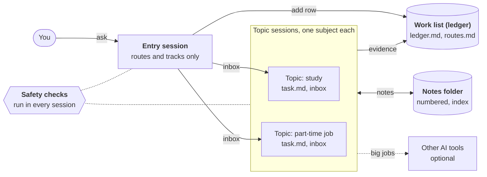
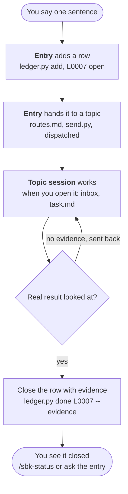
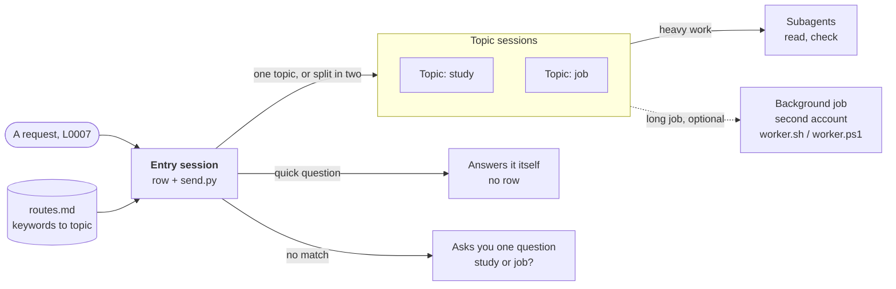
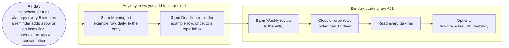
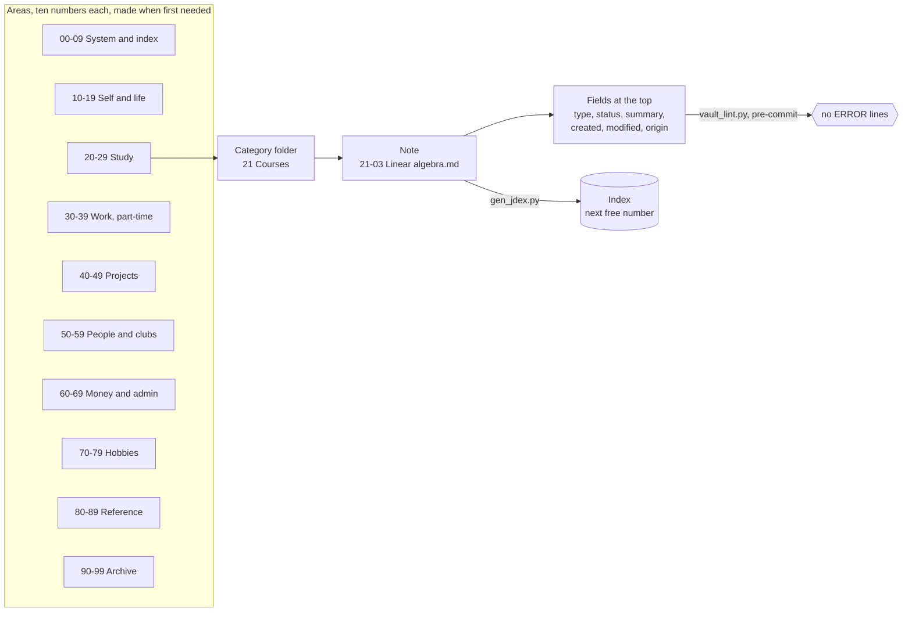
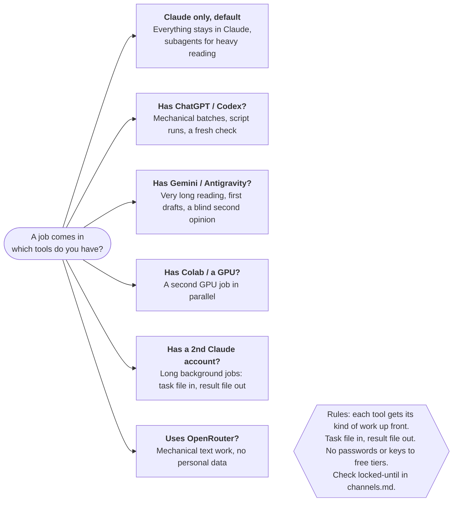
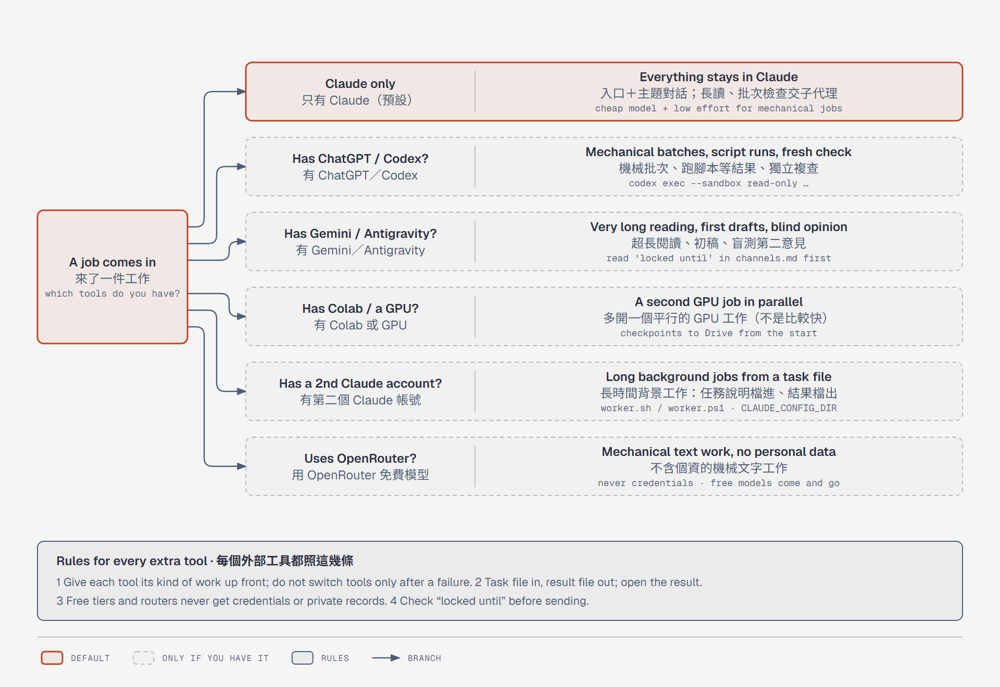

# Advanced features

[繁體中文](zh-TW/進階功能.md) · [Back to the README](../README.md)

Basic is one main Claude session in your notes folder, a work list Claude keeps for you, and safety checks. Everything on this page is already in the kit but **does nothing until it is switched on**. At install ([SETUP.md](SETUP.md)) Claude suggests each part from your answer and switches on only the ones you confirm (any extra part = Full); the rest waits until what happens to you shows it would help (table below).

To switch something on, tell Claude, for example: "Turn on topic sessions", "Remind me every Sunday to review", "Make the done-check stricter". Claude does it with the steps at the end of this page.

## When Claude suggests it

At install Claude suggested each part from your answer to "where do you get stuck?" and you confirmed which to switch on (maybe none). After that, a small script, `scripts/level_check.py`, measures the rows below on your computer. The rows look at **what actually happened to you** (asking for reminders, saying things got mixed up), not at how busy you are: the number of open items, topics and summarised conversations is quoted in the question as support and never triggers anything on its own. If you said no to reading your conversations at install, it reads only the work list and the log, not your conversations. It runs at most once a week when you open Claude in your notes folder (the `level_notice` check) and every time you run `/sbk-status`. It never changes a setting. When a row holds, Claude asks you **one yes/no question** with the numbers and switches the part on only after a yes. After a no it does not ask about that part again for four weeks. A part that is already on is never offered.

| Trigger (measured; id in the script's output) | What gets switched on | What Claude does to switch it on |
|---|---|---|
| In notes-folder conversations in the last 7 days you said 2 or more times that things got mixed up (for example "you mixed up the two reports", "not that project"); open items, topics and summarised conversations are quoted as support (`multi_session`) | Entry session + topic sessions (A1) | A1 below: entry and one session per topic (topics = the `[topic]` tags of the open items), `routes.md`, `inbox_notice` -> warn, one launcher each |
| You asked Claude to remind you 2 or more times in the last 7 days, or an open item with `due YYYY-MM-DD` is still open 3 or more days after that date (`alarms`) | Reminders (A2) | A2 below: `alarms.md` with a row for that date; the computer's scheduler only after a separate yes |
| The done-check has been logging for 14 days or more, at least 20 flagged replies could be judged (small samples mislead), and fewer than 25% were false alarms; a false alarm is a flagged reply after which your next message did not report a problem (`block_mode`) | Stricter done-check (A4) | A4 below: `stop_evidence` -> block |
| You said you have an account for another AI tool (at setup, or by telling Claude later); just naming a tool in a conversation does not count (`multi_tool`) | The guide for splitting work with that tool (A5), only tools you have | A5 below: a row in `channels.md` and one tiny real job |
| You ask for any part yourself, including the usage warning (A3) | That part | Its steps below |

Saying no is recorded with `level_check.py --decline <id>`; the script writes only its own file `~/.claude/sbk/state/level_check.json`.

## The parts, in plain words

- **Entry session and topic sessions.** Instead of one main session, you get one *entry* session that takes every request, plus one session per subject (study, job, a project ...). The entry writes the request in the work list and passes it to the right topic session through that session's *inbox* (a short text file).
  **Writing to an inbox does not run anything.** The topic session sees the new line when you open it (the `inbox_notice` check shows it at the start). If you never open that session, the work waits.
- **Reminders.** A small table (`alarms.md`) of reminders. The computer's scheduler checks it every five minutes; a due reminder adds a line to the work list or an inbox. It never interrupts a conversation; you see it the next time you talk to Claude.
- **Usage warning.** Warns once when your weekly Claude usage passes 80%. It reads the same numbers as Claude Code's `/usage` screen; that source is not an official interface and may stop working, in which case the warning stays silent.
- **Stricter done-check.** In Basic, the done-check only writes a note in a log when Claude says "done" after an edit without looking at the result. In strict mode it stops Claude once and asks it to check first.
- **Other AI tools.** If you have ChatGPT/Codex, Gemini, a second Claude account, Colab or OpenRouter, each one can be given one kind of work. One Claude account is enough; nothing here is needed. Details: [MULTI-TOOL.md](MULTI-TOOL.md).

## Pictures

Each picture is a Mermaid diagram that GitHub draws; open "Drawn version" for the larger image ([all files](diagrams/)).

### 1. The whole picture with topic sessions

You talk to the entry session. It writes each request to be tracked in the work list (the ledger) and hands it to a topic session. Topic sessions use the notes, close work-list rows with evidence, and may use other AI tools. The safety checks run in every session.

Drawn version

[SVG](diagrams/01-architecture.svg) · [PNG](diagrams/01-architecture.png)

### 2. Life of one request

A request becomes a work-list row, is handed over, worked on, and closed only with evidence. A row without evidence is sent back.

The work list refuses a "done" without evidence. With the stricter done-check (A4) the Stop check also asks Claude once more.

Drawn version

[SVG](diagrams/02-request-life.svg) · [PNG](diagrams/02-request-life.png)

### 3. Who gets the task

The entry reads `routes.md` to pick the topic. Quick questions it answers itself, without a row. Heavy reading goes to subagents (helpers Claude starts inside the same session), or to a second Claude account if you have one.

Drawn version

[SVG](diagrams/03-task-dispatch.svg) · [PNG](diagrams/03-task-dispatch.png)

### 4. A day with reminders

The scheduler runs every five minutes and fires due rows of `alarms.md` into the work list or a topic inbox. The weekly review is the row the kit starts with; the morning list and the deadline reminder are examples you can add.

Drawn version

[SVG](diagrams/04-day-timeline.svg) · [PNG](diagrams/04-day-timeline.png)

### 5. The notes folder and the note format

This part is also in Basic; you never need to learn it, Claude follows it. Numbered folders (the Johnny Decimal method: areas of ten numbers, categories, numbered notes), six fields at the top of each note, an index Claude regenerates, and a checker. An area or category folder is created the first time a note needs it.

Drawn version

[SVG](diagrams/05-vault-folders.svg) · [PNG](diagrams/05-vault-folders.png)

### 6. Which tool gets which job

Only Claude is the default. Each extra tool you already have is given one kind of work up front; Claude does not switch tools just because one failed.

Drawn version

[SVG](diagrams/06-tool-routing.svg) · [PNG](diagrams/06-tool-routing.png)

---

## Steps for Claude (A1-A5)

Written for the Claude that switches a part on. Words (`KIT`, `SBK_HOME`, `VAULT`), rules and status words are the same as in [SETUP.md](SETUP.md); Basic must already be installed (during setup, SETUP Step 5b runs these steps right after Basic). Do only the part the user agreed to or the setup decision called for. When the first part is switched on, set `"level": "full"` in `SBK_HOME/config.json`; change only the `modes` named in that part and keep every other value. Report each part with a status word.

### A1 - Entry session and topic sessions

1. `SBK_HOME/entry/CLAUDE.md` <- `KIT/templates/entry-CLAUDE.md`, with `{{vault}}` replaced.
2. Start with two to four topics: during setup, the things the user named (SETUP Step 5b, no question); after a weekly-check yes, the `[topic]` tags of the open work-list items; otherwise ask "Which two subjects should get their own conversation?". For each: a short ASCII id (`study`, `work`), `SBK_HOME/managers/<id>/CLAUDE.md` <- `templates/manager-CLAUDE.md` (fill `{{manager}}`, `{{vault}}`, `{{scope}}` with one line in the user's words), `SBK_HOME/managers/<id>/task.md` <- `templates/task.md` (fill `{{topic}}`). If `SBK_HOME/task.md` from Basic has open items, ask which topic it belongs to and move it there.
3. `SBK_HOME/routes.md` <- `templates/routes.md`, one row per id with 5-10 words the user would really say.
4. `config.json` -> `"modes": {"inbox_notice": "warn"}`.
5. How to open each session, by `SURFACE` (SETUP Step 0.2). Terminal, a launcher like SETUP Step 5 per session: entry `cd "<SBK_HOME>/entry"` then `claude --add-dir "<VAULT>" -n entry`; topic `cd "<SBK_HOME>/managers/<id>"` then `claude --add-dir "<VAULT>" -n <id>`. App, no launcher file: **+ New**, **Open folder…** `<SBK_HOME>/entry` (or `<SBK_HOME>/managers/<id>`), then click **+** next to the prompt box, **Add folder**, `<VAULT>` (the app's equivalent of `--add-dir`), and rename the session to `entry` or `<id>` by clicking its title. Update the start section of `VAULT/README.md`: new requests go to the entry; open a topic session to let it work. The Basic way of opening (launcher, or the notes-folder session in the app) may stay for quick note questions.
6. Tell the user plainly: "Writing to an inbox does not start anything. A topic session works on it when you open that session."

**Check:** `python SBK_HOME/bin/send.py <id> "setup check A1"` prints `<new id> -> <id>` (use the printed id); `SBK_HOME/inbox/<id>.md` has the line; `echo '{"cwd":"<SBK_HOME>/managers/<id>","hook_event_name":"SessionStart"}' | python KIT/hooks/inbox_notice.py` prints it; `status.py` lists it. Then `ledger.py drop <new id> --evidence "A1 setup test item"` and tick the inbox line `[x]`.

### A2 - Reminders

1. `SBK_HOME/alarms.md` <- `templates/alarms.md` if it does not exist (never replace an existing one). One sentence to the user: the starting row is a weekly review on Sunday 20:00; every row must lead to an action.
2. Ask: "OK to add a scheduled task that checks the reminders every 5 minutes?" After a yes:
   - Windows: `schtasks /Create /SC MINUTE /MO 5 /TN sbk-alarm /TR "\"<path to pythonw.exe>\" \"%USERPROFILE%\.claude\sbk\bin\alarm.py\" --tick"` (`pythonw.exe` so no window flashes)
   - macOS/Linux: add `*/5 * * * * python3 "$HOME/.claude/sbk/bin/alarm.py" --tick` with `crontab -e`.
   A no is **not enabled**: reminders do not fire by themselves, `alarm.py --fire A01` still works by hand, and the scheduler check below is skipped.

**Check:** `python SBK_HOME/bin/alarm.py --list` shows the rows; `schtasks /Query /TN sbk-alarm` (or `crontab -l`) shows the entry (or the scheduler is **not enabled**). Test firing **in a throw-away folder**, never in the real `SBK_HOME`: copy `alarms.md` into a new temporary folder, run `alarm.py --tick --now <next Sunday>T20:01` with the environment variable `SBK_HOME` set to that folder, confirm its `ledger.md` got the row, then delete the temporary folder. The real `state/alarms.json` is never deleted.

### A3 - Usage warning

1. `config.json` -> `"modes": {"usage_warn": "warn"}` (threshold: `"usage_warn_pct"`, default 80).
2. Tell the user it reads an unofficial source and stays silent when it cannot read it.

**Check:** with `SBK_HOME` set to a temporary folder, `SBK_MODE_USAGE_WARN=warn` and `SBK_USAGE_FAKE='{"seven_day":{"utilization":91,"resets_at":"2030-01-01T00:00:00Z"}}'`, `echo '{"session_id":"a3"}' | python KIT/hooks/usage_warn.py` prints a line with `91%`. Whether the real numbers can be read on this computer is **not verified** until a real warning appears.

### A4 - Stricter done-check

1. Replay first (with consent: `read_history` is true in `config.json`, or ask now): `python KIT/hooks/stop_evidence.py --replay <file>` on the five newest transcripts, and `SBK_HOME/logs/stop_evidence.log` if Basic has run for a while.
2. If the weekly check brought you here, its numbers already show fewer than 25% false alarms: set block. If the user asked without that, and about one turn in four or more would be flagged in the replay, tell the user it would interrupt too often and keep `log`. Otherwise set `config.json` -> `"modes": {"stop_evidence": "block"}`. It stops Claude at most once per reply.

**Check:** the replay ran on at least one transcript (or the log), and `config.json` shows the mode you chose.

### A5 - Other AI tools

Only tools the user said they have. For each, read its section of [MULTI-TOOL.md](MULTI-TOOL.md) (reference: take what fits).
1. `SBK_HOME/channels.md` <- `templates/channels.md`, one row per tool.
2. Second Claude account: the user runs `/login` once with `CLAUDE_CONFIG_DIR` set to a new folder for that account (**needs you**: give the exact command for their OS); then `entry/worker.ps1 -DryRun` or `SBK_DRYRUN=1 entry/worker.sh` and read the printed command.
3. Codex, Gemini CLI, OpenRouter: the version command or a one-line job runs. Tools used only in a web browser (ChatGPT or Gemini websites, Colab) are **not verified** by you; write down how the user hands a task file over.
4. One tiny real job per tool whose result is a file; open the file.

**Check:** each tool has a row in `channels.md` and a result file you opened (or **not verified** for web-only tools). Tools the user does not have appear nowhere.

### Switching a part off

Set its mode back to the Basic value (`templates/config.json`), delete the scheduler entry for A2, and leave the files (`routes.md`, `alarms.md`, inboxes, `state/`) in place unless the user asks to delete them.
