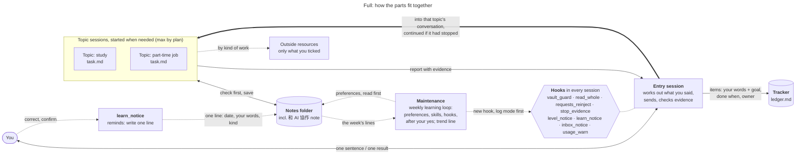
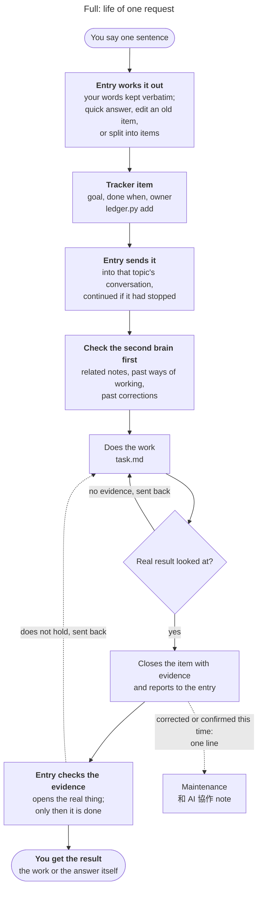
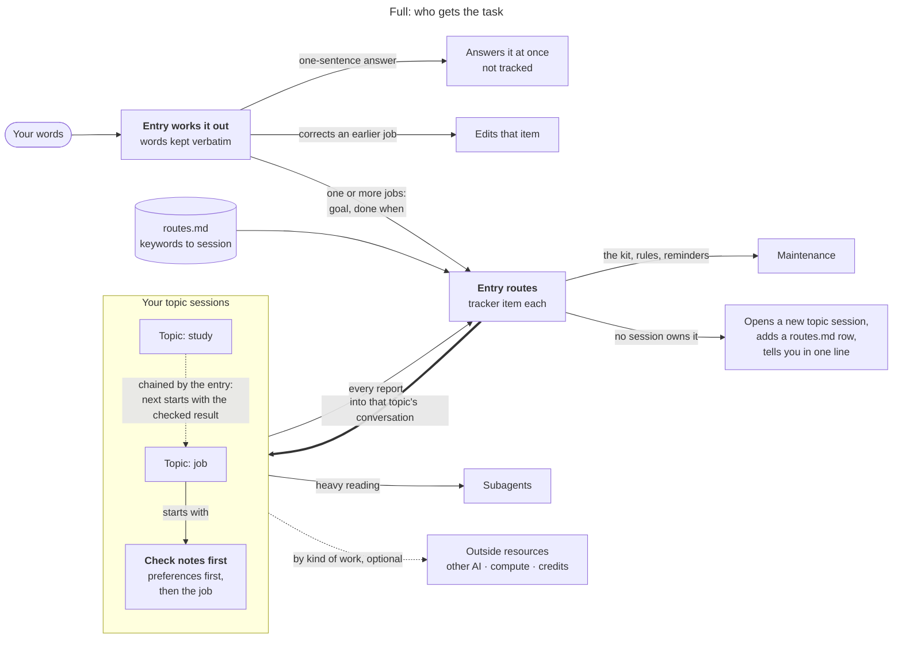
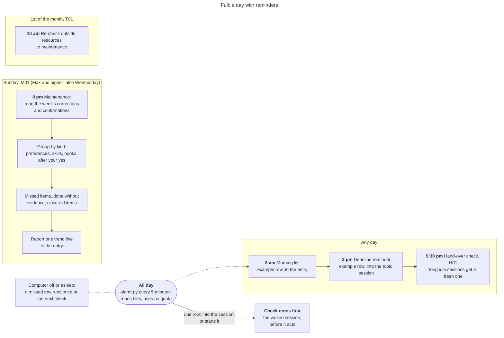
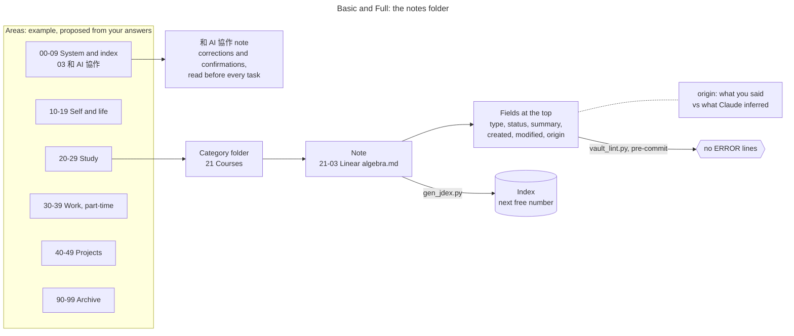
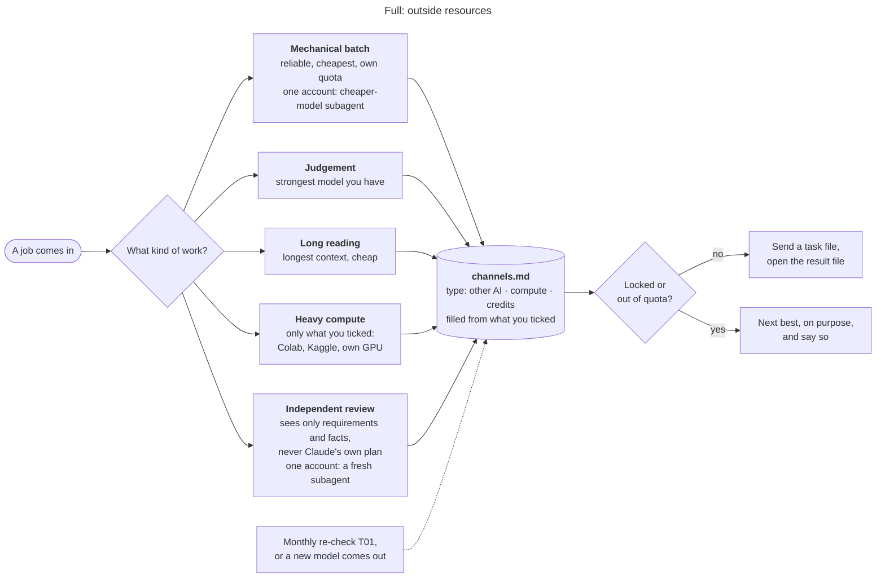

# Full plan and advanced features

[繁體中文](zh-TW/進階功能.md) · [Back to the README](../README.md)

Basic is one main Claude session in your notes folder, the tracker (`ledger.py`: what is still open, one item per line, each closed with a note of how it was checked) that Claude keeps for you, safety checks, and a note where Claude writes down every time you corrected it or confirmed it did something right. Everything on this page is already in the kit but **does nothing until it is switched on**. At install ([SETUP.md](SETUP.md)) Claude suggests each part from your answers and switches on only the ones you confirm (any extra part = Full); the rest waits until what happens to you shows it would help (table below).

To switch something on, tell Claude, for example: "Turn on topic sessions", "Remind me every Sunday to review", "Make the done-check stricter", "Use my Colab for heavy jobs". Claude does it with the steps at the end of this page.

## Basic and Full

Full is not one big switch: each part (A1-A5 below) is switched on by itself, and any part on makes it Full.

| | Basic | Full |
|---|---|---|
| Sessions | One main session in your notes folder | Two fixed sessions: **entry** (the only one you talk to) and **maintenance** (the kit, rules, hooks, reminders, and the weekly learning loop), plus one session per subject of yours that the entry starts and sends work into (A1) |
| Tracker (`ledger.py`) | Claude adds and closes items, each with a note of how it was checked | The same file, shared by every session; topic sessions report to the entry, which opens the evidence. You get one result message |
| Before every task | Claude checks the notes first, including the 和 AI 協作 note | Every session checks the notes first, including the 和 AI 協作 note |
| Learning from use | `learn_notice` reminds Claude to write one line in the 和 AI 協作 note for every correction and every "yes, that's right"; a light weekly review (at the first session of the week) groups the lines by kind and proposes preferences, written only after your yes; the preferences are read first before every task | The same, run by maintenance's weekly review instead: preferences, skills and (only for a mistake that came back and that a program can see) a new hook, each after your yes; one trend line per week |
| Long conversations | When it gets long, Claude writes a hand-over into task.md and tells you to start a new conversation and say "continue" | The same; background sessions over the limit (150k tokens) and idle are replaced by a fresh one automatically (`handover.py`) |
| Notes folder, asking before delete/upload, your own words put back | Yes | Yes |
| Done-check | Writes a log line only | Log, or stops Claude once to check first (A4, if you want) |
| Reminders | None | `alarms.md` + the computer's scheduler: the weekly review, the monthly outside-resources re-check, the daily hand-over check, your own rows (A2) |
| Outside resources | Not used | A table by kind of work, only what you ticked at install (other AI, compute, credits), re-checked every month (A5) |
| Usage warning | Off | On if you ask (A3) |
| Quota | Only what you do | Each running session uses your quota like a conversation; idle ones use none. Capped by plan: sessions at once, and how often a reminder may start one |
| Suits | One person, a few things at a time; new to Claude Code | Several subjects that get mixed up; deadlines you forget |
| How to switch | Say "Turn on topic sessions" (or any part) | Say "Turn off X" or "Back to Basic": modes go back to the Basic values, your files stay |

Hooks and the weekly review do different jobs: **hooks catch what a program can see at the moment Claude acts; the weekly review catches what only reading back the whole week shows** (items nobody picked up, "done" without evidence, the same mistake made again).

## Costs

The reminder check that runs every 5 minutes only reads files on your computer: it uses **none** of your Claude limit. Only starting a Claude session or sending one a message does. So each plan gets starting values at install, which your Claude may change later (it tells you when):

| Plan | Topic sessions at once (`max_sessions`) | A reminder may start or message a session (`wake_limits`) | Weekly review |
|---|---|---|---|
| Pro | 2 | 4 times a day, 120 minutes apart per session | Sunday 20:00 |
| Max | 4 | 12 times a day, 60 minutes apart | Wednesday and Sunday 20:00 |
| Ultra, Team, Enterprise or higher | 6 | 24 times a day, 30 minutes apart | Wednesday and Sunday 20:00 |
| API (pay per use), or not sure | 2 | 4 times a day, 120 minutes apart | Sunday 20:00 |

Over a limit, the work waits in that session's inbox and runs later. When the computer is off or asleep, nothing runs; at the next check a missed reminder runs **once**, marked "(late)", however many times it was missed.

## When Claude suggests it

At install Claude suggested each part from your answer to "where do you get stuck?" and you confirmed which to switch on (maybe none). After that, a small script, `scripts/level_check.py`, measures the rows below on your computer. The rows look at **what actually happened to you** (asking for reminders, saying things got mixed up), not at how busy you are: the number of open items, topics and summarised conversations is quoted in the question as support and never triggers anything on its own. If you said no to reading your conversations at install, it reads only the tracker and the log, not your conversations. It runs at most once a week when you open Claude in your notes folder (the `level_notice` check) and every time you run `/sbk-status`. It never changes a setting. When a row holds, Claude asks you **one yes/no question** with the numbers and switches the part on only after a yes. After a no it does not ask about that part again for four weeks. A part that is already on is never offered.

| Trigger (measured; id in the script's output) | What gets switched on | What Claude does to switch it on |
|---|---|---|
| In notes-folder conversations in the last 7 days you said 2 or more times that things got mixed up (for example "you mixed up the two reports", "not that project"); open items, topics and summarised conversations are quoted as support (`multi_session`) | The Full sessions: entry, maintenance + topic sessions (A1) | A1 below: the two fixed sessions and one session per topic (topics = the `[topic]` tags of the open items), `routes.md`, live routing if this computer can do it, how to open the entry |
| You asked Claude to remind you 2 or more times in the last 7 days, or an open item with `due YYYY-MM-DD` is still open 3 or more days after that date (`alarms`) | Reminders (A2) | A2 below: `alarms.md` with a row for that date; the computer's scheduler only after a separate yes |
| The done-check has been logging for 14 days or more, at least 20 flagged replies could be judged (small samples mislead), and fewer than 25% were false alarms; a false alarm is a flagged reply after which your next message did not report a problem (`block_mode`) | Stricter done-check (A4) | A4 below: `stop_evidence` -> block |
| You said you have an outside resource (ticked at setup, or told Claude later); just naming one in a conversation does not count (`multi_tool`) | The outside-resources table (A5), only what you have | A5 below: `channels.md` filled from what you ticked, one tiny real job each, the monthly re-check |
| You ask for any part yourself, including the usage warning (A3) | That part | Its steps below |

Saying no is recorded with `level_check.py --decline <id>`; the script writes only its own file `~/.sbk/state/level_check.json`.

## The parts, in plain words

- **The Full sessions.** Instead of one main session you get one *entry* session that takes every request and gives you every result, one *maintenance* session, and one session per subject of yours (study, job, a project ...):
  - **Entry:** first works out what you said: a one-sentence answer it gives at once without tracking it; a correction edits the earlier tracker item instead of adding one; one message with several jobs becomes several items. Each item keeps your words verbatim, plus its goal, when it counts as done, and which session owns it. Then it sends the job **straight into the conversation of the topic that owns it**: one conversation per topic, continued even after Claude Code stopped its process (it does that for a finished session nobody is attached to for about an hour; the conversation stays, and the entry resumes it); only the first time is a new one started; if no topic owns that kind of work it opens a new topic itself, adds it to `routes.md` and tells you in one line.
  - **Topic sessions** check the notes first, do the work, close the item with evidence and **report to the entry, never to you**. A job that needs two topics is chained by the entry. The entry opens the evidence (the real file or page) and only then counts the job done; you get **one result message**: the result itself, where to see it, and anything only you can do (signing in, pressing send - the page is opened ready for you).
  - **Maintenance:** the kit itself (rules, safety checks, reminders, the outside-resources table, updates) and the **learning loop** below.
  At most `max_sessions` topic sessions run at once (by plan); an idle one uses no quota. When the cap is reached, the entry stops the oldest idle session (its state is in its `task.md`) or the job waits in its inbox.
  Where background sessions cannot run (the desktop app alone, no `claude` command, an old version), the job waits in the session's *inbox* (a short text file) and the entry tells you which session to open; the session shows the waiting work when it starts.
- **The learning loop.** Every time you correct Claude, and every time you confirm it did something right, it writes one line in the 和 AI 協作 note at once: date, your own words, which kind of mistake or which way of working (`learn.py add`). The `learn_notice` hook spots messages that read like a correction or a confirmation (Chinese and English phrases; quoted text and code are ignored) and reminds Claude to write that line. At the start of every conversation (and after a summary) the same hook puts the sorted preferences into the conversation, and "check the notes first" reads the recent lines, so the next similar task sees both. (An end-to-end run showed why: a fresh session did not open the note by itself and broke a preference written the day before.) In Basic, `level_notice` also runs a light review at the first session of each week: `learn.py group` sorts the new lines by kind, Claude drafts a preference sentence for each kind seen twice or more (and proposes a skill addition or, for a repeated mistake a program can see, a hook), asks you once, and writes with `learn.py pref` only after your yes. In Full, maintenance's weekly review replaces the light one: it (Pro weekly, Max and higher twice a week) reads the week's conversations and the tracker, groups lines of the same kind and turns them into: preferences written at the top of the note; ways that worked added to the matching skill; and a hook **only** when the same kind of mistake came a second time **and** a program can see it at the moment of action. A new hook starts in log mode and is replayed on past conversations before it may block. Each review reports one trend line: corrections this week, kinds that came back, against last week.
- **Long conversations hand over by themselves.** A session's state lives only in its `task.md` and a file of your words. When a background session passes 150k tokens (`handover_tokens`) and is idle, the daily check asks it to write its hand-over into `task.md`, copies your words out, stops it and starts a fresh one with the same name that reads both first. A conversation in a window (Basic's main one, or the entry you type into) cannot be replaced by a script: Claude writes the hand-over and tells you to start a new conversation and say "continue".
- **Evidence is for the sessions, not for you.** A topic closes its tracker item with what it looked at; the entry opens it. You hear only the result.
- **Reminders.** A small table (`alarms.md`): daily, weekly, monthly or once. The computer's scheduler checks it every five minutes. A due reminder writes an item or an inbox line first, then (with live routing) goes straight into that topic's conversation (continued if its process had stopped), within the plan's limits.
- **Usage warning.** Warns once when your weekly Claude usage passes 80%. It reads the same numbers as Claude Code's `/usage` screen; that source is not an official interface and may stop working, in which case the warning stays silent.
- **Stricter done-check.** In Basic, the done-check only writes a note in a log when Claude says "done" after an edit without looking at the result. In strict mode it stops Claude once and asks it to check first.
- **Outside resources.** Everything you have besides this Claude account: other AI (a second Claude account, Codex, ChatGPT or Gemini on the web), compute (Colab, Kaggle, a GPU of your own), credits and services (Azure for Students, Copilot, API credit). At install you tick what you have; only those go in the table, and free-to-sign-up ones are marked 可免費申請. No resource gets a fixed job: for each kind of work Claude uses what currently measures best and has quota, and re-checks every month. With one Claude account only, mechanical work goes to a cheaper-model subagent and an independent check to a fresh subagent that never sees the first answer. Details: [MULTI-TOOL.md](MULTI-TOOL.md).

## Pictures

Each picture is a Mermaid diagram that GitHub draws; open "Drawn version" for the larger image ([all files](diagrams/)). The title of each says whether it shows Basic or Full.

### 1. Full: how the parts fit together

You talk only to the entry. It works out what you said, writes tracker items and sends each job into the topic session that owns it (running, or started now). Topic sessions check the notes first, do the work and report back to the entry with evidence; the entry opens it and gives you one result. The growth loop: when you correct or confirm a session, `learn_notice` reminds it to write one line in the 和 AI 協作 note; maintenance's weekly review groups the lines into preferences, skills and (for a mistake that came back) a new hook, changed only after your yes; every session reads the preferences first.



What each hook does (Basic on/off; Full switches on the ones marked):
- `vault_guard` - asks you before Claude pushes, deletes a whole folder, throws away git work, skips git checks, changes protected rule files or shrinks a note to a fraction of it. Basic: on.
- `read_whole` - in the notes folder, stops Claude from judging a note by its first lines; it reads the note to the end. Basic: on.
- `requests_reinject` - when a long conversation is summarised, puts your own messages back word for word; when a conversation passes the hand-over size, tells Claude to write its hand-over and you to start a fresh one. Basic: on.
- `stop_evidence` - notices when Claude says "done" after a change without looking at the result. Basic: on, writes a log line only; Full can make it stop Claude once (A4).
- `level_notice` - about once a week, in the notes folder, asks one yes/no question when what happened to you shows another part would help; in Basic it also runs the light weekly review of the 和 AI 協作 lines (proposes only; nothing changes before your yes). Basic: on.
- `learn_notice` - when your message reads like a correction or a confirmation, reminds Claude to write one line in the 和 AI 協作 note; at the start of a conversation (and after it is summarised) puts the note's sorted preferences into it. Basic: on (`"learn_notice": "warn"`; `log` only counts, `off` stops it).
- `inbox_notice` - when a session opens, and at each message, shows the work waiting in its inbox; in the entry, also the items done and waiting for its check. Basic: off; Full sessions switch it on (A1).
- `usage_warn` - warns once when your weekly Claude usage passes 80%. Basic: off; on only if you ask (A3).

<details><summary>Drawn version</summary>


[SVG](diagrams/01-architecture.svg) · [PNG](diagrams/01-architecture.png)

</details>

### 2. Full: life of one request

Your words are kept verbatim and worked out into tracker items. The job goes into that topic's conversation (the same one every time); it checks the second brain first, does the work and closes the item with evidence. The entry opens the real thing before it counts as done, and you get the result itself.



The tracker refuses a "done" without evidence. With the stricter done-check (A4) the Stop check also asks Claude once more.

<details><summary>Drawn version</summary>


[SVG](diagrams/02-request-life.svg) · [PNG](diagrams/02-request-life.png)

</details>

### 3. Full: who gets the task

The entry first works out your words (answer at once, edit an old item, or split), then reads `routes.md`. Anything about the kit, rules or reminders goes to maintenance. A job no session owns gets a new topic session, opened by the entry itself. Jobs that need two topics are chained by the entry, and every report comes back to it. A topic session starts every job by checking the second brain (the notes and the 和 AI 協作 preferences). Heavy reading goes to subagents (helpers Claude starts inside the same session); outside resources by kind of work, if you have them.



<details><summary>Drawn version</summary>


[SVG](diagrams/03-task-dispatch.svg) · [PNG](diagrams/03-task-dispatch.png)

</details>

### 4. Full: a day with reminders

The scheduler runs every five minutes; that check uses no quota. A due row goes straight into that topic's conversation (continued if it had stopped) within the plan's daily limit; over the limit it waits in the inbox. A woken session checks the second brain (the notes and the 和 AI 協作 preferences) before it acts. The weekly review is maintenance's learning loop. The morning list and the deadline reminder are examples you can add.



<details><summary>Drawn version</summary>


[SVG](diagrams/04-day-timeline.svg) · [PNG](diagrams/04-day-timeline.png)

</details>

### 5. Basic and Full: the notes folder and the note format

This part is the same in Basic and Full; you never need to learn it, Claude follows it. Numbered folders (the Johnny Decimal method: areas of ten numbers, categories, numbered notes), six fields at the top of each note, an index Claude regenerates, and a checker. The areas are proposed from your answers at install (the ones below are an example for a student); a folder is created the first time a note needs it. The `origin` field tells what you said apart from what Claude inferred, so Claude's words are never taken as yours.



<details><summary>Drawn version</summary>


[SVG](diagrams/05-vault-folders.svg) · [PNG](diagrams/05-vault-folders.png)

</details>

### 6. Full: outside resources

No resource has a fixed role. Claude names the kind of work, reads your table (`channels.md`, only what you ticked at install) for what is best for it right now, and checks it is not locked. With one Claude account and nothing else, every row still has an answer inside that account.



<details><summary>Drawn version</summary>


[SVG](diagrams/06-tool-routing.svg) · [PNG](diagrams/06-tool-routing.png)

</details>

---

## Steps for Claude (A1-A5)

Written for the Claude that switches a part on. Words (`KIT`, `SBK_HOME`, `VAULT`), rules and status words are the same as in [SETUP.md](SETUP.md); Basic must already be installed (during setup, SETUP Step 5b runs these steps right after Basic). Do only the part the user agreed to or the setup decision called for. When the first part is switched on, set `"level": "full"` in `SBK_HOME/config.json`; change only the `modes` (and, for A1, `routing`) named in that part and keep every other value, including the plan's starting values (`max_sessions`, `wake_limits`, `review`). Report each part with a status word.

### A1 - The Full sessions: entry, maintenance and topics

1. `SBK_HOME/entry/CLAUDE.md` <- `KIT/templates/entry-CLAUDE.md`, with `{{vault}}` replaced.
2. The fixed maintenance session, always: `SBK_HOME/managers/maintenance/CLAUDE.md` <- `templates/maintenance-CLAUDE.md` (fill `{{vault}}`), with a `task.md` from `templates/task.md` (`{{topic}}` = maintenance).
3. The user's topics, two to four: during setup, the things the user named (SETUP Step 5b, no question); after a weekly-check yes, the `[topic]` tags of the open tracker items; otherwise ask "Which two subjects should get their own conversation?". For each: a short ASCII id (`study`, `work`), `SBK_HOME/managers/<id>/CLAUDE.md` <- `templates/manager-CLAUDE.md` (fill `{{manager}}`, `{{vault}}`, `{{scope}}` with one line in the user's words), `SBK_HOME/managers/<id>/task.md` <- `templates/task.md` (fill `{{topic}}`). If `SBK_HOME/task.md` from Basic has open items, ask which topic it belongs to and move it there. Later topics are opened by the entry itself (same files).
4. `SBK_HOME/routes.md` <- `templates/routes.md`: keep the maintenance row, one row per topic id with 5-10 words the user would really say.
5. Live routing: copy `KIT/entry/session.py`, `handover.py`, `learn.py` and `KIT/hooks/_common.py` (handover.py imports it) to `SBK_HOME/bin/` if missing, then `python SBK_HOME/bin/session.py check`. It prints and writes `"routing"` and the absolute `claude_path`: `live` when the `claude` command runs, is new enough for cross-session messaging (2.1.234 on Windows, 2.1.224 on macOS/Linux) and answers `claude agents --json`; else `inbox`. With `live`, ask once: "OK if I mark the folder `~/.sbk` as trusted for Claude Code, so the entry can start topic sessions there in the background?" After a yes, `session.py trust`; after a no, set `"routing": "inbox"` and say so.
6. `config.json` -> `"modes": {"inbox_notice": "warn"}`.
7. Maintenance's schedule: create `SBK_HOME/alarms.md` from `templates/alarms.md` if it does not exist (never replace one; add missing rows M01, T01 and H01 to an existing one). Max, Ultra, Team, Enterprise or higher: add `| M02 | weekly wed 20:00 | maintenance | Weekly review (learning loop), mid-week |`. Rows fire only with the scheduler: ask A2's scheduler question now if it was not asked yet. A no: the rows stay but never fire by themselves, and nobody opens maintenance by hand, so say plainly that the weekly review will not run there; the entry gets the Basic light review at session start instead whenever no `[review]` tracker item was closed in the last 8 days (the fallback is on evidence). `alarm.py --fire M01` still starts it by hand.
8. How to open the entry, by `SURFACE` (SETUP Step 0.2). Terminal, a launcher like SETUP Step 5: `cd "<SBK_HOME>/entry"` then `claude --add-dir "<VAULT>" -n entry`. App: **+ New**, **Open folder…** `<SBK_HOME>/entry`, then **+** next to the prompt box, **Add folder**, `<VAULT>`, and rename the session to `entry` by clicking its title. With `routing` `inbox` (App only, no `claude` command) do not set topic sessions up at all (SETUP Step 0.4): the entry works through the requests itself in its one conversation, so there is nothing for the user to open. Update the start section of `VAULT/README.md`: new requests go to the entry; results come from the entry. The Basic way of opening may stay for quick note questions.
9. Tell the user plainly: "Talk only to the entry. It sends each job into the session that owns it, starting it if needed (at most N at once on your plan; idle sessions use none of your limit), and gives you one result." With `inbox`: "On this computer one conversation, the entry, does all the work and keeps each subject apart with a tag; you open nothing else."

**Check:** `python SBK_HOME/bin/send.py <id> "setup check A1"` prints `<new id> -> <id>` (use the printed id); `SBK_HOME/inbox/<id>.md` has the line; `echo '{"cwd":"<SBK_HOME>/managers/<id>","hook_event_name":"SessionStart"}' | python KIT/hooks/inbox_notice.py` prints it; `status.py` lists it; `managers/maintenance/CLAUDE.md` exists; `session.py check` prints the same `routing` as `config.json`; with `live`, `SBK_SESSION_DRYRUN=1 python SBK_HOME/bin/session.py open <id>` prints a `claude --bg -n <id>` command; `alarm.py --list` shows M01 and the line `routing: ... sessions at once: N ...` matches `config.json`. Then `ledger.py drop <new id> --evidence "A1 setup test item"` and tick the inbox line `[x]`.

### A2 - Reminders

1. `SBK_HOME/alarms.md` <- `templates/alarms.md` if it does not exist (never replace an existing one). One sentence to the user: the starting rows are maintenance's weekly review, the monthly outside-resources re-check and the daily hand-over check; every row must lead to an action. Rows may be daily, weekly, monthly or once.
2. Ask: "OK to add a scheduled task that checks the reminders every 5 minutes? The check reads files on this computer and uses none of your Claude limit." (skip if already answered in A1). After a yes:
   - Windows (PowerShell; runs after a missed start and on battery; `pythonw.exe` so no window flashes; the tick writes its output to `SBK_HOME/logs/alarm.log` because `pythonw.exe` has no console):
     ```powershell
     $a = New-ScheduledTaskAction -Execute "<path to pythonw.exe>" -Argument ('"' + $env:USERPROFILE + '\.sbk\bin\alarm.py" --tick')
     $t = New-ScheduledTaskTrigger -Once -At (Get-Date) -RepetitionInterval (New-TimeSpan -Minutes 5)
     $s = New-ScheduledTaskSettingsSet -StartWhenAvailable -AllowStartIfOnBatteries -DontStopIfGoingOnBatteries
     Register-ScheduledTask -TaskName sbk-alarm -Action $a -Trigger $t -Settings $s
     ```
   - macOS/Linux: install with a command Claude can run, not `crontab -e` (an editor): `(crontab -l 2>/dev/null; echo '*/5 * * * * PATH=<the folders of claude and python3, e.g. $HOME/.local/bin:/opt/homebrew/bin:/usr/local/bin:/usr/bin:/bin> <PY> "$HOME/.sbk/bin/alarm.py" --tick') | crontab -` (cron has a minimal PATH and would not find `claude` or Homebrew's `python3`; `session.py check` also saves the absolute `claude_path` in `config.json`, which the tick uses first). On macOS a LaunchAgent (`~/Library/LaunchAgents/`, `StartInterval` 300, same `PATH` in `EnvironmentVariables`) is the better fit: cron may need Full Disk Access there. The tick appends its output to `SBK_HOME/logs/alarm.log`.
   - Windows where `Register-ScheduledTask` is refused (no administrator rights, or a policy forbids scheduled tasks): start the loop at sign-in instead, with a shortcut in the user's Startup folder. It needs no rights, runs `--tick` every 5 minutes as a separate process, and only one loop runs per `SBK_HOME`:
     ```powershell
     $s = (New-Object -ComObject WScript.Shell).CreateShortcut((Join-Path ([Environment]::GetFolderPath('Startup')) 'sbk-alarm.lnk'))
     $s.TargetPath = "<path to pythonw.exe>"; $s.Arguments = ('"' + $env:USERPROFILE + '\.sbk\bin\alarm.py" --loop'); $s.Save()
     Start-Process "<path to pythonw.exe>" -ArgumentList ('"' + $env:USERPROFILE + '\.sbk\bin\alarm.py" --loop')
     ```
     Check: `SBK_HOME/state/tick-loop.json` names a running process and `SBK_HOME/state/alarms.json` gets a new time within 5 minutes.
   A no is **not enabled**: reminders do not fire by themselves, `alarm.py --fire M01` still works by hand, and the scheduler check below is skipped.
3. Tell the user: nothing fires while the computer is off or asleep; at the next check a missed reminder runs once, marked "(late)".

**Check:** `python SBK_HOME/bin/alarm.py --list` shows the rows and the wake limits; `Get-ScheduledTask -TaskName sbk-alarm` (or `crontab -l`) shows the entry (or the scheduler is **not enabled**). Test firing **in a throw-away folder**, never in the real `SBK_HOME`: copy `alarms.md` into a new temporary folder, run `alarm.py --tick --now <next Sunday>T20:01` with the environment variables `SBK_HOME` set to that folder and `SBK_SESSION_DRYRUN=1`, confirm its `inbox/maintenance.md` got the line, then delete the temporary folder. The real `state/alarms.json` is never deleted. The selftest runs one tick under `pythonw.exe` on Windows, but the task itself is checked here: wait for one real scheduled run (`Start-ScheduledTask sbk-alarm`, then wait a few seconds), and read `(Get-ScheduledTaskInfo sbk-alarm).LastTaskResult`, which must be `0`, and the time of `SBK_HOME/state/alarms.json`, which must be new; read the task's settings with `Get-ScheduledTask sbk-alarm | Select -Expand Settings`. If `LastTaskResult` is not `0` or the file did not change, read `SBK_HOME/logs/alarm.log`; the scheduler is not **done** until one real run is.

### A3 - Usage warning

1. `config.json` -> `"modes": {"usage_warn": "warn"}` (threshold: `"usage_warn_pct"`, default 80).
2. Tell the user it reads an unofficial source and stays silent when it cannot read it.

**Check:** with `SBK_HOME` set to a temporary folder, `SBK_MODE_USAGE_WARN=warn` and `SBK_USAGE_FAKE='{"seven_day":{"utilization":91,"resets_at":"2030-01-01T00:00:00Z"}}'`, `echo '{"session_id":"a3"}' | python KIT/hooks/usage_warn.py` prints a line with `91%`. Whether the real numbers can be read on this computer is **not verified** until a real warning appears.

### A4 - Stricter done-check

1. Replay first (with consent: `read_history` is true in `config.json`, or ask now): `python KIT/hooks/stop_evidence.py --replay <file>` on the five newest transcripts, and `SBK_HOME/logs/stop_evidence.log` if Basic has run for a while.
2. If the weekly check brought you here, its numbers already show fewer than 25% false alarms: set block. If the user asked without that, and about one turn in four or more would be flagged in the replay, tell the user it would interrupt too often and keep `log`. Otherwise set `config.json` -> `"modes": {"stop_evidence": "block"}`. It stops Claude at most once per reply.

**Check:** the replay ran on at least one transcript (or the log), and `config.json` shows the mode you chose.

### A5 - Outside resources

Only what the user ticked (SETUP question 6) or said later. Read [MULTI-TOOL.md](MULTI-TOOL.md): "Outside resources: one table", "The one rule", "With one Claude account only", "Kinds of work", "Filling and re-checking the table", and, under "Lessons from specific resources", the sections of the ones they have. Do not give any resource a fixed role.
1. `SBK_HOME/channels.md` <- `templates/channels.md`: one row per ticked resource (類型, resource, plan, how to call, limits), and the "Kind of work -> resource now" table filled for every kind (the best one they have that has quota now, one line why, today's date; Claude where nothing is better). Free-to-sign-up ones they did not tick get one line 可免費申請; explain sign-up only if the user asks.
2. Second Claude account: the user runs `/login` once with `CLAUDE_CONFIG_DIR` set to a new folder for that account (**needs you**: give the exact command for their OS); then `entry/worker.ps1 -DryRun` or `SBK_DRYRUN=1 entry/worker.sh` and read the printed command.
3. Codex, Gemini CLI, OpenRouter: the version command or a one-line job runs. Resources used only in a web browser (ChatGPT or Gemini websites, Colab, Kaggle) are **not verified** by you; write down how the user hands a task file over.
4. One tiny real job per resource whose result is a file; open the file and write the date in "tested on".
5. Full with A2's scheduler: keep the monthly re-check row T01 (`| T01 | monthly 1 10:00 | maintenance | Re-check the outside resources table (channels.md): only what the user has |`) in `alarms.md` (without A1, put the row `to` `entry`).

**Check:** each ticked resource has a row in `channels.md`, every kind of work has a "resource now", there is a result file you opened (or **not verified** for web-only ones), and `alarm.py --list` shows T01 when the scheduler is on. Resources the user did not tick appear nowhere except as a 可免費申請 line.

### Switching a part off, or changing the limits

- Off: set its mode back to the Basic value (`templates/config.json`), delete the scheduler entry for A2, and leave the files (`routes.md`, `alarms.md`, inboxes, `state/`) in place unless the user asks to delete them. To stop live routing only: `"routing": "inbox"`.
- Limits: the user says, for example, "Run at most 3 topics at once" or "Don't start sessions more than twice a day": change only `max_sessions` or `wake_limits` in `config.json`, then show `alarm.py --list`.
