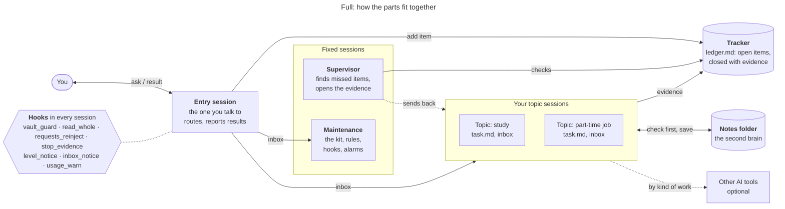
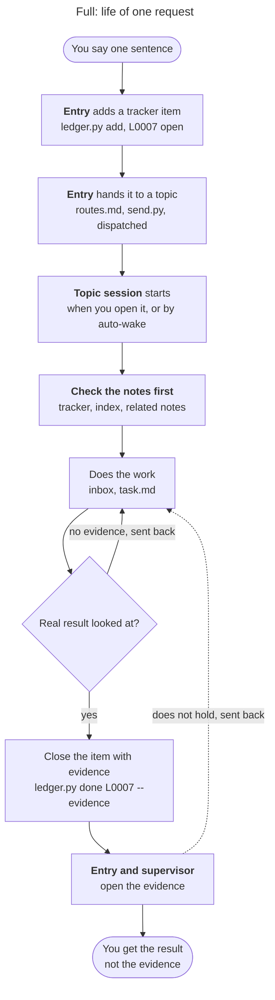
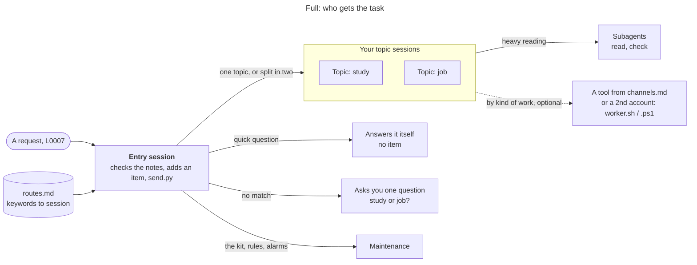
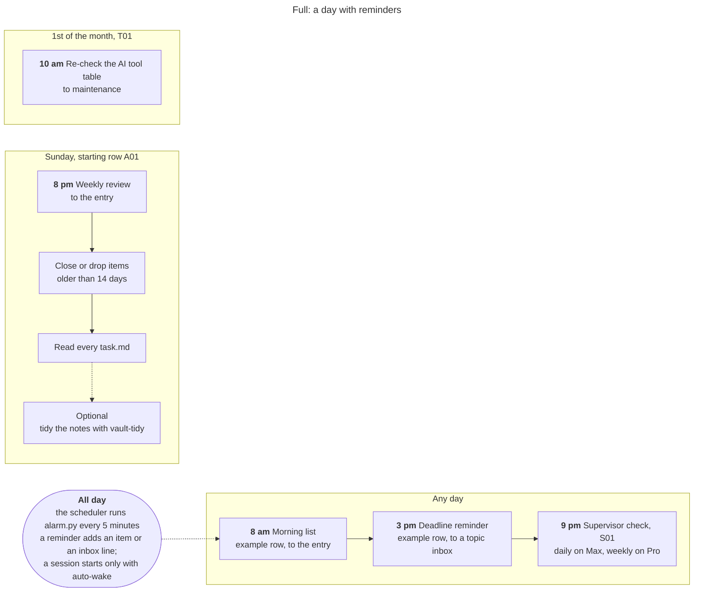
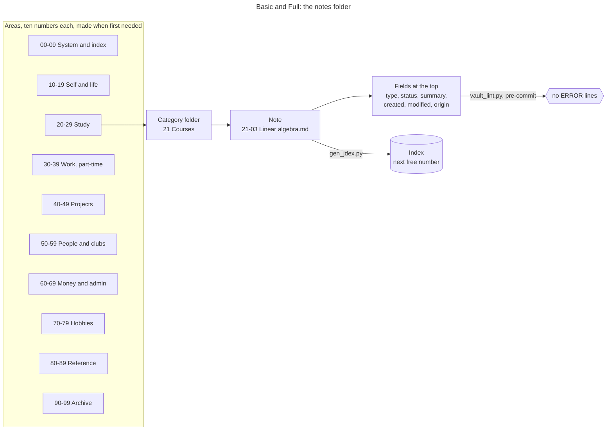
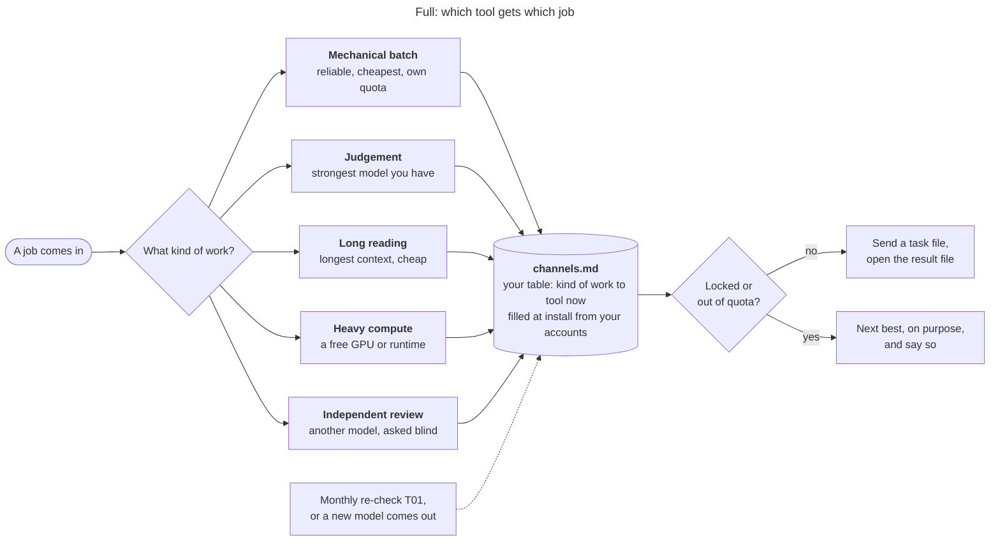

# Full plan and advanced features

[繁體中文](zh-TW/進階功能.md) · [Back to the README](../README.md)

Basic is one main Claude session in your notes folder, the tracker (`ledger.py`: what is still open, one item per line, each closed with a note of how it was checked) that Claude keeps for you, and safety checks. Everything on this page is already in the kit but **does nothing until it is switched on**. At install ([SETUP.md](SETUP.md)) Claude suggests each part from your answer and switches on only the ones you confirm (any extra part = Full); the rest waits until what happens to you shows it would help (table below).

To switch something on, tell Claude, for example: "Turn on topic sessions", "Remind me every Sunday to review", "Make the done-check stricter", "Wake the supervisor automatically". Claude does it with the steps at the end of this page.

## Basic and Full

Full is not one big switch: each part (A1-A5 below) is switched on by itself, and any part on makes it Full.

| | Basic | Full |
|---|---|---|
| Sessions | One main session in your notes folder | **Entry** (the only one you talk to), **supervisor** (checks for missed items and "done" claims that do not hold), **maintenance** (the kit, rules, hooks, alarms), plus one session per subject of yours (A1) |
| Tracker (`ledger.py`) | Claude adds and closes items, each with a note of how it was checked | The same file, shared by every session; the entry and the supervisor open that evidence. You get only the result |
| Before every task | Claude checks the notes first | Every session checks the notes first |
| Notes folder, asking before delete/upload, your own words put back | Yes | Yes |
| Done-check | Writes a log line only | Log, or stops Claude once to check first (A4, if you want) |
| Reminders | None | `alarms.md` + the computer's scheduler: weekly review, the supervisor's check, the monthly tool re-check, your own rows (A2) |
| Who starts a session | You, by opening it | You, by opening it. **Sessions never start by themselves** unless you chose auto-wake for them (uses your quota) |
| Other AI tools | Not used | A table by kind of work, filled from the accounts you have and re-checked every month (A5) |
| Usage warning | Off | On if you ask (A3) |
| Quota | Only what you do | More: several sessions, the supervisor's check, and auto-wake if chosen |
| Suits | One person, a few things at a time; new to Claude Code | Several subjects that get mixed up; deadlines you forget; auto-wake fits Max, Team or Enterprise plans |
| How to switch | Say "Turn on topic sessions" (or any part) | Say "Turn off X" or "Back to Basic": modes go back to the Basic values, your files stay |

Suggested wake by plan (asked at install, changeable any time): Pro - all manual, supervisor weekly; Max, Team, Enterprise - supervisor woken automatically every evening, topics manual; API (pay per use) or not sure - all manual, supervisor weekly.

## When Claude suggests it

At install Claude suggested each part from your answer to "where do you get stuck?" and you confirmed which to switch on (maybe none). After that, a small script, `scripts/level_check.py`, measures the rows below on your computer. The rows look at **what actually happened to you** (asking for reminders, saying things got mixed up), not at how busy you are: the number of open items, topics and summarised conversations is quoted in the question as support and never triggers anything on its own. If you said no to reading your conversations at install, it reads only the tracker and the log, not your conversations. It runs at most once a week when you open Claude in your notes folder (the `level_notice` check) and every time you run `/sbk-status`. It never changes a setting. When a row holds, Claude asks you **one yes/no question** with the numbers and switches the part on only after a yes. After a no it does not ask about that part again for four weeks. A part that is already on is never offered.

| Trigger (measured; id in the script's output) | What gets switched on | What Claude does to switch it on |
|---|---|---|
| In notes-folder conversations in the last 7 days you said 2 or more times that things got mixed up (for example "you mixed up the two reports", "not that project"); open items, topics and summarised conversations are quoted as support (`multi_session`) | The Full sessions: entry, supervisor, maintenance + topic sessions (A1) | A1 below: the three fixed sessions and one session per topic (topics = the `[topic]` tags of the open items), `routes.md`, `inbox_notice` -> warn, the wake choice, how to open each one |
| You asked Claude to remind you 2 or more times in the last 7 days, or an open item with `due YYYY-MM-DD` is still open 3 or more days after that date (`alarms`) | Reminders (A2) | A2 below: `alarms.md` with a row for that date; the computer's scheduler only after a separate yes |
| The done-check has been logging for 14 days or more, at least 20 flagged replies could be judged (small samples mislead), and fewer than 25% were false alarms; a false alarm is a flagged reply after which your next message did not report a problem (`block_mode`) | Stricter done-check (A4) | A4 below: `stop_evidence` -> block |
| You said you have an account for another AI tool (at setup, or by telling Claude later); just naming a tool in a conversation does not count (`multi_tool`) | The table for splitting work by kind (A5), only tools you have | A5 below: `channels.md` filled from your accounts, one tiny real job, the monthly re-check |
| You ask for any part yourself, including the usage warning (A3) | That part | Its steps below |

Saying no is recorded with `level_check.py --decline <id>`; the script writes only its own file `~/.claude/sbk/state/level_check.json`.

## The parts, in plain words

- **The Full sessions.** Instead of one main session, you get one *entry* session that takes every request and tells you the results, plus two fixed sessions every Full install has, plus one session per subject of yours (study, job, a project ...):
  - **Supervisor:** looks at the entry and every topic for things that were missed and opens the evidence of items marked done; what does not hold goes back to that topic. It runs on a schedule that fits your plan (daily on Max-class plans, weekly on Pro).
  - **Maintenance:** the kit itself - rules, safety checks, reminders, the AI tool table, updates.
  The entry writes each request in the tracker and passes it to the right session through that session's *inbox* (a short text file). **Writing to an inbox does not run anything.** A session sees the new line when you open it (the `inbox_notice` check shows it at the start). If you never open that session, the work waits - unless you chose auto-wake for it: then the scheduler starts it in the background when its inbox has work (at most once an hour per session; this uses your quota).
- **Evidence is for the sessions, not for you.** A topic closes its tracker item with what it looked at; the entry and the supervisor open that. You hear only the result: what is done, where to see it, what could not be checked.
- **Reminders.** A small table (`alarms.md`) of reminders: daily, weekly, monthly or once. The computer's scheduler checks it every five minutes; a due reminder adds an item to the tracker or a line to an inbox. It never interrupts a conversation; you see it the next time you talk to Claude (or, with auto-wake, that session starts).
- **Usage warning.** Warns once when your weekly Claude usage passes 80%. It reads the same numbers as Claude Code's `/usage` screen; that source is not an official interface and may stop working, in which case the warning stays silent.
- **Stricter done-check.** In Basic, the done-check only writes a note in a log when Claude says "done" after an edit without looking at the result. In strict mode it stops Claude once and asks it to check first.
- **Other AI tools.** No tool gets a fixed job: models keep changing. The kit gives rules by kind of work (mechanical batch, judgement, long reading, heavy compute, independent review); your Claude fills a table from the accounts you have, picking for each kind the tool that is best right now and has quota, and re-checks it every month or when a new model comes out. One Claude account is enough; nothing here is needed. Details: [MULTI-TOOL.md](MULTI-TOOL.md).

## Pictures

Each picture is a Mermaid diagram that GitHub draws; open "Drawn version" for the larger image ([all files](diagrams/)). The title of each says whether it shows Basic or Full.

### 1. Full: how the parts fit together

You talk only to the entry session. It writes each request to be tracked in the tracker and hands it to a session. Topic sessions check the notes first, do the work and close their tracker items with evidence; the supervisor opens that evidence and sends back what does not hold; maintenance looks after the kit itself. You get the results from the entry.

What each hook does (Basic on/off; Full switches on the ones marked):
- `vault_guard` - asks you before Claude pushes, deletes a whole folder, throws away git work, skips git checks, changes protected rule files or shrinks a note to a fraction of it. Basic: on.
- `read_whole` - in the notes folder, stops Claude from judging a note by its first lines; it reads the note to the end. Basic: on.
- `requests_reinject` - when a long conversation is summarised, puts your own messages back word for word. Basic: on.
- `stop_evidence` - notices when Claude says "done" after a change without looking at the result. Basic: on, writes a log line only; Full can make it stop Claude once (A4).
- `level_notice` - about once a week, in the notes folder, asks one yes/no question when what happened to you shows another part would help. Basic: on.
- `inbox_notice` - when a session opens, and at each message, shows the work waiting in its inbox. Basic: off; Full sessions switch it on (A1).
- `usage_warn` - warns once when your weekly Claude usage passes 80%. Basic: off; on only if you ask (A3).

Drawn version

[SVG](diagrams/01-architecture.svg) · [PNG](diagrams/01-architecture.png)

### 2. Full: life of one request

A request becomes a tracker item, is handed over, and the topic session checks the notes before it works. The item is closed only with evidence; a "done" without it is sent back. The entry and the supervisor open the evidence; you get the result.

The tracker refuses a "done" without evidence. With the stricter done-check (A4) the Stop check also asks Claude once more.

Drawn version

[SVG](diagrams/02-request-life.svg) · [PNG](diagrams/02-request-life.png)

### 3. Full: who gets the task

The entry reads `routes.md` to pick the session. Quick questions it answers itself, without an item. Anything about the kit, rules or reminders goes to maintenance. Heavy reading goes to subagents (helpers Claude starts inside the same session); other tools only by the kind-of-work table, if you have them.

Drawn version

[SVG](diagrams/03-task-dispatch.svg) · [PNG](diagrams/03-task-dispatch.png)

### 4. Full: a day with reminders

The scheduler runs every five minutes and fires due rows of `alarms.md` into the tracker or an inbox. The weekly review is the row the kit starts with; the supervisor's check (S01) comes with the Full sessions; the monthly tool re-check (T01) comes with other AI tools; the morning list and the deadline reminder are examples you can add. A session that gets a line starts only when you open it, or by auto-wake if you chose it.

Drawn version

[SVG](diagrams/04-day-timeline.svg) · [PNG](diagrams/04-day-timeline.png)

### 5. Basic and Full: the notes folder and the note format

This part is the same in Basic and Full; you never need to learn it, Claude follows it. Numbered folders (the Johnny Decimal method: areas of ten numbers, categories, numbered notes), six fields at the top of each note, an index Claude regenerates, and a checker. An area or category folder is created the first time a note needs it.

Drawn version

[SVG](diagrams/05-vault-folders.svg) · [PNG](diagrams/05-vault-folders.png)

### 6. Full: which tool gets which job

No tool has a fixed role. Claude names the kind of work, reads your table (`channels.md`) for the tool that is best for it right now, and checks it is not locked. With only Claude, every row says Claude and heavy reading goes to subagents.

Drawn version

[SVG](diagrams/06-tool-routing.svg) · [PNG](diagrams/06-tool-routing.png)

---

## Steps for Claude (A1-A5)

Written for the Claude that switches a part on. Words (`KIT`, `SBK_HOME`, `VAULT`), rules and status words are the same as in [SETUP.md](SETUP.md); Basic must already be installed (during setup, SETUP Step 5b runs these steps right after Basic). Do only the part the user agreed to or the setup decision called for. When the first part is switched on, set `"level": "full"` in `SBK_HOME/config.json`; change only the `modes` (and, for A1, `wake`) named in that part and keep every other value. Report each part with a status word.

### A1 - The Full sessions: entry, supervisor, maintenance and topics

1. `SBK_HOME/entry/CLAUDE.md` <- `KIT/templates/entry-CLAUDE.md`, with `{{vault}}` replaced.
2. The two fixed sessions, always: `SBK_HOME/managers/supervisor/CLAUDE.md` <- `templates/supervisor-CLAUDE.md` and `SBK_HOME/managers/maintenance/CLAUDE.md` <- `templates/maintenance-CLAUDE.md` (fill `{{vault}}`), each with a `task.md` from `templates/task.md` (`{{topic}}` = supervisor / maintenance).
3. The user's topics, two to four: during setup, the things the user named (SETUP Step 5b, no question); after a weekly-check yes, the `[topic]` tags of the open tracker items; otherwise ask "Which two subjects should get their own conversation?". For each: a short ASCII id (`study`, `work`), `SBK_HOME/managers/<id>/CLAUDE.md` <- `templates/manager-CLAUDE.md` (fill `{{manager}}`, `{{vault}}`, `{{scope}}` with one line in the user's words), `SBK_HOME/managers/<id>/task.md` <- `templates/task.md` (fill `{{topic}}`). If `SBK_HOME/task.md` from Basic has open items, ask which topic it belongs to and move it there.
4. `SBK_HOME/routes.md` <- `templates/routes.md`: keep the supervisor and maintenance rows, one row per topic id with 5-10 words the user would really say.
5. `config.json` -> `"modes": {"inbox_notice": "warn"}`, and `"wake"` from the setup decision (SETUP Step 0.4); asked later, suggest by `plan` with the same table, and only `auto` if `claude --version` runs.
6. The supervisor's schedule: create `SBK_HOME/alarms.md` from `templates/alarms.md` if it does not exist (never replace one) and add `| S01 | daily 21:00 | supervisor | Check the entry and every topic: missed items, open the evidence of done items |` for Max, Team or Enterprise, or `| S01 | weekly sun 19:00 | supervisor | ... |` for Pro, API or unknown. Rows fire only with the scheduler: ask A2's scheduler question now if it was not asked yet. A no: the row stays, the supervisor checks only when the user opens it, and `wake` stays manual (say so).
7. How to open each session (entry, supervisor, maintenance, each topic), by `SURFACE` (SETUP Step 0.2). Terminal, a launcher like SETUP Step 5 per session: entry `cd "<SBK_HOME>/entry"` then `claude --add-dir "<VAULT>" -n entry`; others `cd "<SBK_HOME>/managers/<id>"` then `claude --add-dir "<VAULT>" -n <id>`. App, no launcher file: **+ New**, **Open folder…** `<SBK_HOME>/entry` (or `<SBK_HOME>/managers/<id>`), then click **+** next to the prompt box, **Add folder**, `<VAULT>` (the app's equivalent of `--add-dir`), and rename the session to `entry` or `<id>` by clicking its title. Update the start section of `VAULT/README.md`: new requests go to the entry; results come from the entry. The Basic way of opening (launcher, or the notes-folder session in the app) may stay for quick note questions.
8. Tell the user plainly: "Writing to an inbox does not start anything. A session works on it when you open it" - and, only for sessions with auto-wake: "the scheduler starts it when it has work, at most once an hour; that uses your quota."

**Check:** `python SBK_HOME/bin/send.py <id> "setup check A1"` prints `<new id> -> <id>` (use the printed id); `SBK_HOME/inbox/<id>.md` has the line; `echo '{"cwd":"<SBK_HOME>/managers/<id>","hook_event_name":"SessionStart"}' | python KIT/hooks/inbox_notice.py` prints it; `status.py` lists it; `managers/supervisor/CLAUDE.md` and `managers/maintenance/CLAUDE.md` exist; `alarm.py --list` shows S01 and the line `wake: supervisor=... topics=...` matches `config.json`. Then `ledger.py drop <new id> --evidence "A1 setup test item"` and tick the inbox line `[x]`.

### A2 - Reminders

1. `SBK_HOME/alarms.md` <- `templates/alarms.md` if it does not exist (never replace an existing one). One sentence to the user: the starting row is a weekly review on Sunday 20:00; every row must lead to an action. Rows may be daily, weekly, monthly or once.
2. Ask: "OK to add a scheduled task that checks the reminders every 5 minutes?" (skip if already answered in A1). After a yes:
   - Windows: `schtasks /Create /SC MINUTE /MO 5 /TN sbk-alarm /TR "\"<path to pythonw.exe>\" \"%USERPROFILE%\.claude\sbk\bin\alarm.py\" --tick"` (`pythonw.exe` so no window flashes)
   - macOS/Linux: add `*/5 * * * * python3 "$HOME/.claude/sbk/bin/alarm.py" --tick` with `crontab -e`.
   A no is **not enabled**: reminders do not fire by themselves, `alarm.py --fire A01` still works by hand, and the scheduler check below is skipped.
   The same tick honours `config.json` `"wake"`: with `auto` it also starts sessions whose inbox has work (see A1).

**Check:** `python SBK_HOME/bin/alarm.py --list` shows the rows; `schtasks /Query /TN sbk-alarm` (or `crontab -l`) shows the entry (or the scheduler is **not enabled**). Test firing **in a throw-away folder**, never in the real `SBK_HOME`: copy `alarms.md` into a new temporary folder, run `alarm.py --tick --now <next Sunday>T20:01` with the environment variable `SBK_HOME` set to that folder, confirm its `ledger.md` got the item, then delete the temporary folder. The real `state/alarms.json` is never deleted.

### A3 - Usage warning

1. `config.json` -> `"modes": {"usage_warn": "warn"}` (threshold: `"usage_warn_pct"`, default 80).
2. Tell the user it reads an unofficial source and stays silent when it cannot read it.

**Check:** with `SBK_HOME` set to a temporary folder, `SBK_MODE_USAGE_WARN=warn` and `SBK_USAGE_FAKE='{"seven_day":{"utilization":91,"resets_at":"2030-01-01T00:00:00Z"}}'`, `echo '{"session_id":"a3"}' | python KIT/hooks/usage_warn.py` prints a line with `91%`. Whether the real numbers can be read on this computer is **not verified** until a real warning appears.

### A4 - Stricter done-check

1. Replay first (with consent: `read_history` is true in `config.json`, or ask now): `python KIT/hooks/stop_evidence.py --replay <file>` on the five newest transcripts, and `SBK_HOME/logs/stop_evidence.log` if Basic has run for a while.
2. If the weekly check brought you here, its numbers already show fewer than 25% false alarms: set block. If the user asked without that, and about one turn in four or more would be flagged in the replay, tell the user it would interrupt too often and keep `log`. Otherwise set `config.json` -> `"modes": {"stop_evidence": "block"}`. It stops Claude at most once per reply.

**Check:** the replay ran on at least one transcript (or the log), and `config.json` shows the mode you chose.

### A5 - Other AI tools

Only tools the user said they have. Read [MULTI-TOOL.md](MULTI-TOOL.md): "Ground rules for every extra tool", "Kinds of work", "Filling and re-checking the table", and, under "Lessons from specific tools", the sections of the tools they have. Do not give any tool a fixed role.
1. `SBK_HOME/channels.md` <- `templates/channels.md`: one row per account, and the "Kind of work -> tool now" table filled for every kind (the tool they have that is best for it now and has quota, one line why, today's date; Claude where nothing is better).
2. Second Claude account: the user runs `/login` once with `CLAUDE_CONFIG_DIR` set to a new folder for that account (**needs you**: give the exact command for their OS); then `entry/worker.ps1 -DryRun` or `SBK_DRYRUN=1 entry/worker.sh` and read the printed command.
3. Codex, Gemini CLI, OpenRouter: the version command or a one-line job runs. Tools used only in a web browser (ChatGPT or Gemini websites, Colab) are **not verified** by you; write down how the user hands a task file over.
4. One tiny real job per tool whose result is a file; open the file.
5. Full with A2's scheduler: add the monthly re-check row `| T01 | monthly 1 10:00 | maintenance | Re-check channels.md: best tool per kind of work, new models, quota |` to `alarms.md` (A1 makes the maintenance session; without it, put the row `to` `entry`).

**Check:** each tool has a row in `channels.md`, every kind of work has a "tool now", there is a result file you opened (or **not verified** for web-only tools), and `alarm.py --list` shows T01 when the scheduler is on. Tools the user does not have appear nowhere.

### Switching a part off, or changing the wake choice

- Off: set its mode back to the Basic value (`templates/config.json`), delete the scheduler entry for A2, and leave the files (`routes.md`, `alarms.md`, inboxes, `state/`) in place unless the user asks to delete them.
- Wake: the user says, for example, "Wake the supervisor automatically" or "Nothing should start by itself": change only `"wake"` in `config.json` (`auto` needs the scheduler and the `claude` command), then show `alarm.py --list`.
