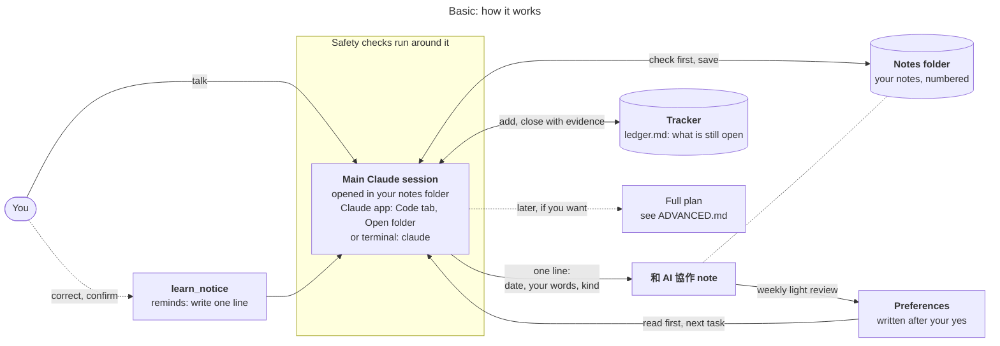
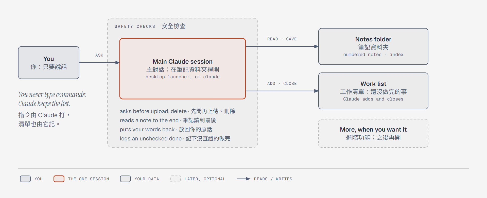
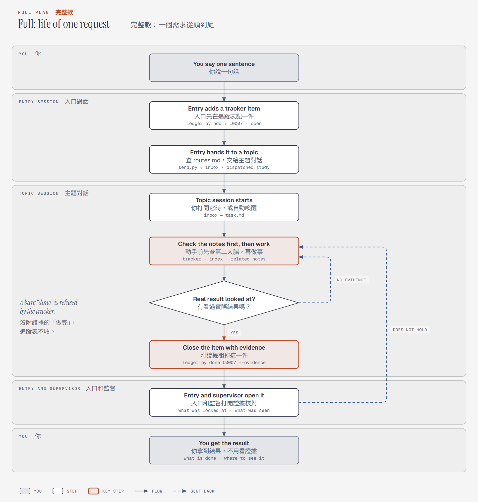

# How it works

[繁體中文](zh-TW/運作原理.md) · [Back to the README](../README.md)

The picture of Basic, the pictures of Full, and what is in the folder.

## The picture



<details><summary>Drawn version</summary>



[SVG](diagrams/00-basic.svg) · [PNG](diagrams/00-basic.png)

</details>

You talk to one Claude conversation that starts inside your notes folder. It checks your notes (including the 和 AI 協作 note of your corrections) before it starts anything, saves what is worth keeping, writes a line whenever you correct or confirm it, and keeps the tracker; you never type commands.

## More pictures (Full)

Each picture also has a Mermaid version in [ADVANCED.md](ADVANCED.md).


[SVG](diagrams/01-architecture.svg) · [PNG](diagrams/01-architecture.png)



[SVG](diagrams/02-request-life.svg) · [PNG](diagrams/02-request-life.png)


[SVG](diagrams/03-task-dispatch.svg) · [PNG](diagrams/03-task-dispatch.png)


[SVG](diagrams/04-day-timeline.svg) · [PNG](diagrams/04-day-timeline.png)


[SVG](diagrams/05-vault-folders.svg) · [PNG](diagrams/05-vault-folders.png)


[SVG](diagrams/06-tool-routing.svg) · [PNG](diagrams/06-tool-routing.png)

## For the curious

```
.claude-plugin/   plugin and marketplace files
skills/           setup-second-brain, evidence-before-done, vault-tidy, multi-tool-routing (outside resources, Full), and the general ones: evidence-check, outward-docs, blind-three-way, full-reader
commands/         /sbk-setup, /sbk-status
hooks/            the safety checks and the end-of-reply commit of changed notes (Python 3, standard library only)
entry/            tracker (ledger.py), status, reminders, live routing (session.py), hand-over (handover.py), learning loop (learn.py), worker tools
templates/        rules for Claude, the notes folder guide, note format, the 和 AI 協作 note (Chinese and English, with the starter preferences), settings, Full templates (entry, maintenance, topics)
scripts/          note checker, index maker, overwrite guard, level check, selftest
docs/             SETUP, ADVANCED, PITFALLS, MULTI-TOOL = outside resources; zh-TW = the pages for readers in Chinese; docs/diagrams = the pictures
experimental/     pieces that are not proven yet
```

- `python scripts/selftest.py` tests every check and tool in a throw-away folder.
- [docs/PITFALLS.md](PITFALLS.md): what went wrong in real use and why the defaults are what they are.
- [experimental/](../experimental/README.md): what is not proven yet. The usage warning (Full) reads the same numbers as Claude Code's `/usage` screen, which is not an official interface. The done-check judges from the order of Claude's actions and a word list for "done"; it can miss cases or, rarely, flag a fine one, which is why Basic only logs it.
