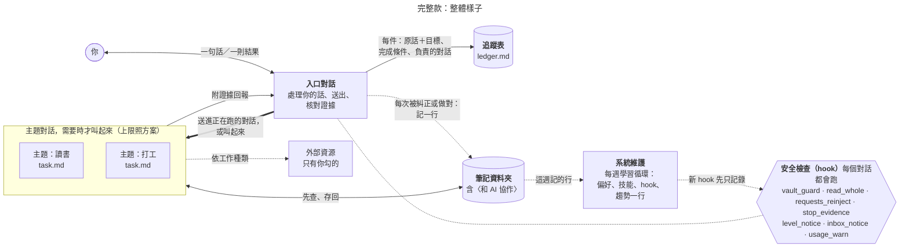
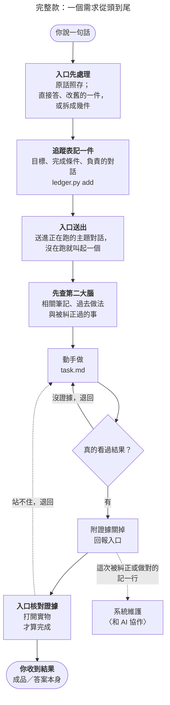
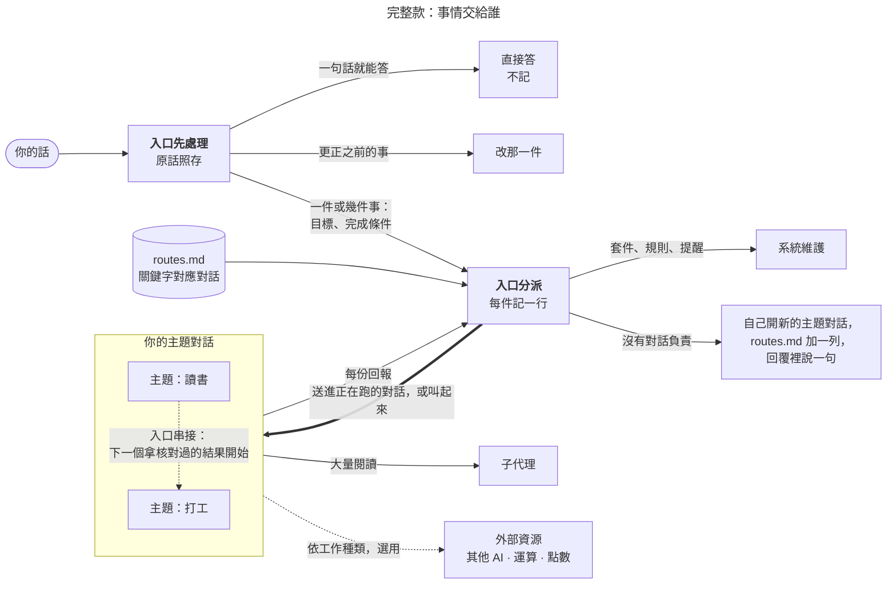
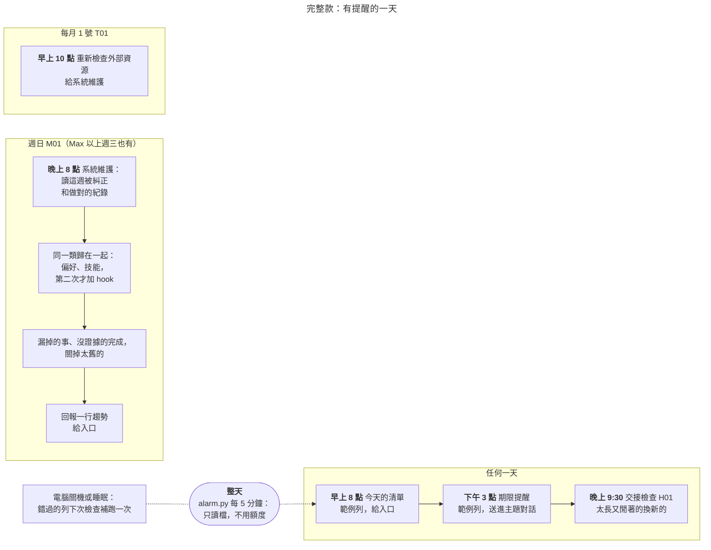
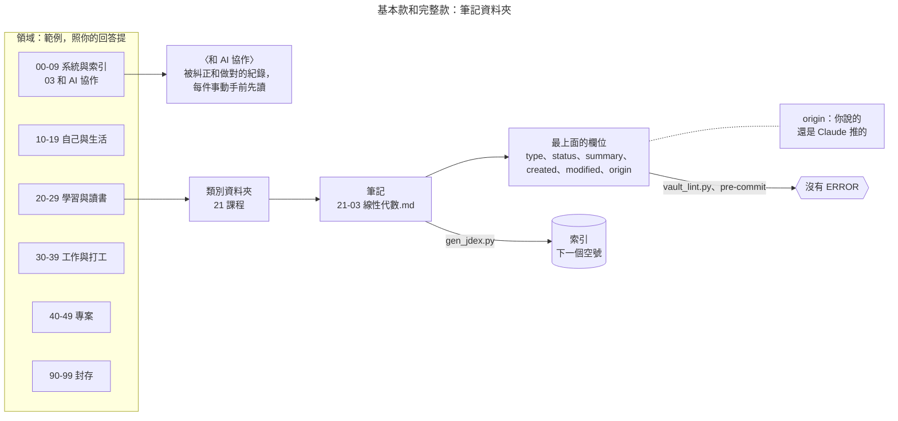
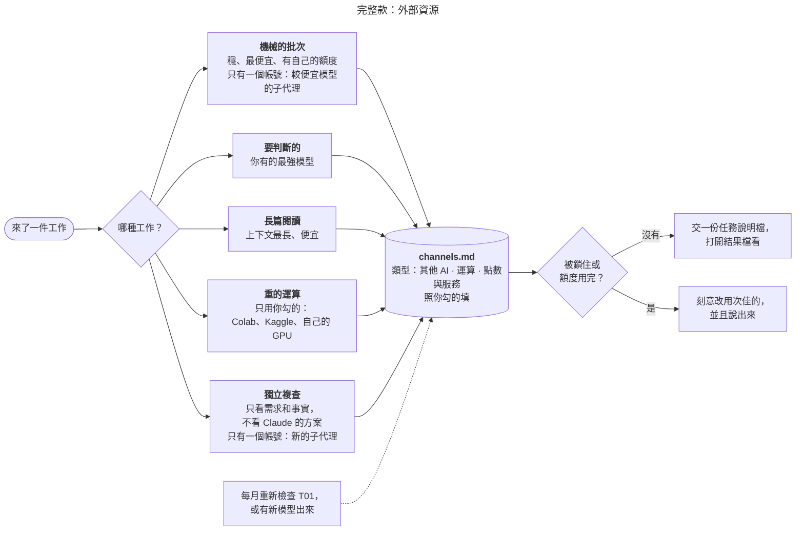

# 完整款與進階功能

[English](../ADVANCED.md) · [回到說明首頁](../../README.zh-TW.md)

基本款是一個在筆記資料夾裡的主對話、一份 Claude 替你記的追蹤表（`ledger.py`：還沒做完的事，一件一行，做完時附上怎麼確認的）、幾個安全檢查，以及一張筆記：你每次糾正 Claude、或確認它做對了，它都記一行。這一頁的東西都已經在套件裡，但**沒開啟之前完全不會作用**。安裝時（[SETUP.md](SETUP.md)），Claude 照你的回答逐項建議，只開你確認的那幾項（加開任何一項就叫完整款）；其他的等你真的遇到下面表裡的狀況時再問你。

要開哪一項，直接跟 Claude 說，例如：「幫我開主題對話」「每週日提醒我整理一次」「做完檢查嚴格一點」「重的工作用我的 Colab 跑」。Claude 會照這一頁最後的步驟做。

## 基本款和完整款

完整款不是一個大開關：下面 A1–A5 每一項各自開，開了任何一項就是完整款。

| | 基本款 | 完整款 |
|---|---|---|
| 對話 | 一個在筆記資料夾裡的主對話 | 兩個固定對話：**入口**（你唯一需要說話的對話）和**系統維護**（套件本身：規則、安全檢查、提醒，以及每週的學習循環），再加上你自己的每件事一個主題對話，由入口開、把事送進去（A1） |
| 追蹤表（`ledger.py`） | Claude 自己記、自己附證據關掉 | 同一份，所有對話共用；主題對話回報給入口，入口打開證據核對。你收到一則結果 |
| 每件事開始前 | Claude 先查筆記，包括〈和 AI 協作〉那張 | 每個對話都先查筆記，包括〈和 AI 協作〉那張 |
| 從使用中學習 | 你每次糾正、每次說「對，就是這樣」，都在〈和 AI 協作〉記一行，下次遇到類似的事先讀 | 一樣，再加上系統維護的每週檢視：把同一類的行整理成偏好、技能，以及（只有同一類錯第二次出現、而且程式看得出來時）新的 hook；每週一行趨勢 |
| 長對話 | 變長時，Claude 把交接寫進 task.md，請你開新對話說「繼續」 | 一樣；在背景跑、超過上限（150k token）又閒著的對話，自動換成新的接手（`handover.py`） |
| 筆記資料夾、刪除或上傳前先問你、把你的原話放回去 | 有 | 有 |
| 做完檢查 | 只在紀錄檔記一筆 | 記一筆，或先攔下 Claude 一次要它檢查（A4，你要才開） |
| 提醒 | 沒有 | `alarms.md` 加電腦的系統排程：每週檢視、每月重新檢查外部資源、每天的交接檢查、你自己加的列（A2） |
| 外部資源 | 不用 | 一張依工作種類分的表，只放你安裝時勾的（其他 AI、運算、點數與服務），每月重新檢查（A5） |
| 用量提醒 | 關 | 你要才開（A3） |
| 額度 | 只有你自己做的事 | 每個正在跑的對話都像一般對話一樣用你的額度；閒著的不用。照方案設上限：同時幾個對話、提醒一天最多叫起幾次 |
| 適合 | 一個人、同時幾件事；剛開始用 Claude Code | 好幾件事常被搞混；常忘記期限 |
| 怎麼切換 | 說「幫我開主題對話」（或任何一項） | 說「把 X 關掉」或「回到基本款」：模式改回基本款的值，你的檔案都留著 |

hook 和每週檢視分工不同：**hook 擋的是 Claude 動手那一刻程式就看得出來的錯；每週檢視抓的是要把整週讀回來才看得出來的事**（沒人接的事、沒證據的「做完了」、同一種錯又犯）。

## 費用

每五分鐘跑一次的提醒檢查只讀你電腦上的檔案，**完全不用** Claude 額度。只有叫起一個 Claude 對話、或傳訊息給它才會用。所以安裝時照方案給起始值，你的 Claude 之後可以調（調了會跟你說）：

| 方案 | 同時跑的主題對話（`max_sessions`） | 提醒叫起或傳訊息給對話（`wake_limits`） | 每週檢視 |
|---|---|---|---|
| Pro | 2 | 一天 4 次，同一個對話間隔 120 分鐘 | 週日 20:00 |
| Max | 4 | 一天 12 次，間隔 60 分鐘 | 週三和週日 20:00 |
| Team、Enterprise 或更高 | 6 | 一天 24 次，間隔 30 分鐘 | 週三和週日 20:00 |
| API（用多少付多少）或不確定 | 2 | 一天 4 次，間隔 120 分鐘 | 週日 20:00 |

超過上限時，工作留在那個對話的收件匣，之後再跑。電腦關機或睡眠時什麼都不會跑；下次檢查時，錯過的提醒**只補跑一次**，標上「(late)」，不管錯過幾次。

## Claude 什麼時候會提議

安裝時，Claude 已經照你對「最常卡在哪」的回答逐項建議、你確認過要加開哪幾項（可能一項都沒有）。之後由一個小程式 `scripts/level_check.py` 在你的電腦上量下面這張表。表裡看的是你**真的遇到的狀況**（例如請 Claude 提醒、說事情搞混），不是事情多不多：沒做完的事有幾件、分幾個主題、對話被濃縮幾次，只當佐證附在問題裡，單獨不會觸發。安裝時你說不要看對話紀錄的話，它只看追蹤表和紀錄檔，不讀對話。它最多一週跑一次（你在筆記資料夾裡打開 Claude 時，由 `level_notice` 這個檢查啟動），你每次用 `/sbk-status` 時也會跑。它不改任何設定。表裡某一列成立時，Claude 會附上數字問你**一個要不要的問題**，你說好才開。你說不要，那一項四週內不會再問。已經開著的不會再提。

| 量到什麼（括號是程式輸出裡的代號） | 會開哪一項 | Claude 怎麼開 |
|---|---|---|
| 最近 7 天在筆記資料夾的對話裡，你有 2 次以上說事情搞混了（例如「你把兩個作業搞混了」「不是那個專案」）；沒做完的事幾件、幾個主題、對話被濃縮幾次附在問題裡當佐證（`multi_session`） | 完整款的對話：入口、系統維護＋主題對話（A1） | 照下面 A1：兩個固定對話和每個主題一個對話（主題＝沒做完項目的 `[主題]` 標籤）、`routes.md`、這台電腦做得到就開即時派送、入口怎麼打開 |
| 最近 7 天你請 Claude 提醒你 2 次以上，或有寫 `due YYYY-MM-DD` 的項目過了日期 3 天以上還沒做完（`alarms`） | 提醒（A2） | 照下面 A2：`alarms.md` 加上那個日期的一列；電腦的系統排程要你另外說好才加 |
| 做完檢查已經記錄 14 天以上，至少 20 次被標出的回覆可以判斷（次數太少會誤導），而且誤判不到 25%；誤判是指被標出之後，你的下一句話沒有反映出問題（`block_mode`） | 嚴格的做完檢查（A4） | 照下面 A4：`stop_evidence` 改成 block |
| 你說過你有外部資源（安裝時勾的，或之後跟 Claude 說）；對話裡只是提到名字不算（`multi_tool`） | 外部資源表（A5），只接你有的 | 照下面 A5：照你勾的填 `channels.md`、每個做一件很小的真工作、每月重新檢查 |
| 你自己要某一項，包括用量提醒（A3） | 那一項 | 照下面那一項的步驟 |

你說不要時，Claude 會執行 `level_check.py --decline <代號>` 記下來；這個程式只寫它自己的檔案 `~/.sbk/state/level_check.json`。

## 每一項是什麼（白話）

- **完整款的對話。** 原本只有一個主對話；開了之後變成一個*入口對話*收你所有的需求、給你所有的結果，一個*系統維護*對話，再加上你自己的每件事各一個對話（讀書、打工、某個專案……）：
  - **入口：** 先把你的話處理過：一句話就能答的直接答、不記；更正之前交代的事，就改那一件，不另記一件；一則訊息裡有好幾件事，就拆成好幾件。每一件都保留你的原話，再加上目標、做到什麼算完成、歸哪個對話。然後**直接把事送進正在跑、負責那件事的對話**；它沒在跑就叫起來；沒有對話負責這一類的，入口自己開一個新的主題對話、在 `routes.md` 加一列，回覆裡用一句話告訴你。
  - **主題對話**先查筆記、做事、附證據關掉那一件，**回報給入口，不直接找你**。要兩個主題合作的事，由入口串起來。入口打開證據（真的檔案或網頁）才算完成；你收到**一則結果**：成品或答案本身、在哪看，以及只有你能做的事（登入、按送出——頁面會先開好等你）。
  - **系統維護：** 管套件本身（規則、安全檢查、提醒、外部資源表、更新），以及下面的**學習循環**。
  同時最多跑 `max_sessions` 個主題對話（照方案）；閒著的不用額度。到上限時，入口停掉最久沒動、閒著的那個（它的狀態在 `task.md` 裡），不然工作就留在收件匣等。
  背景對話跑不起來的地方（只有桌面 App、沒有 `claude` 指令、版本太舊），工作留在那個對話的*收件匣*（一個短短的文字檔），入口告訴你要打開哪個對話；那個對話打開時會顯示等著的工作。
- **學習循環。** 你每次糾正 Claude、每次確認它做對了，它當下就在〈和 AI 協作〉記一行：日期、你的原話、哪一類錯或哪一種做法（`learn.py add`）。「動手前先查第二大腦」會讀這張，所以下次遇到類似的事就看得到。基本款做到這裡。完整款再加上系統維護的每週檢視（Pro 每週一次，Max 以上每週兩次）：讀這一週的對話和追蹤表，把同一類的行歸在一起，變成：寫在筆記最上面的偏好；做對的做法補進對應的技能；**只有**同一類錯第二次出現、**而且**程式在動手那一刻看得出來時，才加一個 hook。新的 hook 先用只記錄的模式，拿過去的對話重播過，才可以擋。每次檢視回報一行趨勢：這週被糾正幾次、哪幾類又出現，和上週比。
- **長對話自動交接。** 每個對話的狀態只放在它的 `task.md` 和一個存你原話的檔。在背景跑的對話超過 150k token（`handover_tokens`）又閒著時，每天的檢查請它把交接寫進 `task.md`、把你的原話抄出來、停掉它，再開一個同名的新對話，先讀這兩個檔。你正在打字的視窗裡的對話（基本款的主對話，或你在用的入口）沒辦法用程式換掉：Claude 會寫好交接，請你開新對話說「繼續」。
- **證據是給對話看的，不是給你看的。** 主題對話關掉追蹤表上的一件事時，寫下它看了什麼；入口去打開核對。你只會聽到結果。
- **提醒。** 一張小小的提醒表（`alarms.md`）：每天、每週、每月或一次。電腦的排程每五分鐘看一次。到時間的提醒先記一件或在收件匣加一行，再（有即時派送時）直接送進正在跑的對話，或把它叫起來，不超過方案的上限。
- **用量提醒。** 你這週的 Claude 用量超過 80% 時提醒一次。它讀的是和 Claude Code `/usage` 畫面同一個來源；那不是官方公開的介面，可能哪天就讀不到，讀不到時就不出聲。
- **嚴格的做完檢查。** 基本款裡，Claude 改了東西、沒看結果就說「做完」時，這個檢查只會在紀錄檔記一筆。嚴格模式會攔下 Claude 一次，要它先檢查。
- **外部資源。** 這個 Claude 帳號以外你有的一切：其他 AI（第二個 Claude 帳號、Codex、網頁版 ChatGPT 或 Gemini）、運算（Colab、Kaggle、自己的 GPU）、點數與服務（Azure for Students、Copilot、API 點數）。安裝時你勾你有的；只有勾的才進表，可以免費註冊的標「可免費申請」。不替任何資源固定角色：每一種工作用現在量起來最好、還有額度的，每個月重新檢查。只有一個 Claude 帳號時，機械的工作交給用較便宜模型的子代理，獨立複查交給一個沒看過原本答案的新子代理。細節見[參考-多工具分工.md](參考-多工具分工.md)。

## 圖解

每張都是 GitHub 會直接畫出來的 Mermaid 圖；點開「完整版圖片」看大張的（[全部檔案](../diagrams/)；完整版圖片的標題是英文，附繁中小字）。每張的標題都寫了它畫的是基本款還是完整款。

### 1. 完整款：整體樣子

你只跟入口說話。它把你的話處理過、記進追蹤表，再把每件事送進負責的主題對話（正在跑的，或現在叫起來）。主題對話先查筆記、做事、附證據回報入口；入口打開核對，給你一則結果。系統維護每週拿〈和 AI 協作〉跑學習循環。



每個安全檢查（hook：Claude Code 在特定時機自動跑的小程式）負責什麼（基本款開／關；完整款會開的有寫）：
- `vault_guard`——Claude 要推上遠端、刪掉整個資料夾、丟掉 git 裡的工作、跳過 git 檢查、改受保護的規則檔，或把一張筆記砍到剩一小部分前，先問你。基本款：開。
- `read_whole`——在筆記資料夾裡，不讓 Claude 只看筆記開頭幾行就下判斷，要讀到最後。基本款：開。
- `requests_reinject`——長對話被濃縮時，把你自己說過的話一字不差放回去；對話長到該交接時，提醒 Claude 寫交接、請你開新對話。基本款：開。
- `stop_evidence`——發現 Claude 改了東西、沒看結果就說「做完」。基本款：開，只記一筆；完整款可以改成攔下一次（A4）。
- `level_notice`——大約一週一次，在筆記資料夾裡，你遇到的狀況顯示另一項會有幫助時，問你一個要不要的問題。基本款：開。
- `inbox_notice`——對話打開時和每次你傳訊息時，顯示它收件匣裡等著的工作；在入口另外列出做完、等它核對的事。基本款：關；完整款的對話會打開（A1）。
- `usage_warn`——你這週的 Claude 用量超過 80% 時提醒一次。基本款：關；你要才開（A3）。

<details><summary>完整版圖片</summary>


[SVG](../diagrams/01-architecture.svg) · [PNG](../diagrams/01-architecture.png)

</details>

### 2. 完整款：一個需求從頭到尾

你的原話照存，處理成追蹤表上的事。事情送進正在跑的主題對話（或叫起一個）；它先查第二大腦、做事、附證據關掉。入口打開實物核對才算完成，你收到的是成品本身。



追蹤表不收沒附證據的「做完了」。開了嚴格的做完檢查（A4）的話，Stop 檢查還會再問 Claude 一次。

<details><summary>完整版圖片</summary>


[SVG](../diagrams/02-request-life.svg) · [PNG](../diagrams/02-request-life.png)

</details>

### 3. 完整款：事情交給誰

入口先處理你的話（直接答、改舊的、或拆開），再讀 `routes.md`。套件、規則、提醒的事交給系統維護。沒有對話負責的事，入口自己開一個新的主題對話。要兩個主題合作的事由入口串起來，每一份回報都回到入口。大量閱讀交給子代理（Claude 在同一個對話裡開的幫手）；有外部資源的話，依工作種類用。



<details><summary>完整版圖片</summary>


[SVG](../diagrams/03-task-dispatch.svg) · [PNG](../diagrams/03-task-dispatch.png)

</details>

### 4. 完整款：有提醒的一天

排程每五分鐘跑一次；這個檢查不用額度。到時間的列直接送進正在跑的對話，或把它叫起來，不超過方案的每日上限；超過就留在收件匣。每週檢視就是系統維護的學習循環。早上的清單和期限提醒是你可以加的例子。



<details><summary>完整版圖片</summary>


[SVG](../diagrams/04-day-timeline.svg) · [PNG](../diagrams/04-day-timeline.png)

</details>

### 5. 基本款和完整款：筆記資料夾和筆記格式

這部分基本款和完整款一樣；你不用學，Claude 會照做。編號資料夾（Johnny Decimal 方法：每個領域十個號碼、類別、編號筆記）、每張筆記最上面六個欄位、Claude 會重新產生的索引，以及一個檢查程式。領域是安裝時照你的回答提的（下面是學生的範例）；資料夾在第一張筆記需要時才建。`origin` 欄位分開你說的和 Claude 推的，Claude 的話不會被當成你說的。



<details><summary>完整版圖片</summary>


[SVG](../diagrams/05-vault-folders.svg) · [PNG](../diagrams/05-vault-folders.png)

</details>

### 6. 完整款：外部資源

不替任何資源固定角色。Claude 先判斷是哪種工作，讀你的表（`channels.md`，只有你安裝時勾的）找現在最適合的，確認它沒被鎖住。只有一個 Claude 帳號、其他都沒有時，每一列在這個帳號裡照樣有答案。



<details><summary>完整版圖片</summary>


[SVG](../diagrams/06-tool-routing.svg) · [PNG](../diagrams/06-tool-routing.png)

</details>

---

## 給 Claude 的步驟（A1–A5）

寫給負責開啟功能的 Claude。代號（`KIT`、`SBK_HOME`、`VAULT`）、做事規則、狀態詞都和 [SETUP.md](SETUP.md) 相同；基本款要先裝好（安裝時由 SETUP 步驟 5b 接在基本款後面做）。只做使用者同意、或安裝時決定要的那一項。開第一項時，把 `SBK_HOME/config.json` 的 `"level"` 改成 `"full"`；只改那一項寫到的 `modes`（A1 另外改 `routing`），其他值一律保留，包括方案的起始值（`max_sessions`、`wake_limits`、`review`）。每一項都用狀態詞回報。

### A1：完整款的對話：入口、系統維護和主題

1. `SBK_HOME/entry/CLAUDE.md` ← `KIT/templates/entry-CLAUDE.md`，`{{vault}}` 換掉。
2. 固定的系統維護對話，一定要建：`SBK_HOME/managers/maintenance/CLAUDE.md` ← `templates/maintenance-CLAUDE.md`（填 `{{vault}}`），從 `templates/task.md` 建一份 `task.md`（`{{topic}}` 填 maintenance）。
3. 使用者的主題，二到四個：安裝時用他說的那幾件事（SETUP 步驟 5b，不再問）；每週檢查後他說好的，用追蹤表裡沒做完項目的 `[主題]` 標籤；其他情況才問他「哪兩件事要各有自己的對話？」。每個主題：取一個短的英數代號（`study`、`work`），`SBK_HOME/managers/<代號>/CLAUDE.md` ← `templates/manager-CLAUDE.md`（`{{manager}}`、`{{vault}}`、`{{scope}}` 填好，`{{scope}}` 用他的話寫一行），`SBK_HOME/managers/<代號>/task.md` ← `templates/task.md`（填 `{{topic}}`）。基本款的 `SBK_HOME/task.md` 還有沒做完的項目的話，問他屬於哪個主題，搬過去。之後的新主題由入口自己開（同樣的檔）。
4. `SBK_HOME/routes.md` ← `templates/routes.md`：保留系統維護那一列，每個主題代號一列，寫 5–10 個他真的會說的詞。
5. 即時派送：`KIT/entry/session.py`、`handover.py`、`learn.py` 和 `KIT/hooks/_common.py`（handover.py 會用到）沒在 `SBK_HOME/bin/` 的話複製過去，再跑 `python SBK_HOME/bin/session.py check`。它會印出並寫入 `"routing"`：`claude` 指令跑得起來、版本夠新可以跨對話傳訊息（Windows 2.1.234、macOS／Linux 2.1.224）、`claude agents --json` 有回應，就是 `live`；否則 `inbox`。是 `live` 的話問一次：「同意我把 `~/.sbk` 這個資料夾設成 Claude Code 信任的資料夾，讓入口可以在背景開主題對話嗎？」同意就跑 `session.py trust`；不同意就設 `"routing": "inbox"`，並說出來。
6. `config.json` → `"modes": {"inbox_notice": "warn"}`。
7. 系統維護的排程：`SBK_HOME/alarms.md` 不存在才從 `templates/alarms.md` 建（已經有的絕不取代；缺 M01、T01、H01 就補上）。Max、Team、Enterprise 或更高：加 `| M02 | weekly wed 20:00 | maintenance | Weekly review (learning loop), mid-week |`。這些列要有系統排程才會觸發：A2 的排程那一題還沒問過，現在問。他說不要：那些列留著，他打開系統維護時才檢視（要說出來）。
8. 入口怎麼打開，照 `SURFACE`（SETUP 步驟 0.2）：終端機，照 SETUP 步驟 5 做一個捷徑：`cd "<SBK_HOME>/entry"` 再 `claude --add-dir "<VAULT>" -n entry`。App：**+ New**，**Open folder…** 選 `<SBK_HOME>/entry`，再點輸入框旁的 **+**、選 **Add folder**、加 `<VAULT>`，並點標題把對話改名成 `entry`。`routing` 是 `inbox` 的話，每個主題和系統維護也照樣寫（`<SBK_HOME>/managers/<代號>`，名稱 `<代號>`）：入口會請使用者打開的就是這些。更新 `VAULT/README.md` 的「怎麼開始」：新的需求交給入口；結果由入口告訴你。基本款原本的開法可以留著，用來問筆記的小問題。
9. 白話告訴使用者：「你只要跟入口說話。它會把每件事送進負責的對話，需要時把它叫起來（你的方案最多同時 N 個；閒著的對話不用額度），再給你一則結果。」是 `inbox` 的話：「這台電腦上入口沒辦法自己開對話；它會告訴你要打開哪一個。」

**檢查：** `python SBK_HOME/bin/send.py <代號> "setup check A1"` 印出 `<新編號> -> <代號>`（用它印出的編號）；`SBK_HOME/inbox/<代號>.md` 有那一行；`echo '{"cwd":"<SBK_HOME>/managers/<代號>","hook_event_name":"SessionStart"}' | python KIT/hooks/inbox_notice.py` 會印出它；`status.py` 列得出來；`managers/maintenance/CLAUDE.md` 存在；`session.py check` 印出的 `routing` 和 `config.json` 一樣；是 `live` 的話，`SBK_SESSION_DRYRUN=1 python SBK_HOME/bin/session.py open <代號>` 印出一行 `claude --bg -n <代號>` 指令；`alarm.py --list` 列出 M01，而且 `routing: ... sessions at once: N ...` 那一行和 `config.json` 一樣。然後 `ledger.py drop <新編號> --evidence "A1 setup test item"`，把收件匣那一行勾成 `[x]`。

### A2：提醒

1. `SBK_HOME/alarms.md` 不存在才從 `templates/alarms.md` 複製（已經有的絕不取代）。用一句話告訴使用者：一開始的列是系統維護的每週檢視、每月重新檢查外部資源、每天的交接檢查；每一列都要對應一個會有人做的動作。可以是每天、每週、每月或一次。
2. 先問：「同意我加一個每五分鐘檢查一次提醒的系統排程嗎？這個檢查只讀這台電腦上的檔，不用你的 Claude 額度。」（A1 已經問過就跳過）同意後：
   - Windows（PowerShell；錯過的會在開機後補跑、用電池也跑；用 `pythonw.exe` 才不會跳出視窗）：
     ```powershell
     $a = New-ScheduledTaskAction -Execute "<pythonw.exe 的路徑>" -Argument ('"' + $env:USERPROFILE + '\.sbk\bin\alarm.py" --tick')
     $t = New-ScheduledTaskTrigger -Once -At (Get-Date) -RepetitionInterval (New-TimeSpan -Minutes 5)
     $s = New-ScheduledTaskSettingsSet -StartWhenAvailable -AllowStartIfOnBatteries -DontStopIfGoingOnBatteries
     Register-ScheduledTask -TaskName sbk-alarm -Action $a -Trigger $t -Settings $s
     ```
   - macOS／Linux：用 `crontab -e` 加上 `*/5 * * * * python3 "$HOME/.sbk/bin/alarm.py" --tick`。
   他說不要就是**沒開啟**：提醒不會自己跳，但 `alarm.py --fire M01` 還是可以手動用，下面排程那項檢查跳過。
3. 告訴使用者：電腦關機或睡眠時什麼都不會跳；下次檢查時，錯過的提醒只補跑一次，標上「(late)」。

**檢查：** `python SBK_HOME/bin/alarm.py --list` 列出各列和喚醒上限；`Get-ScheduledTask -TaskName sbk-alarm`（或 `crontab -l`）看得到排程（或排程是**沒開啟**）。觸發測試**在用完即丟的資料夾裡做**，絕不在真正的 `SBK_HOME`：把 `alarms.md` 複製到一個新的暫存資料夾，環境變數 `SBK_HOME` 設成那個資料夾、`SBK_SESSION_DRYRUN=1`，跑 `alarm.py --tick --now <下個週日>T20:01`，確認它的 `inbox/maintenance.md` 多了那一行，再刪掉暫存資料夾。真正的 `state/alarms.json` 一律不刪。Windows 排程的設定 selftest **沒驗證**；用 `Get-ScheduledTask sbk-alarm | Select -Expand Settings` 讀回來看。

### A3：用量提醒

1. `config.json` → `"modes": {"usage_warn": "warn"}`（門檻：`"usage_warn_pct"`，預設 80）。
2. 告訴使用者它讀的是非官方的來源，讀不到時就不出聲。

**檢查：** `SBK_HOME` 設成暫存資料夾、`SBK_MODE_USAGE_WARN=warn`、`SBK_USAGE_FAKE='{"seven_day":{"utilization":91,"resets_at":"2030-01-01T00:00:00Z"}}'`，執行 `echo '{"session_id":"a3"}' | python KIT/hooks/usage_warn.py` 會印出含 `91%` 的一行。這台電腦讀不讀得到真正的用量，在真的出現一次提醒之前都是**沒驗證**。

### A4：嚴格的做完檢查

1. 先重播（要同意：`config.json` 的 `read_history` 是 true，或現在問他）：對最新五個對話紀錄跑 `python KIT/hooks/stop_evidence.py --replay <檔案>`；基本款用過一陣子的話，也看 `SBK_HOME/logs/stop_evidence.log`。
2. 如果是每週檢查帶你來的，它的數字已經顯示誤判不到 25%：直接設成 block。如果是使用者自己要、沒有那些數字，而重播時大約每四輪就有一輪以上會被攔，告訴他會太常打斷，維持 `log`。否則把 `config.json` 設成 `"modes": {"stop_evidence": "block"}`。它每次回覆最多只攔一次。

**檢查：** 重播至少跑過一個對話紀錄（或看過紀錄檔），`config.json` 是你選的模式。

### A5：外部資源

只接使用者勾的（SETUP 第 6 題）或之後說的。讀[參考-多工具分工.md](參考-多工具分工.md)的〈外部資源：一張表〉、〈一條規則〉、〈只有一個 Claude 帳號時〉、〈工作的種類〉、〈填表與重新檢查〉，以及〈各資源的經驗〉裡他有的那幾節。不替任何資源固定角色。
1. `SBK_HOME/channels.md` ← `templates/channels.md`：每個勾了的資源一列（類型、資源、方案、怎麼呼叫、限制）；「工作種類 → 現在用的資源」那張表每一種都填（他有的裡面現在最適合、還有額度的，一行理由，填今天的日期；沒有更好的就填 Claude）。可以免費註冊但他沒勾的，寫一行「可免費申請」；他說要才教怎麼註冊。
2. 第二個 Claude 帳號：使用者要把 `CLAUDE_CONFIG_DIR` 設成那個帳號專用的新資料夾，跑一次 `/login`（**要你做**：給他符合他作業系統的完整指令）；接著跑 `entry/worker.ps1 -DryRun` 或 `SBK_DRYRUN=1 entry/worker.sh`，讀印出來的指令。
3. Codex、Gemini CLI、OpenRouter：版本指令或一行的小工作跑得起來。只在瀏覽器用的（ChatGPT、Gemini 網站、Colab、Kaggle）你無法驗證，記為**沒驗證**，並寫下使用者要怎麼把任務說明檔交過去。
4. 每個資源做一件結果是檔案的小工作，打開那個檔案看，在「tested on」填日期。
5. 完整款而且 A2 的排程有開：`alarms.md` 保留每月重新檢查那一列 T01（`| T01 | monthly 1 10:00 | maintenance | Re-check the outside resources table (channels.md): only what the user has |`；沒有 A1 的話這一列的對象寫 `entry`）。

**檢查：** 每個勾了的資源在 `channels.md` 有一列，每一種工作都有「現在用的資源」，有一個你打開看過的結果檔（只在網頁用的是**沒驗證**），排程有開時 `alarm.py --list` 列得出 T01。使用者沒勾的資源，除了「可免費申請」那一行，哪裡都不出現。

### 關掉某一項，或改上限

- 關掉：把它的模式改回基本款的值（`templates/config.json`），A2 的話刪掉系統排程；`routes.md`、`alarms.md`、收件匣、`state/` 這些檔案留著，使用者要求才刪。只想停掉即時派送：`"routing": "inbox"`。
- 上限：使用者說例如「同時最多 3 個主題」或「一天最多叫起兩次」：只改 `config.json` 的 `max_sessions` 或 `wake_limits`，再給他看 `alarm.py --list`。
