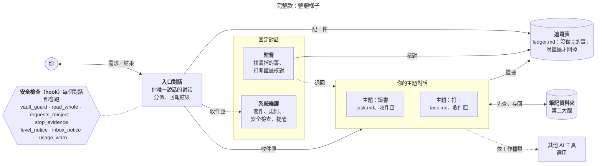
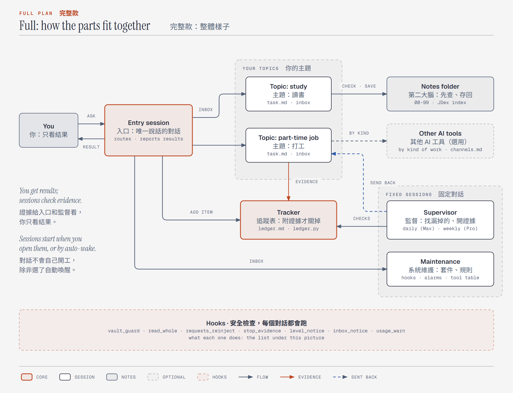
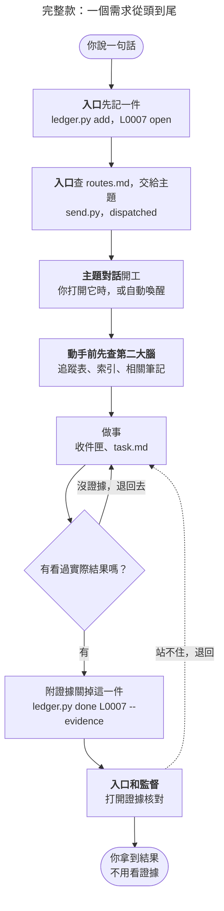
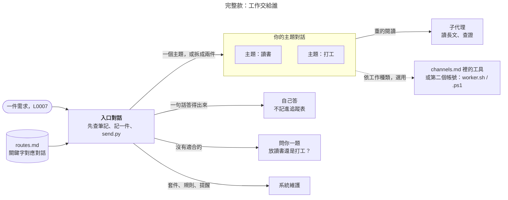
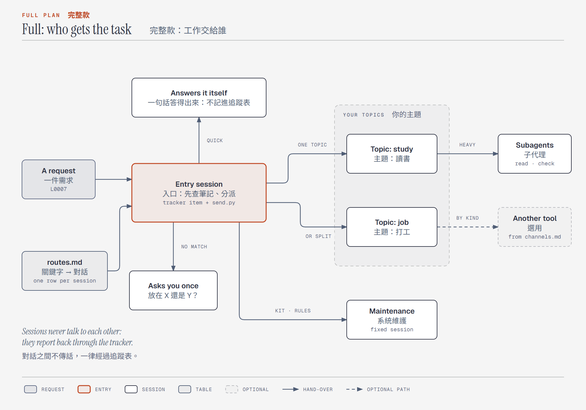
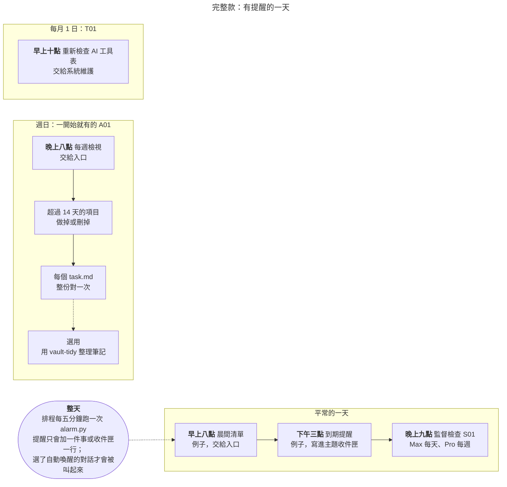
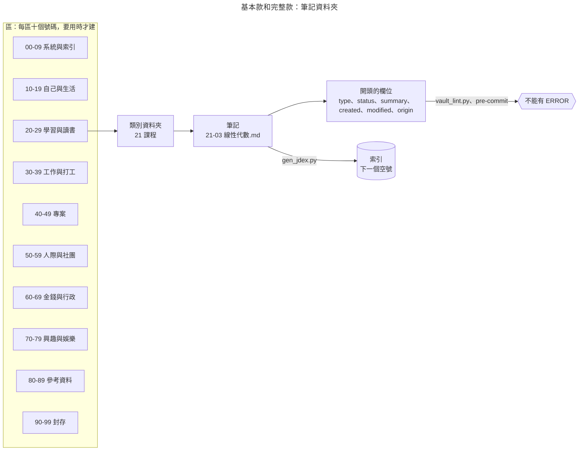
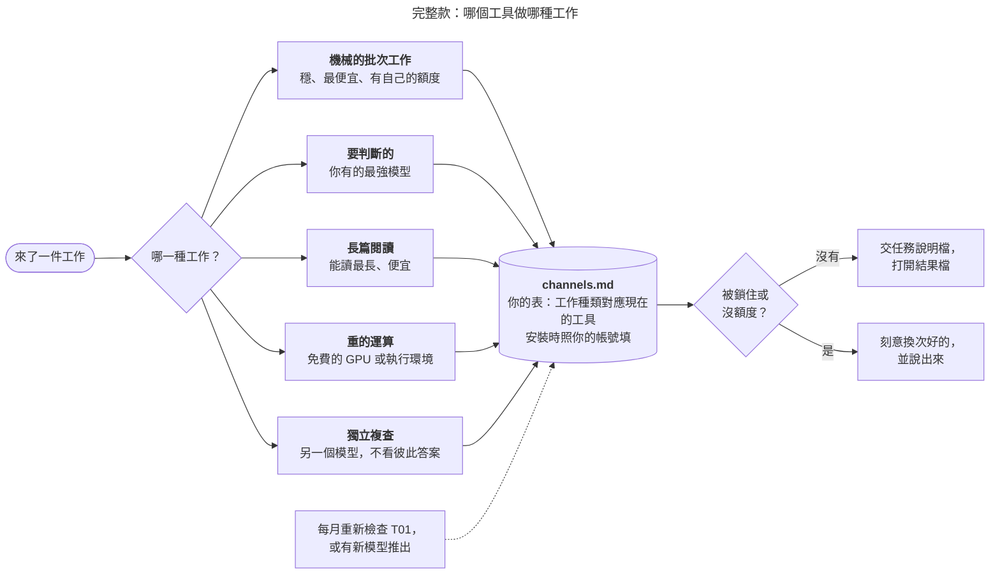

# 完整款與進階功能

[English](../ADVANCED.md) · [回到說明首頁](../../README.zh-TW.md)

基本款是一個在筆記資料夾裡的主對話、一份 Claude 替你記的追蹤表（`ledger.py`：還沒做完的事，一件一行，做完時附上怎麼確認的）、幾個安全檢查。這一頁的東西都已經在套件裡，但**沒開啟之前完全不會作用**。安裝時（[SETUP.md](SETUP.md)），Claude 照你的回答逐項建議，只開你確認的那幾項（加開任何一項就叫完整款）；其他的等你真的遇到下面表裡的狀況時再問你。

要開哪一項，直接跟 Claude 說，例如：「幫我開主題對話」「每週日提醒我整理一次」「做完檢查嚴格一點」「監督改成自動叫醒」。Claude 會照這一頁最後的步驟做。

## 基本款和完整款

完整款不是一個大開關：下面 A1–A5 每一項各自開，開了任何一項就是完整款。

| | 基本款 | 完整款 |
|---|---|---|
| 對話 | 一個在筆記資料夾裡的主對話 | **入口**（你唯一需要說話的對話）、**監督**（找漏掉的事、查「做完了」是不是真的）、**系統維護**（套件本身：規則、安全檢查、提醒），再加上你自己的每件事一個主題對話（A1） |
| 追蹤表（`ledger.py`） | Claude 自己記、自己附證據關掉 | 同一份，所有對話共用；證據由入口和監督打開核對，你只看到結果 |
| 每件事開始前 | Claude 先查筆記 | 每個對話都先查筆記 |
| 筆記資料夾、刪除或上傳前先問你、把你的原話放回去 | 有 | 有 |
| 做完檢查 | 只在紀錄檔記一筆 | 記一筆，或先攔下 Claude 一次要它檢查（A4，你要才開） |
| 提醒 | 沒有 | `alarms.md` 加電腦的系統排程：每週檢視、監督的檢查、每月重新檢查 AI 工具、你自己加的列（A2） |
| 對話由誰開工 | 你打開它 | 你打開它。**對話不會自己開工**，除非你替它選了自動喚醒（會用掉額度） |
| 其他 AI 工具 | 不用 | 一張依工作種類分的表，照你有的帳號填，每月重新檢查（A5） |
| 用量提醒 | 關 | 你要才開（A3） |
| 額度 | 只有你自己做的事 | 比較多：好幾個對話、監督的檢查，選了自動喚醒的話還有喚醒 |
| 適合 | 一個人、同時幾件事；剛開始用 Claude Code | 好幾件事常被搞混；常忘記期限；自動喚醒適合 Max、Team、Enterprise 方案 |
| 怎麼切換 | 說「幫我開主題對話」（或任何一項） | 說「把 X 關掉」或「回到基本款」：模式改回基本款的值，你的檔案都留著 |

照方案建議的喚醒方式（安裝時問，隨時可以改）：Pro——全部手動，監督每週一次；Max、Team、Enterprise——監督每天晚上由排程自動叫醒，主題對話手動；API（用多少付多少）或不確定——全部手動，監督每週一次。

## Claude 什麼時候會提議

安裝時，Claude 已經照你對「最常卡在哪」的回答逐項建議、你確認過要加開哪幾項（可能一項都沒有）。之後由一個小程式 `scripts/level_check.py` 在你的電腦上量下面這張表。表裡看的是你**真的遇到的狀況**（例如請 Claude 提醒、說事情搞混），不是事情多不多：沒做完的事有幾件、分幾個主題、對話被濃縮幾次，只當佐證附在問題裡，單獨不會觸發。安裝時你說不要看對話紀錄的話，它只看追蹤表和紀錄檔，不讀對話。它最多一週跑一次（你在筆記資料夾裡打開 Claude 時，由 `level_notice` 這個檢查啟動），你每次用 `/sbk-status` 時也會跑。它不改任何設定。表裡某一列成立時，Claude 會附上數字問你**一個要不要的問題**，你說好才開。你說不要，那一項四週內不會再問。已經開著的不會再提。

| 量到什麼（括號是程式輸出裡的代號） | 會開哪一項 | Claude 怎麼開 |
|---|---|---|
| 最近 7 天在筆記資料夾的對話裡，你有 2 次以上說事情搞混了（例如「你把兩個作業搞混了」「不是那個專案」）；沒做完的事幾件、幾個主題、對話被濃縮幾次附在問題裡當佐證（`multi_session`） | 完整款的對話：入口、監督、系統維護＋主題對話（A1） | 照下面 A1：三個固定對話和每個主題一個對話（主題＝沒做完項目的 `[主題]` 標籤）、`routes.md`、`inbox_notice` 改成 warn、喚醒方式、每個對話怎麼打開 |
| 最近 7 天你請 Claude 提醒你 2 次以上，或有寫 `due YYYY-MM-DD` 的項目過了日期 3 天以上還沒做完（`alarms`） | 提醒（A2） | 照下面 A2：`alarms.md` 加上那個日期的一列；電腦的系統排程要你另外說好才加 |
| 做完檢查已經記錄 14 天以上，至少 20 次被標出的回覆可以判斷（次數太少會誤導），而且誤判不到 25%；誤判是指被標出之後，你的下一句話沒有反映出問題（`block_mode`） | 嚴格的做完檢查（A4） | 照下面 A4：`stop_evidence` 改成 block |
| 你說過你有其他 AI 工具的帳號（安裝時，或之後跟 Claude 說）；對話裡只是提到名字不算（`multi_tool`） | 依工作種類分工的表（A5），只接你有的 | 照下面 A5：照你的帳號填 `channels.md`、做一件很小的真工作、每月重新檢查 |
| 你自己要某一項，包括用量提醒（A3） | 那一項 | 照下面那一項的步驟 |

你說不要時，Claude 會執行 `level_check.py --decline <代號>` 記下來；這個程式只寫它自己的檔案 `~/.claude/sbk/state/level_check.json`。

## 每一項是什麼（白話）

- **完整款的對話。** 原本只有一個主對話；開了之後變成一個*入口對話*收你所有的需求、告訴你結果，加上每個完整款都有的兩個固定對話，再加上你自己的每件事各一個對話（讀書、打工、某個專案……）：
  - **監督：** 看入口和每個主題有沒有漏掉的事，打開已經做完的那幾件的證據；站不住的退回那個主題。多久檢查一次照你的方案（Max 這類方案每天、Pro 每週）。
  - **系統維護：** 管套件本身——規則、安全檢查、提醒、AI 工具表、更新。
  入口把需求記進追蹤表，再透過那個對話的*收件匣*（一個短短的文字檔）交給它。**寫進收件匣不會讓任何東西開始跑。** 要等你打開那個對話，它才會看到新的一行（`inbox_notice` 這個檢查會在對話開頭顯示出來）。你一直沒開那個對話，工作就一直等著——除非你替它選了自動喚醒：排程會在它的收件匣有工作時，在背景把它叫起來（每個對話最多一小時一次；會用掉你的額度）。
- **證據是給對話看的，不是給你看的。** 主題對話關掉追蹤表上的一件事時，寫下它看了什麼；入口和監督去打開核對。你只會聽到結果：做好了什麼、在哪看、哪些沒辦法確認。
- **提醒。** 一張小小的提醒表（`alarms.md`）：每天、每週、每月或一次。電腦的排程每五分鐘看一次，到時間的提醒會在追蹤表加一件事，或在收件匣加一行。它不會打斷正在進行的對話；你下次跟 Claude 說話時就會看到（選了自動喚醒的話，那個對話會被叫起來）。
- **用量提醒。** 你這週的 Claude 用量超過 80% 時提醒一次。它讀的是和 Claude Code `/usage` 畫面同一個來源；那不是官方公開的介面，可能哪天就讀不到，讀不到時就不出聲。
- **嚴格的做完檢查。** 基本款裡，Claude 改了東西、沒看結果就說「做完」時，這個檢查只會在紀錄檔記一筆。嚴格模式會攔下 Claude 一次，要它先檢查。
- **其他 AI 工具。** 不替任何工具固定角色：模型一直在換。套件只給依工作種類分的規則（機械的批次工作、要判斷的、長篇閱讀、重的運算、獨立複查）；你的 Claude 照你有的帳號填一張表，每一種選現在最好、還有額度的工具，每個月或有新模型推出時重新檢查。只有一個 Claude 帳號就夠了，這些都不是必要的。細節見[參考-多工具分工.md](參考-多工具分工.md)。

## 圖解

每張都是 GitHub 會直接畫出來的 Mermaid 圖；點開「完整版圖片」看大張的（[全部檔案](../diagrams/)；完整版圖片的標題是英文，附繁中小字）。每張的標題都寫了它畫的是基本款還是完整款。

### 1. 完整款：整體樣子

你只跟入口對話說話。要追蹤的需求它記進追蹤表，再交給某個對話。主題對話先查筆記、做事、附證據關掉追蹤表上的那件事；監督打開證據，站不住的退回去；系統維護管套件本身。結果由入口告訴你。

每個安全檢查（hook：Claude Code 在特定時機自動跑的小程式）負責什麼（基本款開／關；完整款會開的有寫）：
- `vault_guard`——Claude 要推上遠端、刪掉整個資料夾、丟掉 git 裡的工作、跳過 git 檢查、改受保護的規則檔，或把一張筆記砍到剩一小部分前，先問你。基本款：開。
- `read_whole`——在筆記資料夾裡，不讓 Claude 只看筆記開頭幾行就下判斷，要讀到最後。基本款：開。
- `requests_reinject`——長對話被濃縮時，把你自己說過的話一字不差放回去。基本款：開。
- `stop_evidence`——發現 Claude 改了東西、沒看結果就說「做完」。基本款：開，只記一筆；完整款可以改成攔下一次（A4）。
- `level_notice`——大約一週一次，在筆記資料夾裡，你遇到的狀況顯示另一項會有幫助時，問你一個要不要的問題。基本款：開。
- `inbox_notice`——對話打開時和每次你傳訊息時，顯示它收件匣裡等著的工作。基本款：關；完整款的對話會打開（A1）。
- `usage_warn`——你這週的 Claude 用量超過 80% 時提醒一次。基本款：關；你要才開（A3）。

完整版圖片

[SVG](../diagrams/01-architecture.svg) · [PNG](../diagrams/01-architecture.png)

### 2. 完整款：一個需求從頭到尾

一句話變成追蹤表上的一件事，交出去；主題對話動手前先查筆記。附上證據才關掉，沒證據就退回去。證據由入口和監督打開核對；你拿到的是結果。

沒附證據的「做完」，追蹤表不收。開了嚴格的做完檢查（A4），Stop 檢查還會再要 Claude 確認一次。

完整版圖片

[SVG](../diagrams/02-request-life.svg) · [PNG](../diagrams/02-request-life.png)

### 3. 完整款：工作交給誰

入口查 `routes.md` 決定交給哪個對話。一句話答得出來的它自己答，不記進追蹤表。套件、規則、提醒的事交給系統維護。要讀很多東西的交給子代理（Claude 在同一個對話裡叫出來幫忙的小幫手）；其他工具照依工作種類分的表，有才用。

完整版圖片

[SVG](../diagrams/03-task-dispatch.svg) · [PNG](../diagrams/03-task-dispatch.png)

### 4. 完整款：有提醒的一天

排程每五分鐘跑一次，把 `alarms.md` 裡到時間的提醒寫進追蹤表或收件匣。每週檢視是套件一開始就有的那一列；監督的檢查（S01）跟著完整款的對話一起開；每月重新檢查 AI 工具（T01）跟著其他 AI 工具一起開；晨間清單和到期提醒是你可以自己加的例子。收到一行的對話，要你打開才會做；選了自動喚醒的才由排程叫起來。

完整版圖片

[SVG](../diagrams/04-day-timeline.svg) · [PNG](../diagrams/04-day-timeline.png)

### 5. 基本款和完整款：筆記資料夾和筆記格式

這部分基本款和完整款都一樣；你不用學，Claude 會照著做。有編號的資料夾（Johnny Decimal 編號法：每區十個號碼，區底下分類別，類別底下是有編號的筆記）、每張筆記開頭六個欄位、Claude 會重新產生的索引，以及一個檢查程式。區和類別的資料夾，第一次有筆記要放時才建。

完整版圖片

[SVG](../diagrams/05-vault-folders.svg) · [PNG](../diagrams/05-vault-folders.png)

### 6. 完整款：哪個工具做哪種工作

不替任何工具固定角色。Claude 先判斷這是哪一種工作，再看你的表（`channels.md`）現在哪個工具最適合，確認它沒被鎖住。只有 Claude 的話，每一列都是 Claude，重的閱讀交給子代理。

完整版圖片

[SVG](../diagrams/06-tool-routing.svg) · [PNG](../diagrams/06-tool-routing.png)

---

## 給 Claude 的步驟（A1–A5）

寫給負責開啟功能的 Claude。代號（`KIT`、`SBK_HOME`、`VAULT`）、做事規則、狀態詞都和 [SETUP.md](SETUP.md) 相同；基本款要先裝好（安裝時由 SETUP 步驟 5b 接在基本款後面做）。只做使用者同意、或安裝時決定要的那一項。開第一項時，把 `SBK_HOME/config.json` 的 `"level"` 改成 `"full"`；只改那一項寫到的 `modes`（A1 另外改 `wake`），其他值一律保留。每一項都用狀態詞回報。

### A1：完整款的對話：入口、監督、系統維護和主題

1. `SBK_HOME/entry/CLAUDE.md` ← `KIT/templates/entry-CLAUDE.md`，`{{vault}}` 換掉。
2. 兩個固定對話，一定要建：`SBK_HOME/managers/supervisor/CLAUDE.md` ← `templates/supervisor-CLAUDE.md`、`SBK_HOME/managers/maintenance/CLAUDE.md` ← `templates/maintenance-CLAUDE.md`（填 `{{vault}}`），各自從 `templates/task.md` 建一份 `task.md`（`{{topic}}` 填 supervisor／maintenance）。
3. 使用者的主題，二到四個：安裝時用他說的那幾件事（SETUP 步驟 5b，不再問）；每週檢查後他說好的，用追蹤表裡沒做完項目的 `[主題]` 標籤；其他情況才問他「哪兩件事要各有自己的對話？」。每個主題：取一個短的英數代號（`study`、`work`），`SBK_HOME/managers/<代號>/CLAUDE.md` ← `templates/manager-CLAUDE.md`（`{{manager}}`、`{{vault}}`、`{{scope}}` 填好，`{{scope}}` 用他的話寫一行），`SBK_HOME/managers/<代號>/task.md` ← `templates/task.md`（填 `{{topic}}`）。基本款的 `SBK_HOME/task.md` 還有沒做完的項目的話，問他屬於哪個主題，搬過去。
4. `SBK_HOME/routes.md` ← `templates/routes.md`：保留監督和系統維護那兩列，每個主題代號一列，寫 5–10 個他真的會說的詞。
5. `config.json` → `"modes": {"inbox_notice": "warn"}`，`"wake"` 照安裝時的決定（SETUP 步驟 0.4）；之後才被要求開的，照 `plan` 用同一張表建議，`claude --version` 跑得起來才可以設 `auto`。
6. 監督的排程：`SBK_HOME/alarms.md` 不存在才從 `templates/alarms.md` 建（已經有的絕不取代），加上一列：Max、Team、Enterprise 是 `| S01 | daily 21:00 | supervisor | Check the entry and every topic: missed items, open the evidence of done items |`；Pro、API 或不確定是 `| S01 | weekly sun 19:00 | supervisor | ... |`。這些列要有系統排程才會觸發：A2 的排程那一題還沒問過，現在問。他說不要：那一列留著，監督只在他打開時檢查，`wake` 維持手動（要說出來）。
7. 每個對話（入口、監督、系統維護、每個主題）怎麼打開，照 `SURFACE`（SETUP 步驟 0.2）：終端機，照 SETUP 步驟 5 每個對話各做一個捷徑：入口 `cd "<SBK_HOME>/entry"` 再 `claude --add-dir "<VAULT>" -n entry`；其他 `cd "<SBK_HOME>/managers/<代號>"` 再 `claude --add-dir "<VAULT>" -n <代號>`。App，不做捷徑檔：**+ New**，**Open folder…** 選 `<SBK_HOME>/entry`（或 `<SBK_HOME>/managers/<代號>`），再點輸入框旁的 **+**、選 **Add folder**、加 `<VAULT>`（等於 `--add-dir`），並點標題把對話改名成 `entry` 或 `<代號>`。更新 `VAULT/README.md` 的「怎麼開始」：新的需求交給入口；結果由入口告訴你。基本款原本的開法（捷徑，或 App 裡筆記資料夾那個對話）可以留著，用來問筆記的小問題。
8. 白話告訴使用者：「寫進收件匣不會讓任何東西開始跑。你打開那個對話，它才會開始做。」——只有選了自動喚醒的對話，再加一句：「它的收件匣有工作時，排程會把它叫起來，最多一小時一次；這會用掉你的額度。」

**檢查：** `python SBK_HOME/bin/send.py <代號> "setup check A1"` 印出 `<新編號> -> <代號>`（用它印出的編號）；`SBK_HOME/inbox/<代號>.md` 有那一行；`echo '{"cwd":"<SBK_HOME>/managers/<代號>","hook_event_name":"SessionStart"}' | python KIT/hooks/inbox_notice.py` 會印出它；`status.py` 列得出來；`managers/supervisor/CLAUDE.md` 和 `managers/maintenance/CLAUDE.md` 存在；`alarm.py --list` 列出 S01，而且 `wake: supervisor=... topics=...` 那一行和 `config.json` 一樣。然後 `ledger.py drop <新編號> --evidence "A1 setup test item"`，把收件匣那一行勾成 `[x]`。

### A2：提醒

1. `SBK_HOME/alarms.md` 不存在才從 `templates/alarms.md` 複製（已經有的絕不取代）。用一句話告訴使用者：一開始只有週日 20:00 的每週檢視；每一列都要對應一個會有人做的動作。可以是每天、每週、每月或一次。
2. 先問：「同意我加一個每五分鐘檢查一次提醒的系統排程嗎？」（A1 已經問過就跳過）同意後：
   - Windows：`schtasks /Create /SC MINUTE /MO 5 /TN sbk-alarm /TR "\"<pythonw.exe 的路徑>\" \"%USERPROFILE%\.claude\sbk\bin\alarm.py\" --tick"`（用 `pythonw.exe` 才不會跳出視窗）
   - macOS／Linux：用 `crontab -e` 加上 `*/5 * * * * python3 "$HOME/.claude/sbk/bin/alarm.py" --tick`。
   他說不要就是**沒開啟**：提醒不會自己跳，但 `alarm.py --fire A01` 還是可以手動用，下面排程那項檢查跳過。
   同一個排程也會照 `config.json` 的 `"wake"` 做：設成 `auto` 的對話，收件匣有工作時會被叫起來（見 A1）。

**檢查：** `python SBK_HOME/bin/alarm.py --list` 列出各列；`schtasks /Query /TN sbk-alarm`（或 `crontab -l`）看得到排程（或排程是**沒開啟**）。觸發測試**在用完即丟的資料夾裡做**，絕不在真正的 `SBK_HOME`：把 `alarms.md` 複製到一個新的暫存資料夾，環境變數 `SBK_HOME` 設成那個資料夾，跑 `alarm.py --tick --now <下個週日>T20:01`，確認它的 `ledger.md` 多了那一件，再刪掉暫存資料夾。真正的 `state/alarms.json` 一律不刪。

### A3：用量提醒

1. `config.json` → `"modes": {"usage_warn": "warn"}`（門檻：`"usage_warn_pct"`，預設 80）。
2. 告訴使用者它讀的是非官方的來源，讀不到時就不出聲。

**檢查：** `SBK_HOME` 設成暫存資料夾、`SBK_MODE_USAGE_WARN=warn`、`SBK_USAGE_FAKE='{"seven_day":{"utilization":91,"resets_at":"2030-01-01T00:00:00Z"}}'`，執行 `echo '{"session_id":"a3"}' | python KIT/hooks/usage_warn.py` 會印出含 `91%` 的一行。這台電腦讀不讀得到真正的用量，在真的出現一次提醒之前都是**沒驗證**。

### A4：嚴格的做完檢查

1. 先重播（要同意：`config.json` 的 `read_history` 是 true，或現在問他）：對最新五個對話紀錄跑 `python KIT/hooks/stop_evidence.py --replay <檔案>`；基本款用過一陣子的話，也看 `SBK_HOME/logs/stop_evidence.log`。
2. 如果是每週檢查帶你來的，它的數字已經顯示誤判不到 25%：直接設成 block。如果是使用者自己要、沒有那些數字，而重播時大約每四輪就有一輪以上會被攔，告訴他會太常打斷，維持 `log`。否則把 `config.json` 設成 `"modes": {"stop_evidence": "block"}`。它每次回覆最多只攔一次。

**檢查：** 重播至少跑過一個對話紀錄（或看過紀錄檔），`config.json` 是你選的模式。

### A5：其他 AI 工具

只接使用者說他有的工具。讀[參考-多工具分工.md](參考-多工具分工.md)的〈所有額外工具共通的規則〉、〈工作的種類〉、〈填表與重新檢查〉，以及〈各工具的經驗〉裡他有的工具那幾節。不替任何工具固定角色。
1. `SBK_HOME/channels.md` ← `templates/channels.md`：每個帳號一列；「工作種類 → 現在用的工具」那張表每一種都填（他有的工具裡現在最適合、還有額度的，一行理由，填今天的日期；沒有更好的就填 Claude）。
2. 第二個 Claude 帳號：使用者要把 `CLAUDE_CONFIG_DIR` 設成那個帳號專用的新資料夾，跑一次 `/login`（**要你做**：給他符合他作業系統的完整指令）；接著跑 `entry/worker.ps1 -DryRun` 或 `SBK_DRYRUN=1 entry/worker.sh`，讀印出來的指令。
3. Codex、Gemini CLI、OpenRouter：版本指令或一行的小工作跑得起來。只在瀏覽器用的工具（ChatGPT、Gemini 網站、Colab）你無法驗證，記為**沒驗證**，並寫下使用者要怎麼把任務說明檔交過去。
4. 每個工具做一件結果是檔案的小工作，打開那個檔案看。
5. 完整款而且 A2 的排程有開：在 `alarms.md` 加上每月重新檢查那一列 `| T01 | monthly 1 10:00 | maintenance | Re-check channels.md: best tool per kind of work, new models, quota |`（系統維護對話由 A1 建；沒有的話這一列的對象寫 `entry`）。

**檢查：** 每個工具在 `channels.md` 有一列，每一種工作都有「現在用的工具」，有一個你打開看過的結果檔（只在網頁用的工具是**沒驗證**），排程有開時 `alarm.py --list` 列得出 T01。使用者沒有的工具哪裡都不出現。

### 關掉某一項，或改喚醒方式

- 關掉：把它的模式改回基本款的值（`templates/config.json`），A2 的話刪掉系統排程；`routes.md`、`alarms.md`、收件匣、`state/` 這些檔案留著，使用者要求才刪。
- 喚醒：使用者說例如「監督改成自動叫醒」或「什麼都不要自己跑」：只改 `config.json` 的 `"wake"`（`auto` 要有系統排程和 `claude` 指令），再給他看 `alarm.py --list`。
