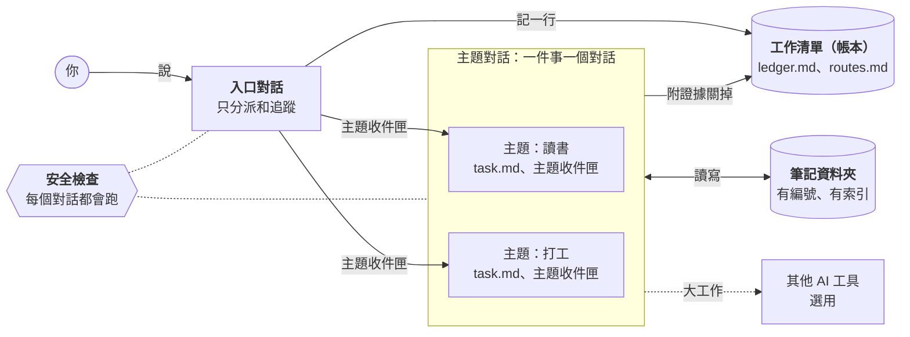
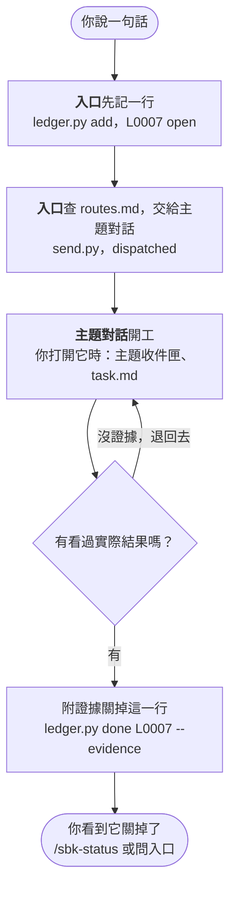
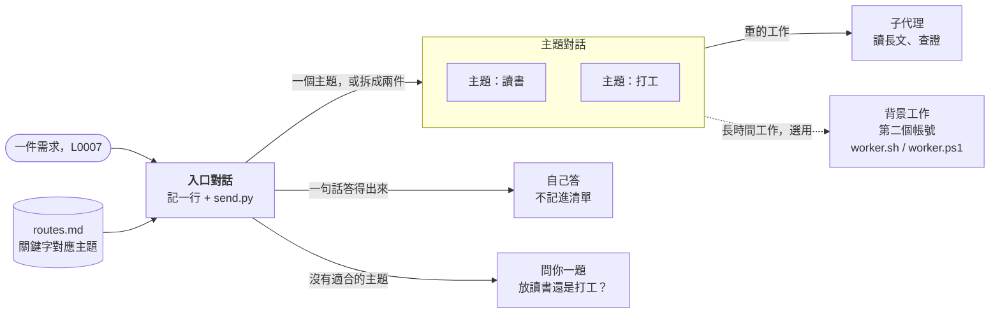
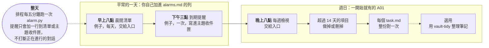
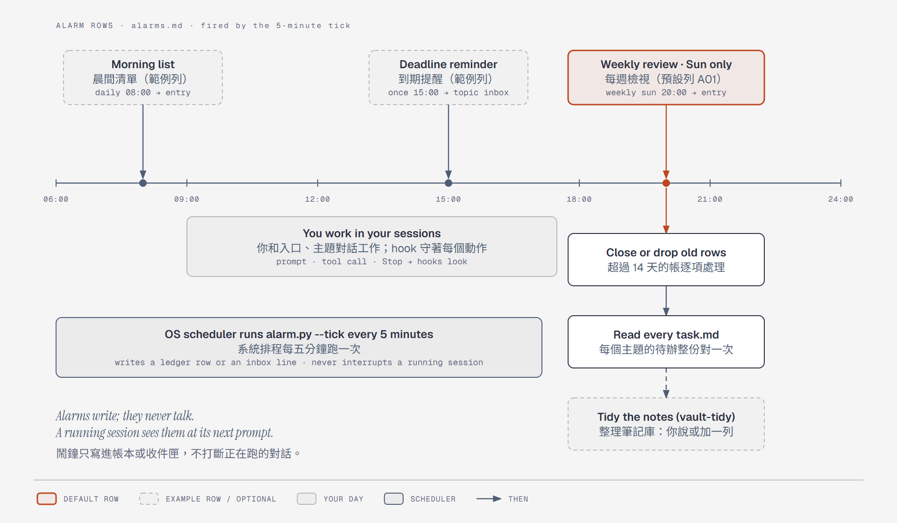
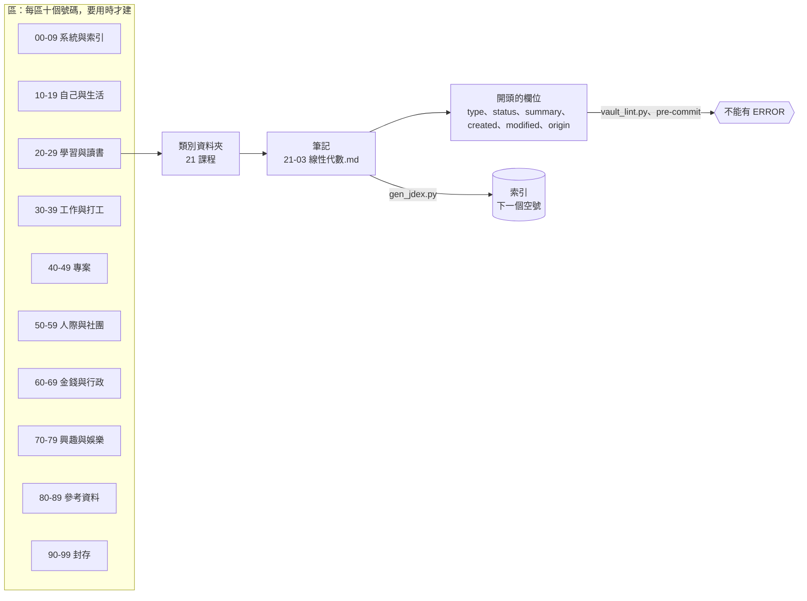
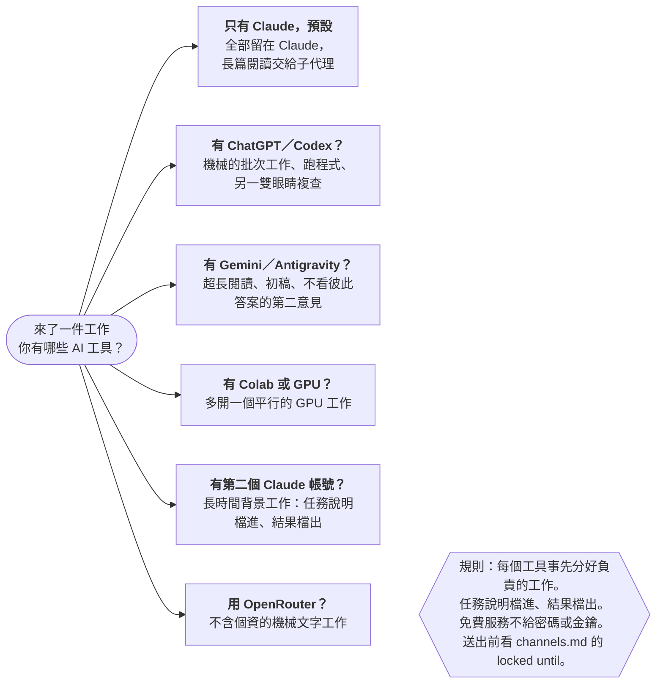

# 進階功能

[English](../ADVANCED.md) · [回到說明首頁](../../README.zh-TW.md)

基本款是一個在筆記資料夾裡的主對話、一份 Claude 替你記的工作清單、幾個安全檢查。這一頁的東西都已經在套件裡，但**沒開啟之前完全不會作用**。安裝時（[SETUP.md](SETUP.md)），Claude 照你的回答逐項建議，只開你確認的那幾項（加開任何一項就叫完整款）；其他的等你真的遇到下面表裡的狀況時再問你。

要開哪一項，直接跟 Claude 說，例如：「幫我開主題對話」「每週日提醒我整理一次」「做完檢查嚴格一點」。Claude 會照這一頁最後的步驟做。

## Claude 什麼時候會提議

安裝時，Claude 已經照你對「最常卡在哪」的回答逐項建議、你確認過要加開哪幾項（可能一項都沒有）。之後由一個小程式 `scripts/level_check.py` 在你的電腦上量下面這張表。表裡看的是你**真的遇到的狀況**（例如請 Claude 提醒、說事情搞混），不是事情多不多：沒做完的事有幾件、分幾個主題、對話被濃縮幾次，只當佐證附在問題裡，單獨不會觸發。安裝時你說不要看對話紀錄的話，它只看工作清單和紀錄檔，不讀對話。它最多一週跑一次（你在筆記資料夾裡打開 Claude 時，由 `level_notice` 這個檢查啟動），你每次用 `/sbk-status` 時也會跑。它不改任何設定。表裡某一列成立時，Claude 會附上數字問你**一個要不要的問題**，你說好才開。你說不要，那一項四週內不會再問。已經開著的不會再提。

| 量到什麼（括號是程式輸出裡的代號） | 會開哪一項 | Claude 怎麼開 |
|---|---|---|
| 最近 7 天在筆記資料夾的對話裡，你有 2 次以上說事情搞混了（例如「你把兩個作業搞混了」「不是那個專案」）；沒做完的事幾件、幾個主題、對話被濃縮幾次附在問題裡當佐證（`multi_session`） | 入口對話＋主題對話（A1） | 照下面 A1：入口對話和每個主題一個對話（主題＝沒做完項目的 `[主題]` 標籤）、`routes.md`、`inbox_notice` 改成 warn、各一個捷徑 |
| 最近 7 天你請 Claude 提醒你 2 次以上，或有寫 `due YYYY-MM-DD` 的項目過了日期 3 天以上還沒做完（`alarms`） | 提醒（A2） | 照下面 A2：`alarms.md` 加上那個日期的一列；電腦的系統排程要你另外說好才加 |
| 做完檢查已經記錄 14 天以上，至少 20 次被標出的回覆可以判斷（次數太少會誤導），而且誤判不到 25%；誤判是指被標出之後，你的下一句話沒有反映出問題（`block_mode`） | 嚴格的做完檢查（A4） | 照下面 A4：`stop_evidence` 改成 block |
| 你說過你有其他 AI 工具的帳號（安裝時，或之後跟 Claude 說）；對話裡只是提到名字不算（`multi_tool`） | 和那個工具分工的參考（A5），只接你有的 | 照下面 A5：`channels.md` 加一列，做一件很小的真工作 |
| 你自己要某一項，包括用量提醒（A3） | 那一項 | 照下面那一項的步驟 |

你說不要時，Claude 會執行 `level_check.py --decline <代號>` 記下來；這個程式只寫它自己的檔案 `~/.claude/sbk/state/level_check.json`。

## 每一項是什麼（白話）

- **入口對話和主題對話。** 原本只有一個主對話；開了之後變成一個*入口對話*負責收你所有的需求，再加上每件事各一個對話（讀書、打工、某個專案……）。入口把需求記進工作清單，再透過那個主題對話的*主題收件匣*（一個短短的文字檔）交給它。
  **寫進主題收件匣不會讓任何東西開始跑。** 要等你打開那個主題對話，它才會看到新的一行（`inbox_notice` 這個檢查會在對話開頭顯示出來）。你一直沒開那個對話，工作就一直等著。
- **提醒。** 一張小小的提醒表（`alarms.md`）。電腦的排程每五分鐘看一次，到時間的提醒會在工作清單或主題收件匣加一行。它不會打斷正在進行的對話；你下次跟 Claude 說話時就會看到。
- **用量提醒。** 你這週的 Claude 用量超過 80% 時提醒一次。它讀的是和 Claude Code `/usage` 畫面同一個來源；那不是官方公開的介面，可能哪天就讀不到，讀不到時就不出聲。
- **嚴格的做完檢查。** 基本款裡，Claude 改了東西、沒看結果就說「做完」時，這個檢查只會在紀錄檔記一筆。嚴格模式會攔下 Claude 一次，要它先檢查。
- **其他 AI 工具。** 如果你有 ChatGPT／Codex、Gemini、第二個 Claude 帳號、Colab 或 OpenRouter，每個工具可以負責一種工作。只有一個 Claude 帳號就夠了，這些都不是必要的。細節見[參考-多工具分工.md](參考-多工具分工.md)。

## 圖解

每張都是 GitHub 會直接畫出來的 Mermaid 圖；點開「完整版圖片」看大張的（[全部檔案](../diagrams/)；完整版圖片的標題是英文，附繁中小字）。

### 1. 開了主題對話之後的整體樣子

你跟入口對話說話。要追蹤的需求它記進工作清單（帳本），再交給主題對話。主題對話讀寫筆記、附證據把清單上那一行關掉，需要時用其他 AI 工具。安全檢查在每個對話裡都會跑。

完整版圖片

[SVG](../diagrams/01-architecture.svg) · [PNG](../diagrams/01-architecture.png)

### 2. 一個需求從頭到尾

一句話變成工作清單上的一行，交出去、開始做，附上證據才關掉；沒證據就退回去。

沒附證據的「做完」，工作清單不收。開了嚴格的做完檢查（A4），Stop 檢查還會再要 Claude 確認一次。

完整版圖片

[SVG](../diagrams/02-request-life.svg) · [PNG](../diagrams/02-request-life.png)

### 3. 工作交給誰

入口查 `routes.md` 決定交給哪個主題。一句話答得出來的它自己答，不記進清單。要讀很多東西的交給子代理（Claude 在同一個對話裡叫出來幫忙的小幫手），有第二個 Claude 帳號的話也可以交給它。

完整版圖片

[SVG](../diagrams/03-task-dispatch.svg) · [PNG](../diagrams/03-task-dispatch.png)

### 4. 有提醒的一天

排程每五分鐘跑一次，把 `alarms.md` 裡到時間的提醒寫進工作清單或主題收件匣。每週檢視是套件一開始就有的那一列；晨間清單和到期提醒是你可以自己加的例子。

完整版圖片

[SVG](../diagrams/04-day-timeline.svg) · [PNG](../diagrams/04-day-timeline.png)

### 5. 筆記資料夾和筆記格式

這部分基本款也有；你不用學，Claude 會照著做。有編號的資料夾（Johnny Decimal 編號法：每區十個號碼，區底下分類別，類別底下是有編號的筆記）、每張筆記開頭六個欄位、Claude 會重新產生的索引，以及一個檢查程式。區和類別的資料夾，第一次有筆記要放時才建。

完整版圖片

[SVG](../diagrams/05-vault-folders.svg) · [PNG](../diagrams/05-vault-folders.png)

### 6. 哪個工具做哪種工作

預設只有 Claude。你已經有的每個工具，事先分好負責哪一種工作；不是某個工具失敗了才換另一個。

完整版圖片

[SVG](../diagrams/06-tool-routing.svg) · [PNG](../diagrams/06-tool-routing.png)

---

## 給 Claude 的步驟（A1–A5）

寫給負責開啟功能的 Claude。代號（`KIT`、`SBK_HOME`、`VAULT`）、做事規則、狀態詞都和 [SETUP.md](SETUP.md) 相同；基本款要先裝好（安裝時由 SETUP 步驟 5b 接在基本款後面做）。只做使用者同意、或安裝時決定要的那一項。開第一項時，把 `SBK_HOME/config.json` 的 `"level"` 改成 `"full"`；只改那一項寫到的 `modes`，其他值一律保留。每一項都用狀態詞回報。

### A1：入口對話和主題對話

1. `SBK_HOME/entry/CLAUDE.md` ← `KIT/templates/entry-CLAUDE.md`，`{{vault}}` 換掉。
2. 先開二到四個主題：安裝時用他說的那幾件事（SETUP 步驟 5b，不再問）；每週檢查後他說好的，用工作清單裡沒做完項目的 `[主題]` 標籤；其他情況才問他「哪兩件事要各有自己的對話？」。每個主題：取一個短的英數代號（`study`、`work`），`SBK_HOME/managers/<代號>/CLAUDE.md` ← `templates/manager-CLAUDE.md`（`{{manager}}`、`{{vault}}`、`{{scope}}` 填好，`{{scope}}` 用他的話寫一行），`SBK_HOME/managers/<代號>/task.md` ← `templates/task.md`（填 `{{topic}}`）。基本款的 `SBK_HOME/task.md` 還有沒做完的項目的話，問他屬於哪個主題，搬過去。
3. `SBK_HOME/routes.md` ← `templates/routes.md`，每個代號一列，寫 5–10 個他真的會說的詞。
4. `config.json` → `"modes": {"inbox_notice": "warn"}`。
5. 每個對話怎麼打開，照 `SURFACE`（SETUP 步驟 0.2）：終端機，照 SETUP 步驟 5 每個對話各做一個捷徑：入口 `cd "<SBK_HOME>/entry"` 再 `claude --add-dir "<VAULT>" -n entry`；主題 `cd "<SBK_HOME>/managers/<代號>"` 再 `claude --add-dir "<VAULT>" -n <代號>`。App，不做捷徑檔：**+ New**，**Open folder…** 選 `<SBK_HOME>/entry`（或 `<SBK_HOME>/managers/<代號>`），再點輸入框旁的 **+**、選 **Add folder**、加 `<VAULT>`（等於 `--add-dir`），並點標題把對話改名成 `entry` 或 `<代號>`。更新 `VAULT/README.md` 的「怎麼開始」：新的需求交給入口；要主題對話動工就打開它。基本款原本的開法（捷徑，或 App 裡筆記資料夾那個對話）可以留著，用來問筆記的小問題。
6. 白話告訴使用者：「寫進主題收件匣不會讓任何東西開始跑。你打開那個主題對話，它才會開始做。」

**檢查：** `python SBK_HOME/bin/send.py <代號> "setup check A1"` 印出 `<新編號> -> <代號>`（用它印出的編號）；`SBK_HOME/inbox/<代號>.md` 有那一行；`echo '{"cwd":"<SBK_HOME>/managers/<代號>","hook_event_name":"SessionStart"}' | python KIT/hooks/inbox_notice.py` 會印出它；`status.py` 列得出來。然後 `ledger.py drop <新編號> --evidence "A1 setup test item"`，把主題收件匣那一行勾成 `[x]`。

### A2：提醒

1. `SBK_HOME/alarms.md` 不存在才從 `templates/alarms.md` 複製（已經有的絕不取代）。用一句話告訴使用者：一開始只有週日 20:00 的每週檢視；每一列都要對應一個會有人做的動作。
2. 先問：「同意我加一個每五分鐘檢查一次提醒的系統排程嗎？」同意後：
   - Windows：`schtasks /Create /SC MINUTE /MO 5 /TN sbk-alarm /TR "\"<pythonw.exe 的路徑>\" \"%USERPROFILE%\.claude\sbk\bin\alarm.py\" --tick"`（用 `pythonw.exe` 才不會跳出視窗）
   - macOS／Linux：用 `crontab -e` 加上 `*/5 * * * * python3 "$HOME/.claude/sbk/bin/alarm.py" --tick`。
   他說不要就是**沒開啟**：提醒不會自己跳，但 `alarm.py --fire A01` 還是可以手動用，下面排程那項檢查跳過。

**檢查：** `python SBK_HOME/bin/alarm.py --list` 列出各列；`schtasks /Query /TN sbk-alarm`（或 `crontab -l`）看得到排程（或排程是**沒開啟**）。觸發測試**在用完即丟的資料夾裡做**，絕不在真正的 `SBK_HOME`：把 `alarms.md` 複製到一個新的暫存資料夾，環境變數 `SBK_HOME` 設成那個資料夾，跑 `alarm.py --tick --now <下個週日>T20:01`，確認它的 `ledger.md` 多了那一行，再刪掉暫存資料夾。真正的 `state/alarms.json` 一律不刪。

### A3：用量提醒

1. `config.json` → `"modes": {"usage_warn": "warn"}`（門檻：`"usage_warn_pct"`，預設 80）。
2. 告訴使用者它讀的是非官方的來源，讀不到時就不出聲。

**檢查：** `SBK_HOME` 設成暫存資料夾、`SBK_MODE_USAGE_WARN=warn`、`SBK_USAGE_FAKE='{"seven_day":{"utilization":91,"resets_at":"2030-01-01T00:00:00Z"}}'`，執行 `echo '{"session_id":"a3"}' | python KIT/hooks/usage_warn.py` 會印出含 `91%` 的一行。這台電腦讀不讀得到真正的用量，在真的出現一次提醒之前都是**沒驗證**。

### A4：嚴格的做完檢查

1. 先重播（要同意：`config.json` 的 `read_history` 是 true，或現在問他）：對最新五個對話紀錄跑 `python KIT/hooks/stop_evidence.py --replay <檔案>`；基本款用過一陣子的話，也看 `SBK_HOME/logs/stop_evidence.log`。
2. 如果是每週檢查帶你來的，它的數字已經顯示誤判不到 25%：直接設成 block。如果是使用者自己要、沒有那些數字，而重播時大約每四輪就有一輪以上會被攔，告訴他會太常打斷，維持 `log`。否則把 `config.json` 設成 `"modes": {"stop_evidence": "block"}`。它每次回覆最多只攔一次。

**檢查：** 重播至少跑過一個對話紀錄（或看過紀錄檔），`config.json` 是你選的模式。

### A5：其他 AI 工具

只接使用者說他有的工具。每個工具先讀[參考-多工具分工.md](參考-多工具分工.md)對應的那一節（參考用，挑適合的）。
1. `SBK_HOME/channels.md` ← `templates/channels.md`，每個工具一列。
2. 第二個 Claude 帳號：使用者要把 `CLAUDE_CONFIG_DIR` 設成那個帳號專用的新資料夾，跑一次 `/login`（**要你做**：給他符合他作業系統的完整指令）；接著跑 `entry/worker.ps1 -DryRun` 或 `SBK_DRYRUN=1 entry/worker.sh`，讀印出來的指令。
3. Codex、Gemini CLI、OpenRouter：版本指令或一行的小工作跑得起來。只在瀏覽器用的工具（ChatGPT、Gemini 網站、Colab）你無法驗證，記為**沒驗證**，並寫下使用者要怎麼把任務說明檔交過去。
4. 每個工具做一件結果是檔案的小工作，打開那個檔案看。

**檢查：** 每個工具在 `channels.md` 有一列，而且有一個你打開看過的結果檔（只在網頁用的工具是**沒驗證**）。使用者沒有的工具哪裡都不出現。

### 關掉某一項

把它的模式改回基本款的值（`templates/config.json`），A2 的話刪掉系統排程；`routes.md`、`alarms.md`、主題收件匣、`state/` 這些檔案留著，使用者要求才刪。
