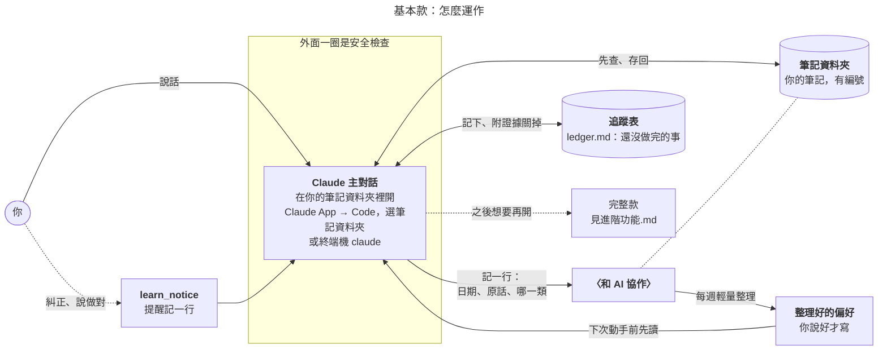
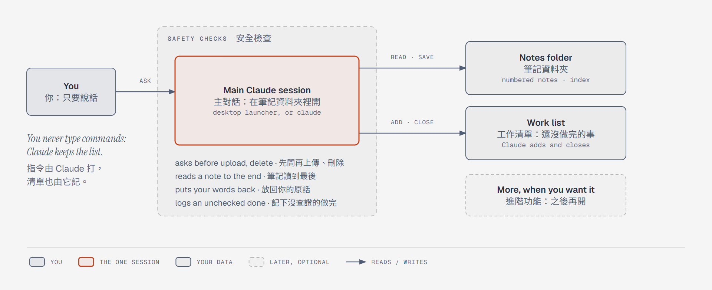

# 運作原理

[English](../HOW-IT-WORKS.md) · [回到說明首頁](../../README.zh-TW.md)

基本款的圖、完整款的圖，以及資料夾裡有什麼。

## 一張圖看懂



<details><summary>完整版圖片</summary>



[SVG](../diagrams/00-basic.svg) · [PNG](../diagrams/00-basic.png)

</details>

你只跟一個 Claude 對話說話，這個對話是在你的筆記資料夾裡開的。它動手前先查你的筆記（包括記你糾正過什麼的〈和 AI 協作〉），值得留的存回去，你糾正或確認它時記一行，也幫你記追蹤表；你不用打任何指令。

## 更多圖（完整款）

每張圖在[進階功能.md](進階功能.md)裡也有 Mermaid 版。


[SVG](../diagrams/01-architecture.svg) · [PNG](../diagrams/01-architecture.png)


[SVG](../diagrams/02-request-life.svg) · [PNG](../diagrams/02-request-life.png)


[SVG](../diagrams/03-task-dispatch.svg) · [PNG](../diagrams/03-task-dispatch.png)


[SVG](../diagrams/04-day-timeline.svg) · [PNG](../diagrams/04-day-timeline.png)


[SVG](../diagrams/05-vault-folders.svg) · [PNG](../diagrams/05-vault-folders.png)


[SVG](../diagrams/06-tool-routing.svg) · [PNG](../diagrams/06-tool-routing.png)

## 給想看細節的人

```
.claude-plugin/   外掛與 marketplace 設定檔
skills/           setup-second-brain、evidence-before-done、vault-tidy、multi-tool-routing（外部資源，完整款），以及通用的：evidence-check、outward-docs、blind-three-way、full-reader
commands/         /sbk-setup、/sbk-status
hooks/            安全檢查（Python 3，只用標準函式庫）
entry/            追蹤表（ledger.py）、狀態、提醒、即時派送（session.py）、自動交接（handover.py）、學習循環（learn.py）、背景工作的小工具
templates/        給 Claude 的原則、筆記資料夾說明、筆記格式、〈和 AI 協作〉（中英兩版，附起始偏好）、設定檔、完整款的模板（入口、系統維護、主題）
scripts/          筆記檢查、索引產生、防覆寫、升級檢查、自我測試
docs/             SETUP、ADVANCED、PITFALLS、MULTI-TOOL（給 Claude 的，英文）；zh-TW 是給你看的中文頁；docs/diagrams 是各張圖
experimental/     還沒驗證穩定的部分
```

- `python scripts/selftest.py` 會在用完即丟的資料夾裡，測試每個檢查和小工具。
- [docs/zh-TW/踩過的坑.md](踩過的坑.md)：實際使用時出過什麼錯，以及預設為什麼長這樣。
- [experimental/](../../experimental/README.md)：還沒驗證穩定的部分。用量提醒（完整款）讀的是和 Claude Code `/usage` 畫面同一個來源，那不是官方公開的介面。做完檢查是看 Claude 動作的先後順序加上一份「完成」字眼清單來判斷，可能漏抓，偶爾也會誤判，所以基本款只記錄、不攔下。
